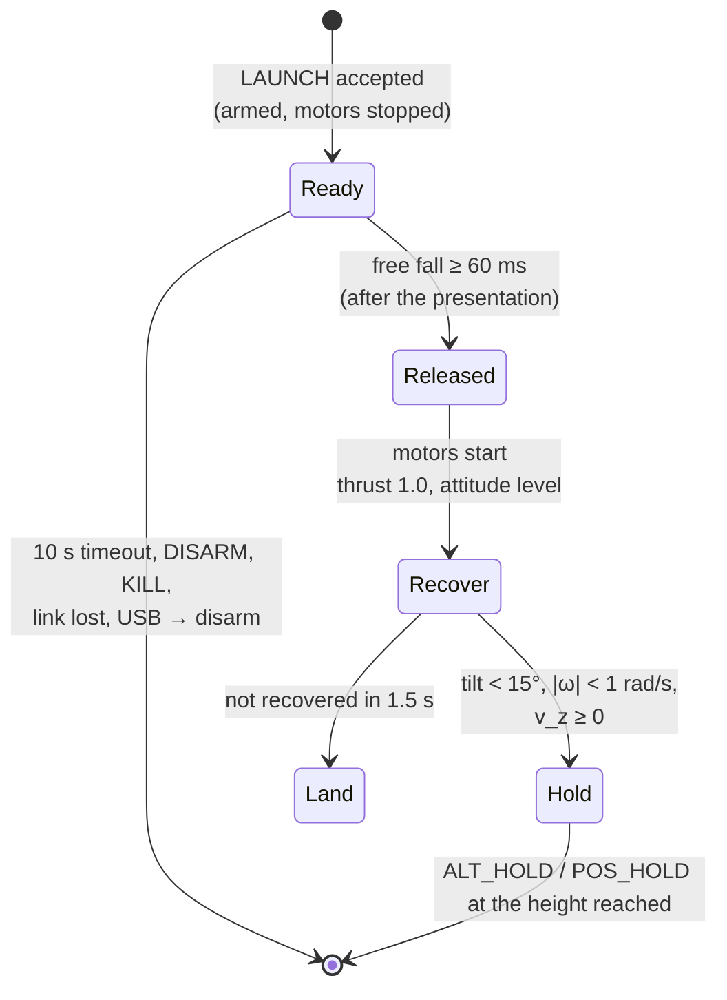

# 0011. Hand launch: armed with the motors stopped, release detected by free fall, attitude recovery

- **Status:** Proposed
- **Date:** 2026-11-13

## Context

The drone takes off today only from the ground: TAKEOFF (automatic, with an altitude source) or the throttle in
ACRO/ANGLE. A hand launch is wanted: the pilot holds the drone, releases or tosses it, and the drone stabilises and
holds its height.

What the firmware has and what is missing:

| Item | Today | Needed for a launch |
|---|---|---|
| Arming | the motors spin at `motorIdle` (5 %) as soon as the drone is armed | armed **with the motors stopped** while it is in the hand |
| Take-off detection | height above the ground level, or the collective above 0.8 $\hat t_h$ | release detected from the IMU, before any height change is measurable |
| Attitude at release | IEKF; the accelerometer is de-weighted when its magnitude is not 1 g | same; the release may come with a tilt and a rotation |
| Gyro range | ±2000 °/s | a tossed drone may spin; a saturated gyro corrupts the attitude |
| Vertical | hover thrust estimate (ADR 0010), vertical loop | thrust right after the release, before the altitude estimate settles |
| Motors | 8520 brushed, lag ≈ 35 ms (assumed), plus the start from standstill | the time from release to thrust sets the height lost |

A first estimate with the vertical model (60 ms to detect the release, 30 ms to start the motors, lag 35 ms;
`00 - FC_FW/Tests/sim/launch_1d.py`):

| Configuration | T/W at 4.2 V | Dropped from the hand: lowest point | Tossed up at 1.5 m/s: lowest point |
|---|---|---|---|
| T400 | 1.97 | −0.14 m | 0 (above the release point) |
| T400 at 3.7 V/cell | 1.53 | −0.21 m | 0 |
| T800 | 1.71 | −0.17 m | 0 |
| T1200 | 1.55 | −0.21 m | 0 |
| T1200 at 3.7 V/cell | 1.20 | −0.45 m | 0 |

The real risk is not the height but **the hand**: on a drop, the propellers start about 90 ms after the release,
when the drone is only about 4 cm below the fingers.

## Decision

### 1. A LAUNCH automatic action, in its own module

New command `LAUNCH` (0x1A, payload: the ARM magic, so that a stray frame cannot start it) and automatic action
`PV2_AUTO_LAUNCH` (6). Logic in `control/launch.c`: a pure state machine, called by `fc_core` with a function call,
as `rc_switches` and `pos_ctrl` are.

- **Preconditions** (refusals with the usual reasons):
  - the same as ARM: checks, battery, no USB host, estimate running;
  - plus an altitude source (baro or ToF), the T/W available at the present voltage ≥ 1.5, and `beginner` = 0.
- **Ready:**
  - armed with the **motors stopped**: a new setpoint flag `motors_off` tells `ctrl_loop.c` to write duty 0 instead of the idle;
  - the app shows "release or toss the drone";
  - EVENT 10 LAUNCH_READY;
  - any of the following disarms: 10 s timeout, DISARM, KILL, the link lost, a USB host.
- **Presentation:** the release is armed only after the drone has been held still and level (tilt < 30°, |ω| < 1 rad/s) for 0.5 s. A drone carried while walking, or swung, never starts its motors.
- **Release:** the specific force below 0.3 g for 60 ms (free fall, or the ballistic phase of a toss), with the gyro not saturated → EVENT 11 LAUNCH_RELEASED.
- **Recover:**
  - collective 1.0 while falling, then $\hat t_h/\cos(\text{tilt})$;
  - attitude setpoint level, with full authority (airmode);
  - yaw rate 0.
- **Hold:**
  - the vertical loop takes the height where the vertical speed crossed zero;
  - the mode becomes POS_HOLD with the flow, else ALT_HOLD (as at the end of TAKEOFF);
  - `pos_hold` engages when the flow is usable.
- **Abort:**
  - not recovered in 1.5 s → LAND;
  - the attitude estimate stopped → motors off (as the stall watchdog: flying without an attitude is a fly-away).

### 2. Gyro range ±4000 °/s (shared with ADR 0012)

The LSM6DSV16X full scale goes from ±2000 to ±4000 °/s, for every mode.
- Resolution 70 → 140 mdps/LSB: the quantisation noise (0.04 °/s RMS) stays below the sensor noise.
- Bias calibration and the IEKF are unchanged; only the driver conversion constant changes.
- Saturation is reported as a flag, and the launch refuses the release while it is set.

### 3. Safety rules

- **Toss up rather than drop.** The app teaches a toss from a flat palm, upwards; a drop is accepted, with the hand pulled away. Propeller guards are required: the launch is refused unless the frame parameter says the guards are fitted (`propGuards`).
- **No launch from the radio arm switch.** The launch is an explicit action, from the app (a hold-to-confirm button) or from a radio switch mapped only to it (AUX3, later).
- **No release indoors without an altitude source.**

### 4. Protocol and parameters

| Item | Value |
|---|---|
| op | `0x1A` LAUNCH, payload `0xA5 0x5A` |
| auto | `6` LAUNCH; FLIGHT shows `motors_off` while ready |
| events | 10 LAUNCH_READY (INFO), 11 LAUNCH_RELEASED (INFO), 12 LAUNCH_ABORTED (WARN, arg = reason) |
| parameter | `propGuards` (104, 0/1) |
| constants | release 0.3 g / 60 ms, presentation 0.5 s, ready timeout 10 s, recovery 1.5 s |

## Consequences

- One more automatic action with its own module and tests; `fc_core` only routes the command and applies the
  outputs.
- `ctrl_loop.c` learns `motors_off`: armed but stopped. The stall watchdog, KILL and the motor test are unchanged.
- The gyro range change touches the driver and the IEKF replay data (scale), and needs a new bench check of the
  gyro bias calibration.
- The parameter count goes to 44 of 48 slots: the configuration image v4 (more slots) is needed before the GPS work.

## Alternatives considered

- **Arm with the motors at idle in the hand** (some racing firmwares). The props spin near the fingers for the whole
  holding time. Rejected.
- **Detect the release by the height (baro/ToF).** The baro needs hundreds of ms to see 0.2 m, and the ToF sees the
  hand or the floor. Too late, and ambiguous.
- **Detect the release by a large acceleration (the push of the toss).** A jolt or a tap gives the same signal, and a
  drop has no push. Free fall is the common signature of a drop and a toss; a hand that holds the drone always
  gives about 1 g.
- **Motors at full thrust on any free fall while armed** (a "catch" feature). Useful later as a recovery from a
  failed motor test or a fall, but it is not a launch: no presentation, no explicit action.

## Validation (before implementation is accepted)

1. **Host simulation:** the rotational plant of `ctrl_test` plus the vertical point mass, across a grid of releases:
   - tilt ±40°, body rates up to ±400 °/s, a drop and tosses at 0.5–2 m/s;
   - 4.2 and 3.6 V, T400/T800/T1200 masses;
   - pass criteria: recovered within 0.5 s, lowest point ≥ −0.5 m, no attitude error > 5° after the recovery.
2. **False releases:** synthetic and logged IMU traces of handling (walking, running, shaking, a tap, setting the drone down, a jump with it in the hand). Pass criterion: no release.
3. **Bench, props off, `MOTORS_ENABLE` = 0:**
   - drop onto a cushion and check the release in the log (EVENT 11, the timing);
   - then props on, tethered from above.
4. **First real launches:** T400, full battery, over a soft floor, propeller guards fitted.
