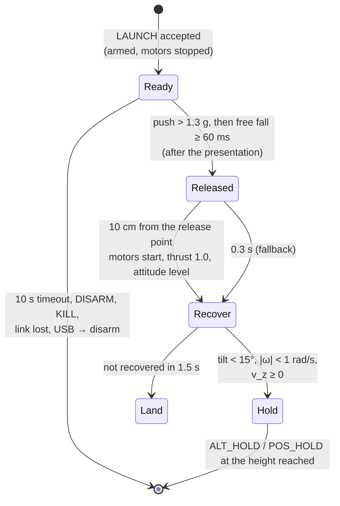

# 0011. Hand launch: armed with the motors stopped, toss up, motors started away from the hand

- **Status:** Accepted (2026-11-13, design); the implementation is accepted after the validation below
- **Date:** 2026-11-13

## Context

The drone takes off today only from the ground: TAKEOFF (automatic, with an altitude source) or the throttle in
ACRO/ANGLE. A hand launch is wanted: the pilot holds the drone, releases or tosses it, and the drone stabilises and
holds its height.

What the firmware has and what is missing:

| Item | Today | Needed for a launch |
|---|---|---|
| Arming | the motors spin at `motorIdle` (5 %) as soon as the drone is armed | armed **with the motors stopped** while it is in the hand |
| Take-off detection | height above the ground level, or the collective above 0.8 $\hat t_h$ | release detected from the IMU, before any height change is measurable |
| Attitude at release | IEKF; the accelerometer is de-weighted when its magnitude is not 1 g | same; the release may come with a tilt and a rotation |
| Gyro range | ±2000 °/s | a tossed drone may spin; a saturated gyro corrupts the attitude |
| Vertical | hover thrust estimate (ADR 0010), vertical loop | thrust right after the release, before the altitude estimate settles |
| Motors | 8520 brushed, lag ≈ 35 ms (assumed), plus the start from standstill | the time from release to thrust sets the height lost |

Propeller guards cannot be relied on: a parameter saying they are fitted is a declaration anyone can set, and no
signal on the board tells whether they are there (2–4 g are within the spread of the hover thrust). The launch must
therefore be safe for the hand **by the way it starts the motors**, whatever is fitted.

A first estimate with the vertical model (`00 - FC_FW/Tests/sim/launch_1d.py`): the release detected after 60 ms of
free fall, the motors started only once the drone is 10 cm from the release point (§3), 30 ms to start, lag 35 ms.

| Configuration | T/W | Tossed up at 1.5 m/s: lowest point (motors at) | Dropped: lowest point (motors at) |
|---|---|---|---|
| T400, 4.2 V/cell | 1.97 | 0 (98 ms) | −0.42 m (143 ms) |
| T400, 3.7 V/cell | 1.53 | 0 | −0.60 m |
| T800, 4.2 V/cell | 1.71 | 0 | −0.50 m |
| T800, 3.7 V/cell | 1.33 | 0 | −0.85 m |
| T1200, 4.2 V/cell | 1.55 | 0 | −0.59 m |
| T1200, 3.7 V/cell | 1.20 | 0 | −1.25 m |

A toss gains the separation while the drone still rises, so it costs no height; a drop pays for every centimetre of
separation with height. Without the separation rule, a drop starts the propellers 90 ms after the release, about
4 cm below the fingers.

## Decision

### 1. A LAUNCH automatic action, in its own module

New command `LAUNCH` (0x1A, payload: the ARM magic, so that a stray frame cannot start it) and automatic action
`PV2_AUTO_LAUNCH` (6). Logic in `control/launch.c`: a pure state machine, called by `fc_core` with a function call,
as `rc_switches` and `pos_ctrl` are.

- **Preconditions** (refusals with the usual reasons):
  - the same as ARM: checks, battery, no USB host, estimate running;
  - plus an altitude source (baro or ToF), the T/W available at the present voltage ≥ 1.5, and `beginner` = 0.
- **Ready:**
  - armed with the **motors stopped**: a new setpoint flag `motors_off` tells `ctrl_loop.c` to write duty 0 instead of the idle;
  - the app shows "release or toss the drone";
  - EVENT 10 LAUNCH_READY;
  - any of the following disarms: 10 s timeout, DISARM, KILL, the link lost, a USB host.
- **Presentation:** the release is armed only after the drone has been held still and level (tilt < 30°, |ω| < 1 rad/s) for 0.5 s. A drone carried while walking, or swung, never starts its motors.
- **Release:** the push of the hand (specific force above 1.3 g, the toss) followed by free fall (below 0.3 g for 60 ms), with the gyro not saturated → EVENT 11 LAUNCH_RELEASED. With `launchDrop` = 1, free fall alone is accepted (§3).
- **Separation:** the motors stay off until the drone is 10 cm from the release point (§3).
- **Recover:**
  - collective 1.0 while falling, then $\hat t_h/\cos(\text{tilt})$;
  - attitude setpoint level, with full authority (airmode);
  - yaw rate 0.
- **Hold:**
  - the vertical loop takes the height where the vertical speed crossed zero;
  - the mode becomes POS_HOLD with the flow, else ALT_HOLD (as at the end of TAKEOFF);
  - `pos_hold` engages when the flow is usable.
- **Abort:**
  - not recovered in 1.5 s → LAND;
  - the attitude estimate stopped → motors off (as the stall watchdog: flying without an attitude is a fly-away).

### 2. Gyro range ±4000 °/s (shared with ADR 0012)

The LSM6DSV16X full scale goes from ±2000 to ±4000 °/s, for every mode.
- Resolution 70 → 140 mdps/LSB: the quantisation noise (0.04 °/s RMS) stays below the sensor noise.
- Bias calibration and the IEKF are unchanged; only the driver conversion constant changes.
- Saturation is reported as a flag, and the launch refuses the release while it is set.

### 3. Safety rules: the hand does not depend on guards

- **Motors started away from the hand.** The firmware does not rely on propeller guards and has no parameter for them. After the release, it starts the motors only once the drone is **10 cm** from the release point. The rule is always active: no parameter disables it.
  - The distance is the double integral of the world acceleration $R f - g\,e_3$, from the release.
  - The velocity at the release is the integral of the push, from the presentation, where the drone was still.
  - Over the 0.1–0.2 s involved, the drift of this dead reckoning is millimetres.
  - If the 10 cm are not reached within 0.3 s, the motors start anyway: the drone is falling and must recover.
- **Toss up as the standard launch.** The release requires the push of a toss first, so the drone leaves the hand upwards, and the hand is below the propellers, not above them. The app shows the gesture: flat palm, a short upward push.
- **Drop only as an explicit option.** `launchDrop` (104, default 0) also accepts free fall without a push.
  - It costs 0.4–1.3 m of height (table above).
  - It is refused when the T/W available now is below 1.7.
  - The app tells the pilot to pull the hand away sideways.
- **What remains.** A hand held above the drone at the release is still exposed: these rules lower the risk for the normal gesture, they do not remove it. The app shows the warning before every launch.
- **No launch from the radio arm switch.** The launch is an explicit action: from the app (a hold-to-confirm button), or from a radio switch mapped only to it (AUX3, later).
- **No release without an altitude source.**

### 4. Protocol and parameters

| Item | Value |
|---|---|
| op | `0x1A` LAUNCH, payload `0xA5 0x5A` |
| auto | `6` LAUNCH; FLIGHT shows `motors_off` while ready |
| events | 10 LAUNCH_READY (INFO), 11 LAUNCH_RELEASED (INFO, arg = ms to the motor start), 12 LAUNCH_ABORTED (WARN, arg = reason) |
| parameter | `launchDrop` (104, 0/1, default 0) |
| constants | push 1.3 g, free fall 0.3 g / 60 ms, separation 10 cm (fallback 0.3 s), presentation 0.5 s, ready timeout 10 s, recovery 1.5 s, drop T/W ≥ 1.7 |

## Consequences

- One more automatic action with its own module and tests; `fc_core` only routes the command and applies the
  outputs.
- `ctrl_loop.c` learns `motors_off`: armed but stopped. The stall watchdog, KILL and the motor test are unchanged.
- The gyro range change touches the driver and the IEKF replay data (scale), and needs a new bench check of the
  gyro bias calibration.
- The parameter count goes to 44 of 48 slots: the configuration image v4 (more slots) is needed before the GPS work.

## Alternatives considered

- **Arm with the motors at idle in the hand** (some racing firmwares). The props spin near the fingers for the whole
  holding time. Rejected.
- **Detect the release by the height (baro/ToF).** The baro needs hundreds of ms to see 0.2 m, and the ToF sees the
  hand or the floor. Too late, and ambiguous.
- **Detect the release by the push alone.** A jolt or a tap gives the same signal. The push is used only as the
  first half of the signature: push, then free fall.
- **A `propGuards` parameter as an interlock.** It is a declaration: anyone can set it, and the guards can be
  removed after. Rejected in favour of the separation rule, which protects the hand without trusting it.
- **A hardware interlock** (a contact closed by the guards). Considered and not pursued.
- **Start the motors at the free-fall detection** (no separation). 0.3 m less height lost on a drop, with the
  propellers 4 cm below the fingers. Rejected.
- **Motors at full thrust on any free fall while armed** (a "catch" feature). Useful later as a recovery from a
  failed motor test or a fall, but it is not a launch: no presentation, no explicit action.

## Validation (before implementation is accepted)

1. **Host simulation:** the rotational plant of `ctrl_test` plus the vertical point mass, across a grid of releases:
   - tilt ±40°, body rates up to ±400 °/s, tosses at 0.5–2 m/s and drops;
   - 4.2 and 3.6 V, T400/T800/T1200 masses;
   - pass criteria: motors off until 10 cm of separation, recovered within 0.7 s after the start (amended, see
     the results), a toss loses
     no height below the release point, a drop within the table above, no attitude error > 5° after the
     recovery.
2. **False releases:** synthetic and logged IMU traces of handling (walking, running, shaking, a tap, setting the drone down, a jump with it in the hand). Pass criterion: no release.
3. **Separation estimate:** logged tosses and drops (props off) against a camera or a string of known length: the 10 cm detected within ±2 cm.
4. **Bench, props off, `MOTORS_ENABLE` = 0:**
   - drop onto a cushion and check the release in the log (EVENT 11, the timing);
   - then props on, tethered from above.
5. **First real launches:** T400, full battery, over a soft floor, tosses only.

## Validation results (host, firmware 0.11)

`make launch_test` and `host_test` (`test_launch_core`). The attitude estimate is taken as exact in the closed loop
(the IEKF propagates on the gyro during the free fall; its behaviour there is checked on the bench, step 4).

| Item | Result |
|---|---|
| toss at 1.5 m/s | motors at 100 ms (10 cm) |
| gentle toss at 1.2 m/s (rises 7 cm, never 10 cm) | motors at the apex, 124 ms |
| toss too weak (0.6 m/s, rises 1.8 cm) | motors kept off, EVENT 12 reason 5 |
| drop with `launchDrop` = 1 | motors at 148 ms |
| drop without `launchDrop` | motors kept off |
| walking, a tap, short dips, running (apex 1.8 cm) | no motor start |
| gyro saturated during the free fall | no release |
| closed loop, 27 tosses (T400/T800/T1200 at 4.2 V, tilt 0–40°, rates 0–400 °/s; the 3.6 V cases are refused by the T/W gate) | all recovered; lowest point −0.03 m; drop −0.34 m |
| slowest recovery | 0.62 s after the motor start, tilt ≤ 2° 0.3 s later |
| through the flight core | refusals (thrust, no battery reading, beginner, magic), motors stopped, lifted in the hand without "in the air", EVENT 10/11, hold at the height reached, 10 s timeout, DISARM in the hand |

**Changes made by the validation**

1. **The apex rule.** A toss at 1.2 m/s rises only 7 cm: with the 10 cm rule alone the motors would have started
   on the way back down, onto the hand. The motors now also start at the apex of a toss that rose at least 4 cm.
   A toss that rose less is aborted with the motors off (unless `launchDrop`), and only a drop keeps the 0.3 s
   time fallback.
2. **The quiet reset.** The velocity is dead-reckoned only through one gesture: 200 ms between 0.7 and 1.3 g
   zero it and forget the push. Without it, the accelerometer bias integrated over the 10 s in the hand could
   make a false apex.
3. **Recovery criterion 0.5 → 0.7 s.** At 400 °/s the drone turns freely to 63–85° during the ~0.1 s the
   separation rule keeps the motors off. The tilt loop (6 rad/s, rate limit 6 rad/s) needs about 0.6 s from
   there. The 0.5 s first written here did not account for it; a faster recovery would need a higher tilt gain
   during the recovery, not tested.

**Not solved: a jump with the drone in the hand.** The legs push (about 2 g) and the flight phase of the jump is a
free fall of 0.3–0.5 s: for the IMU it is a toss, and the motors start about 64 ms later, still in the hand. The
separation is measured from the release point in the world, not from the hand, so it cannot see that the hand
travels with the drone. No IMU signature separates the two. What limits the risk today:

- the launch is armed for 10 s only, after a hold-to-confirm in the app;
- the app tells the pilot to stand still and toss;
- a run (apex ≈ 2–3 cm) is aborted by the weak-toss rule, with a thin margin over the 4 cm threshold.

Options to remove it are listed for a decision: a dead-man hold in the app while the drone is in the hand (the
release accepted only with the button held, so the other hand cannot be in a jump without a deliberate act), or a
toss window (the free fall within 150 ms of the end of a short push, which a jump's longer leg push may not meet,
to be checked on logged traces).
