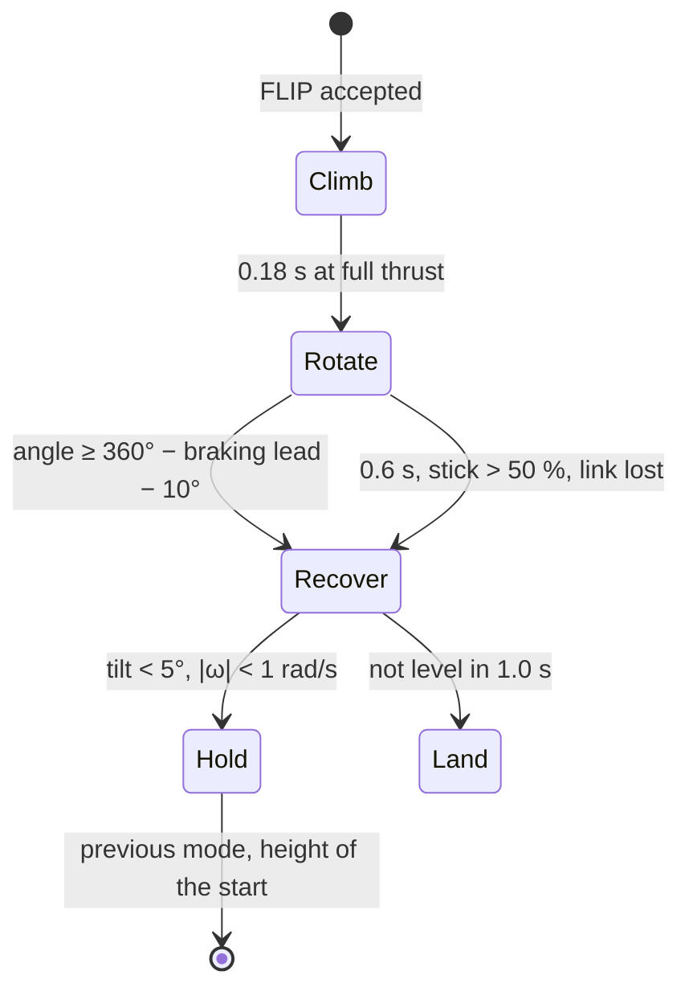

# 0012. Autonomous flip: a phased manoeuvre gated on the thrust available now

- **Status:** Accepted (2026-11-13); implemented in firmware 0.13.0, host validation below
- **Date:** 2026-11-13

## Context

A flip on command is wanted: one full rotation about the roll or the pitch axis, started by the pilot, then back to
the hover at the starting height.

What the firmware offers already:

- a rate loop at 960 Hz;
- a mixer with airmode, so the attitude authority is kept at low collective;
- the hover thrust estimate (ADR 0010);
- the vertical and position loops;
- the IEKF, which tolerates the accelerometer during manoeuvres (adaptive noise, NIS gate).

What it does not have:

- a way to command a rotation larger than the ACRO stick scale (4 × `maxYawRate` = 480 °/s);
- a sequence of phases;
- entry checks.

A one-dimensional estimate of the manoeuvre (`00 - FC_FW/Tests/sim/flip_1d.py`) gives these numbers. The model:
- full thrust for 0.18 s;
- collective 0.25 and 1400 °/s while rotating;
- angular acceleration limited to 520 rad/s², which is the torque command clamp of 0.5 × 1100 rad/s²;
- motor lag 35 ms;
- recovery at level with full thrust while falling.

| Configuration, V/cell | T/W available | Lowest point | Highest point | Duration |
|---|---|---|---|---|
| T400, 4.2 V | 1.97 | 0.00 m | +0.30 m | 0.52 s |
| T400, 3.9 V | 1.70 | −0.15 m | +0.19 m | 0.52 s |
| T400, 3.6 V | 1.45 | −0.52 m | +0.10 m | 0.52 s |
| T800, 4.2 V | 1.71 | −0.14 m | +0.19 m | 0.52 s |
| T800, 3.9 V | 1.47 | −0.47 m | +0.11 m | 0.52 s |
| T1200, 4.2 V | 1.55 | −0.34 m | +0.14 m | 0.52 s |
| T1200, 3.6 V | 1.14 | −2.30 m | +0.02 m | 0.52 s |

The thrust available falls with the square of the cell voltage. The mixer compensates the battery by raising the
duty, but it cannot exceed 100 %. **What decides whether a flip is safe is the T/W at the present voltage, not the
frame:** a T400 at the end of its pack loses more height than a T800 on a full one.

## Decision

### 1. A FLIP automatic action, in its own module

New command `FLIP` (0x1B, payload: `axis u8`, 0 roll right, 1 roll left, 2 pitch forward, 3 pitch back), automatic
action `PV2_AUTO_FLIP` (7). Logic in `control/flip.c`, a pure state machine called by `fc_core`. Its outputs are a
rate setpoint and a collective that override the normal setpoints for the length of the manoeuvre.

- **Climb:** collective 1.0, attitude level, for 0.18 s (≈ +1 m/s).
- **Rotate:**
  - rate setpoint `flipRate` (1400 °/s) on the axis, other axes 0;
  - collective 0.25, so as not to push sideways or down while inverted; the airmode raises it as far as the torque needs;
  - the angle is the gyro integrated on the axis;
  - it ends at 360° minus the braking lead $\omega^2/(2\alpha)$ minus 10°.
- **Recover:**
  - attitude level, collective $\hat t_h/\cos(\text{tilt})$, plus full thrust while $v_z$ < 0;
  - the yaw is not corrected (no heading hold).
- **Hold:**
  - the vertical loop returns to the starting height;
  - the previous mode is restored, and `pos_hold` re-latches a new point.
- **Estimator during the flip:**
  - the IEKF propagates on the gyro; the accelerometer and the magnetometer are already de-weighted, and the flip tells the estimator to skip them explicitly from Climb to the end of Recover;
  - the altitude KF ignores the ToF above 30° of tilt (already the case: when inverted it would measure the ceiling);
  - the hover estimate and `pos_ctrl` are frozen (tilt and saturation gates, `pos_hold` = 0).

### 2. Entry gate (refused with a reason, nothing moves)

| Condition | Value | Why |
|---|---|---|
| in the air, a hold mode or ANGLE, no automatic action, no failsafe | | a known starting point |
| T/W available at the present voltage | ≥ `flipMinTw` (1.6) | the table above: below it the height loss grows quickly |
| height above the floor (ToF) or above the take-off point (baro) | ≥ `flipMinH` (2.0 m) | lowest point −0.3 m at T/W 1.6, plus margin for the model and the estimate |
| room below the ceiling / geofence | ≥ 0.6 m | the climb phase goes +0.3 m |
| level and slow | tilt < 10°, \|ω\| < 1 rad/s, \|v_h\| < 1 m/s, \|v_z\| < 0.5 m/s | |
| battery | level OK (not low) | |
| `beginner` | 0 | |
| link | the controlling input fresh | |

The T/W available is $\frac{1}{\hat t_h}\left(\frac{V_{cell}}{4.2}\right)^2$: the hover estimate and the sagged cell
voltage, the same quantities as CHECKS item 13.

### 3. Gyro range ±4000 °/s

As in ADR 0011 §2. 1400 °/s with the overshoot of the rate loop (≈ 20 %) is within ±2000 °/s, but with no margin
for a stronger setpoint or the cross-axis rates. The flip is refused if the gyro saturates, and a saturation during
the rotation goes straight to Recover.

### 4. Protocol and parameters

| Item | Value |
|---|---|
| op | `0x1B` FLIP, payload `axis u8` |
| auto | `7` FLIP |
| events | 13 FLIP_DONE (INFO, arg = height lost in cm), 14 FLIP_ABORTED (WARN, arg = phase << 8 \| reason) |
| parameters | `flipRate` (106, 600–2000 °/s, 1400), `flipMinH` (107, 1.0–5.0 m, 2.0), `flipMinTw` (108, 1.3–2.5, 1.6); ids shifted by one from the first draft, 105 went to `ctlLaw` (ADR 0013) |
| app | a flip button with four directions, enabled only when the gate passes (CHECKS-like reason shown) |
| radio | a switch mapped only to it, later |

## Consequences

- With ADR 0011 the parameter count reaches 47 of 48 slots: the configuration image v4 (more slots) must come first.
- The rate loop must actually reach 1400 °/s: the gains, the torque clamp (±0.5) and the motor lag on the real
  drone decide it. The flip waits for the tuning of the loops (issue #42).
- The 1-D estimate ignores the drag, the torque lost when the collective is low and the motor saturation of the
  airmode. The host simulation below must confirm the numbers before the gate values are frozen.
- The yaw may drift a few degrees during a flip; acceptable without a heading hold.

## Alternatives considered

- **ACRO with a larger stick scale** (the pilot flips by hand). Already possible by raising `maxYawRate`. Not autonomous,
  and the height loss depends on the pilot.
- **A gate on the frame (T400/T800/T1200).** It ignores the battery: the table shows a T400 at 3.6 V worse than a
  T800 at 4.2 V.
- **Trajectory-optimised flip** (minimum height loss, feed-forward of the torque profile). Better, but it needs an
  identified model of the real drone. A later step, once the logs give the motor and inertia numbers.
- **Flip without the climb phase.** It loses about 0.3 m more at every T/W, for 0.18 s saved.

## Validation (before implementation is accepted)

1. **Host simulation in closed loop:**
   - plant: the rotational plant of `ctrl_test` (inertia, four rotors with lag, voltage) plus the vertical point mass;
   - controllers: the real controllers and `flip.c`;
   - all four axes, at 4.2 / 3.9 / 3.6 V, with T400 / T800 / T1200 masses;
   - pass criteria: level within 5° at the end, lowest point within 0.1 m of the gate assumption, duration < 1.5 s, the abort paths.
2. **Gate tests:** each condition refused with its reason.
3. **Bench, props off:** command a flip with `g_fc_dbg_in_air` and check the phase sequence and the setpoints in the log (motors disabled).
4. **First flips:**
   - outdoors, 3 m up, over grass, T400 on a full battery;
   - then indoors under a 2.5 m ceiling only if the logs show a lowest point within the gate.

## Validation results (host, firmware 0.13)

`make flip_test` (closed loop: `flip.c`, the attitude and rate loops, the mixer, the 6-DOF plant of `plant6.h`) and
`host_test` (`test_flip_core`, through the flight core). The attitude estimate is taken as exact in the closed loop.

| Case | Result |
|---|---|
| 16 flips (4 axes × T400 4.2/3.9 V, T800 4.2 V, and a mass at T/W 1.62); the other cases are refused by the gate | all one full turn (359°), level within 1.2° 0.3 s after, done in 1.21–1.28 s |
| lowest point | −0.13 m at T/W 1.62; −0.01 m at T/W 1.70; 0.00 at 1.97 |
| a stick in the rotation, the gyro saturated | cut short, recovered level, reported |
| not level within 1 s, estimate lost | EVENT 14, LAND |
| gate | each refusal with its reason (height, ceiling, T/W, tilt, motion, battery, mode, beginner) |
| through the flight core | climb at full thrust, rotation rate, level recovery, estimator on the gyro during the manoeuvre, the mode and the starting height restored, EVENT 13 with the height lost |

**The closed loop loses less height than the 1-D estimate of the Context.** At T/W 1.70 the 1-D estimate is −0.15 m;
the closed loop gives −0.01 m. The 1-D model kept the collective at 0.25 during the rotation. The mixer instead
raises it as far as the torque needs (airmode), so the drone keeps more thrust while it turns. The gate of T/W 1.6
and 2 m therefore has more margin than the table above suggests. The values stay as they are until flight logs
show the real loss: the motor lag and the torque authority are still assumed numbers.

**Implementation notes**
- The estimator gained a `vector_hold` flag (`est_pipeline.h`). The flight core raises it during the manoeuvre
  (`fc_vector_hold()`), and the IEKF then skips its accelerometer and magnetometer updates, without touching the
  stillness detector, the acc window or the callbacks.
- The flip goes through the control-law interface (ADR 0013): `CTL_ATT_RATE` with the rotation rate during the
  rotation, `CTL_ATT_ANGLE` level otherwise, and `CTL_V_COLLECTIVE` with the collective of the phase. Any law that
  follows the reference flies it.
