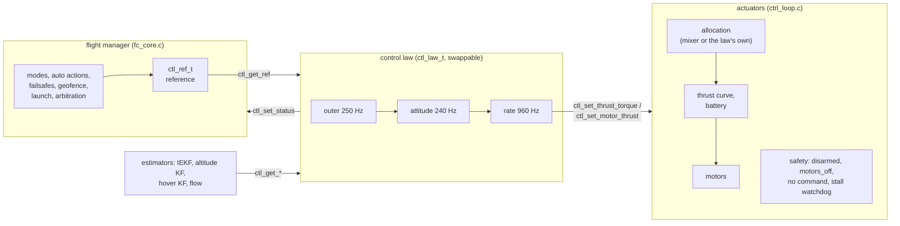

# 0013. A generic control-law interface: reference in, getters and setters, swappable laws

- **Status:** Accepted (2026-11-13); implemented in firmware 0.12.0
- **Date:** 2026-11-13

## Context

Until firmware 0.11 the control law was spread over two files that also had other jobs:

| Where | Control | Other jobs in the same place |
|---|---|---|
| `control/fc_core.c` | the vertical loop (`alt_ctrl`), the horizontal loop (`pos_ctrl`), the geofence limiter of the collective, the take-off ramp written into the loop's own limit | modes, automatic actions, failsafes, geofence, input arbitration, hand launch |
| `app/ctrl_loop.c` | the tilt loop and the rate PID (`att_ctrl`) | the mixer, the battery compensation, the motors, the stall watchdog |

To try another law (LQR, INDI, a model-predictive controller, a different vertical loop), one had to edit the
flight manager, the module that holds the safety logic, and follow the state of the loops it reached into (`s_ac`,
`s_pc`, `s_ac.thr_max`). The goal: someone can change the control law easily, reading the sensor data through
getters and commanding the drone through setters, without touching the flight manager or the actuators.

## Decision

### 1. Three layers

- The **flight manager** decides *what*. It publishes a reference with one *kind* per group, never a gain or a
  loop state:
  - attitude: angles or body rates;
  - vertical: collective, climb rate or height;
  - horizontal: none, or a velocity (zero = hold the point).

  The limits travel with it: climb limits, the geofence ceiling, the take-off thrust ramp, `maxTilt`, `maxHSpeed`.
- The **control law** decides *how*. It reads the reference and the vehicle state with getters (`ctl_get_*`). It
  commands with one of two setters:
  - collective plus torques, allocated by the standard quad-X mixer;
  - the thrust of each motor, for a law with its own allocation.

  It reports its collective, attitude targets and saturation back (`ctl_set_status`).
- The **actuators** own what must hold for every law:
  - no output while disarmed;
  - duty 0 with `motors_off` or when a rate step brought no command;
  - the stall watchdog;
  - the thrust curve and the battery compensation.

### 2. The interface (`control/ctl_api.h`)

| Hook | Rate | Context |
|---|---|---|
| `outer(dt)` | ~250 Hz | after the reference: vertical and horizontal loops |
| `attitude(dt)` | 240 Hz | after each attitude update of the IEKF |
| `rate(dt)` | 960 Hz | right after the gyro propagation; one command |
| `init()`, `reset()` | – | when the law becomes active |

All in the ImuTask, never concurrently: a law needs no lock. Units are SI, body FLU, world NWU. Thrust is the
normalised thrust of ADR 0010, so a law never sees the battery or the motor curve.

### 3. Selection

- Laws are registered with `ctl_register()`. The default (`cascade_pid`, the loops of 0.7–0.11) is index 0.
- Other laws are registered in a user function `ctl_user_laws()` (weak hook), so adding one touches no existing
  file.
- The parameter `ctlLaw` (105) chooses the index. The change applies **only while disarmed**: the active law never
  changes in flight. An index without a law falls back to 0.

### 4. Behaviour unchanged

The default law is the code of 0.11, moved behind the interface without changing its arithmetic. The rate loop
keeps using the collective and the reference seen at the last attitude step, as before. Every host test passes
with the same expected values. The output of `host_test`, `power_test` and `log_test`, and the telemetry and log
streams they write, are **identical bit for bit** to 0.11: once the parameter table is the same, nothing differs.

## Consequences

- `fc_core.c` no longer includes a controller header. It builds `ctl_ref_t`, calls `ctl_io_outer()`, and reads
  `ctl_get_status()` for the hover-thrust learning, the airborne test without altitude and the open-loop landing.
- A law with an internal state the flight manager used to touch (the vertical integrator at arm, at the take-off,
  after a hand launch) now handles it itself, from the reference: it resets on arming and on entering a closed-loop
  vertical kind.
- One more parameter (44 of 128 slots).
- The interface is a contract: a change to `ctl_ref_t` or to the getters breaks the laws written against it. New
  fields are added at the end, and the kinds are never renumbered.

## Alternatives considered

- **Swap only the inner loops** (attitude and rate), keeping the vertical and horizontal loops in the flight
  manager. Less work, but a law that controls position or height differently (MPC, INDI on the vertical) would still
  need the flight manager edited. Rejected.
- **A reference of raw stick values** (the law maps the sticks). The modes, the failsafes and the geofence would
  move into every law. Rejected: they are safety logic, written and tested once.
- **Run-time selection in flight.** A law switch with the drone in the air needs bumpless state transfer between
  unrelated laws; not worth the risk. Disarmed only.
- **Function pointers to every getter passed to the law** (dependency injection). More flexible for unit tests,
  but heavier to write against; plain getters, backed by one module (`ctl_io.c`) that a host test can feed, give
  the same testability.

## Validation

- `host_test` (`test_ctl_api`) runs a probe law registered next to the default one. It checks:
  - **selection:** switched by `ctlLaw` only while disarmed, `init` called once;
  - **getters:** the probe reads the real state (height, hover estimate, attitude, rates, reference);
  - **setters:** both of them reach the motors, the per-motor one through the thrust curve;
  - **safety rules:** nothing is written while disarmed, and a step without a command gives duty 0;
  - **status:** the law's status reaches the flight core;
  - **fallback:** `cascade_pid` comes back after the disarm.
- Bit-exact comparison with 0.11, as in §4.
