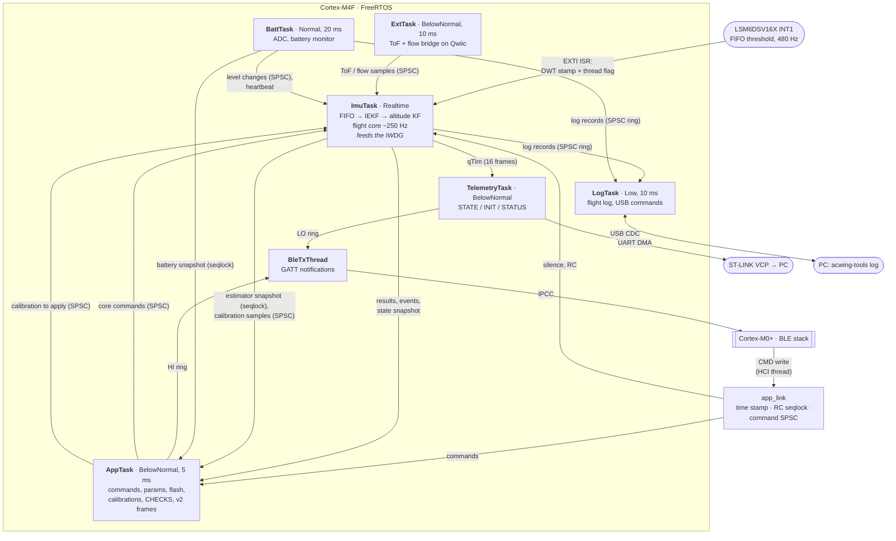
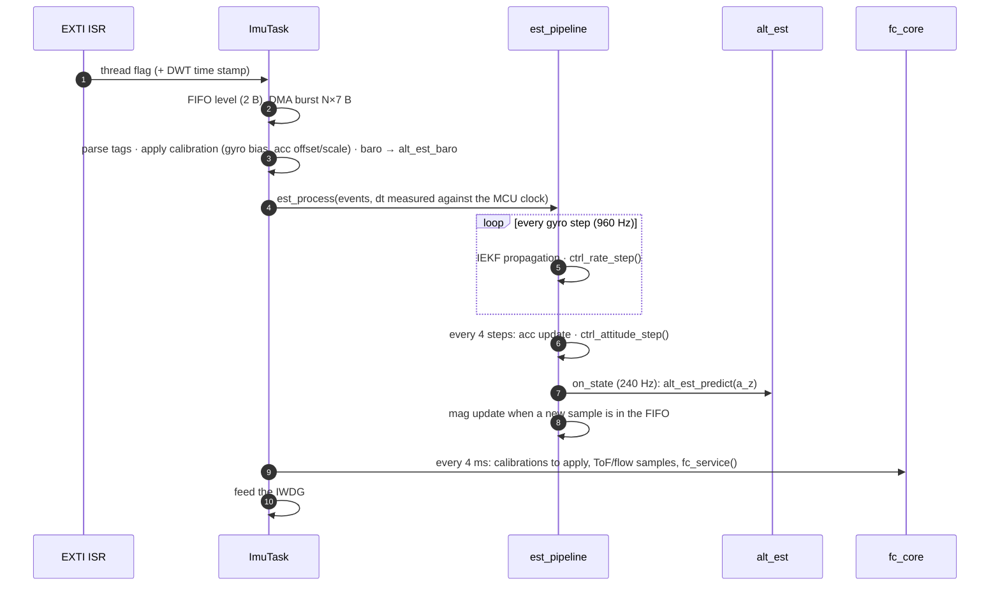
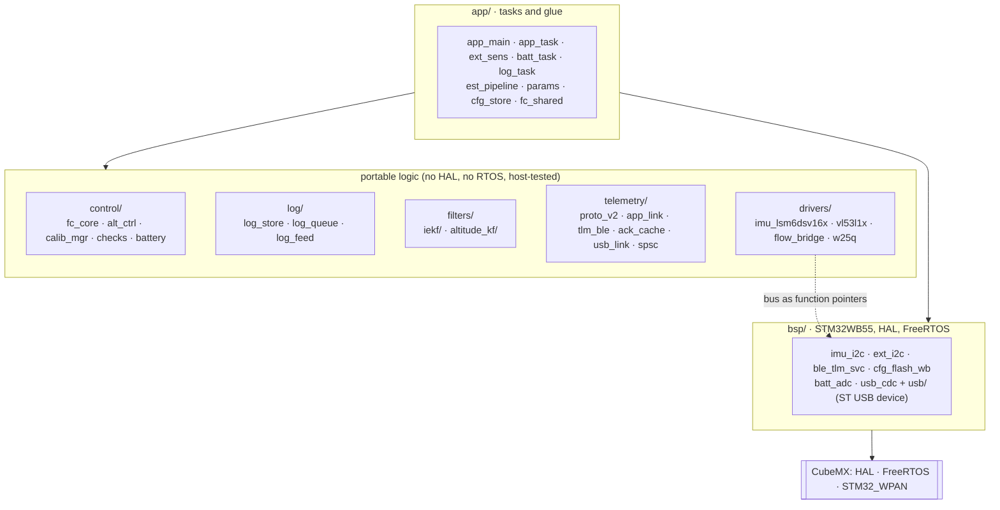

# Firmware architecture

The flight-controller firmware (`00 - FC_FW`) runs FreeRTOS on the Cortex-M4F
core of the STM32WB55. The BLE stack runs on the Cortex-M0+ core (CPU2).
This page shows the tasks, the data paths between them and the layering of the
code. The protocol with the app, the flight core and the sensors have their
own pages: [ACwing Pilot protocol v2](protocol-v2.md),
[Flight core](flight-core.md) and [Sensors and expansion boards](sensors.md).

## Tasks and data paths

Every arrow between tasks is either a **lock-free single-producer
single-consumer queue** (`telemetry/spsc.h`) or a **seqlock snapshot**. No task
ever waits on another, and nothing in the ImuTask waits on BLE.

| Task | Priority | Stack | Rate | Owns |
|---|---|---|---|---|
| ImuTask | Realtime | 3 KB | IMU interrupt (480 Hz), flight core every 4 ms | IMU, IEKF and altitude filter state, flight state, IWDG |
| TelemetryTask | BelowNormal | 1 KB | queue-driven, STATUS 10 Hz | UART DMA, LO BLE ring producer |
| AppTask | BelowNormal | 3 KB | 5 ms | ACK cache, parameters, flash image, calibration fits, HI BLE ring producer |
| ExtTask | BelowNormal | 768 B | 10 ms | the Qwiic devices (probe, poll) |
| BattTask | Normal | 768 B | 20 ms | ADC1, battery estimator ([Battery](battery.md)) |
| LogTask | Low | 1.5 KB | 10 ms (1 ms while downloading) | log flash, log store, USB link ([Flight log](logging.md)) |
| BleTxThread | (BLE glue) | 1 KB | 10 ms flush | BLE ring consumer, notifications |

## One IMU interrupt, step by step

- `ctrl_rate_step()` runs right after the propagation, **before** the Kalman
  corrections, to minimise the gyro → motor latency.
- The IMU period is measured against the MCU crystal over 2 s windows, as
  explained in [IEKF on the microcontroller](../theory/iekf-embedded.md).
- After a read that left the FIFO above the watermark, the task reads again
  at once. INT1 is a level on an edge-triggered EXTI, so this keeps the edges
  coming (see [Troubleshooting](../guides/troubleshooting.md)).

## Code layers

- The modules in the middle layer can be compiled by any C compiler. That is
  what `00 - FC_FW/Tests/host` does: see [Testing](testing.md).
- `drivers/` and `bsp/` are separate on purpose: the reasons are in
  [ADR 0005](../decisions/0005-drivers-and-bsp.md).
- Porting to the ACwing FC rev A (IMU on SPI, compass and baro on the sensor
  hub, I²C1 only for the expansion bus) changes `bsp/` and the CubeMX project,
  not the logic.

## Safety isolation

- **The flight core owns the flight state.** `fc_core.c` runs only in the
  ImuTask. A stalled BLE stack, CPU2, AppTask or flash write cannot delay a
  failsafe.
- **The app-link timer is refreshed only by CMD frames** (RC, HEARTBEAT or any
  command). Each frame stores its arrival time from `HAL_GetTick()`.
  Connection events, notifications and link-layer traffic do not refresh it. A
  GAP disconnection can only start the failsafe earlier.
- **Watchdog.** IWDG at 0.5 s, fed only by the ImuTask loop and frozen when the
  debugger halts the core. The flight core is also told "estimate not usable"
  when no gyro sample has arrived for 50 ms.
- **Bus sharing.** On the bench the ACwing Flow devices share I²C1 with the
  IMU. Every transaction takes a mutex with priority inheritance, so the
  ImuTask waits at most for one short expansion transaction, a few hundred
  microseconds. On the ACwing FC the IMU is on SPI and the lock is
  uncontended.
- **Flash writes** happen only when disarmed (parameter save, calibration save,
  name, the charge of the last flight). On the WB55 they are coordinated with CPU2 through the hardware
  semaphores (`bsp/cfg_flash_wb.c`). The configuration lives in two A/B pages
  at the top of the flash, with a sequence number and a CRC32.

- **Battery.** The BattTask measures and signals; the flight core decides.
  Because the IWDG is fed only by the ImuTask, the flight core watches the
  BattTask heartbeat and treats a silence over 1 s as "battery unknown"
  ([ADR 0007](../decisions/0007-battery-task.md)).
- **Log.** Producers write into their own lock-free rings and never wait; a
  full ring drops records and counts them. Only the LogTask touches the log
  flash ([ADR 0008](../decisions/0008-flash-log-and-usb-cdc.md)).

The reasoning behind these choices is in
[ADR 0003](../decisions/0003-flight-core-in-imu-task.md).

## I²C budget

Each interrupt reads about 2 status bytes and about 5 FIFO words (35 B). That
takes about 1 ms per cycle at 400 kHz, which is fine at 960 Hz but not at
1920 Hz, and about 0.4 ms at 1 MHz Fast-mode Plus. The DMA frees the CPU, but
the transfer time is latency on the rate loop. If unexpected FIFO tags appear
(`ps.unknown`), switch from one burst to word-by-word reads.

## Pin map of the bench (UM3239, UM2435)

| Signal | IKS4A1 | Arduino | STM32WB55 |
|---|---|---|---|
| I²C SCL | CN5-10 | D15 | PB8 (I2C1) |
| I²C SDA | CN5-9 | D14 | PB9 (I2C1) |
| LSM6DSV16X INT1 | CN9-6 | D5 | PA15 (EXTI15, label `IMU_INT1`) |
| ST-LINK VCP | — | — | PB6/PB7 (USART1) |

IKS4A1 **Mode 3**: J4 and J5 on 5-6 only. The LIS2MDL and the LPS22DF are then
behind the LSM6DSV16X sensor hub. PA15 is also JTDI, so debug must be *Serial
Wire*. The ACwing Flow board, if used on the bench, goes on the same
I²C1 (D14/D15) with a Qwiic cable.

**Motors (prepared, disabled).** `motors.c` uses TIM1 at 64 MHz / 2000 = 32 kHz
PWM, with 2000 levels, and `MOTORS_ENABLE = 0`. A power stage is required:
low-side logic-level N-MOSFET, gate resistor, pull-down, Schottky
freewheeling diode and bulk capacitance. PA8 (TIM1_CH1) is wired to the
LPS22DF INT1 on the IKS4A1, so the PWM pins have to be chosen together with
the power stage.
