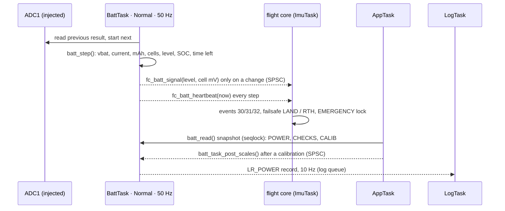
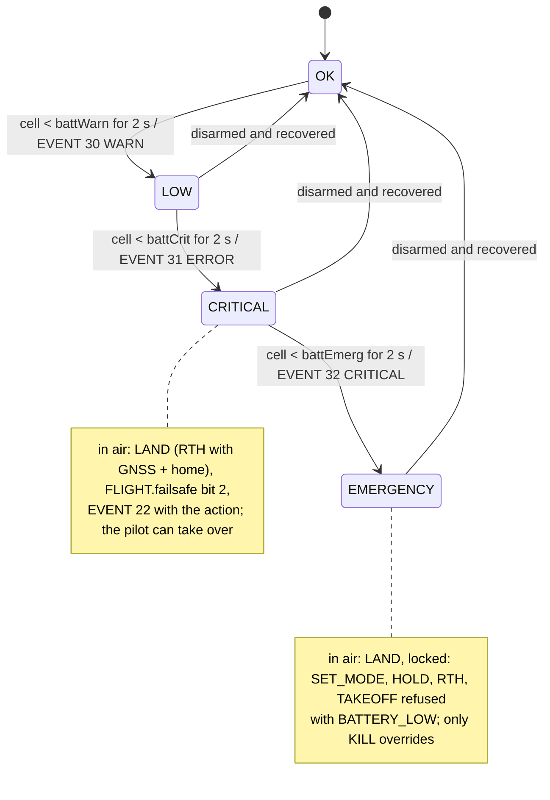

# Battery: monitor, calibration and failsafes

The battery is measured, estimated and calibrated by the **BattTask**, a task
of its own. The flight core only receives a **signal** when the warning level
changes, and decides what the drone does. This page covers the hardware, the
estimator, the calibration, the checks, the failsafes and how to test them.

| What | Where |
|---|---|
| Estimator (pure C, host-tested) | `App/control/battery.c` |
| BattTask: ADC sampling, signals, last-flight charge | `App/app/batt_task.c` |
| ADC binding (injected group, VREFINT) | `App/bsp/batt_adc.c` |
| Failsafes and events | `App/control/fc_core.c`, `battery()` |
| POWER frame, CHECKS item 1, BATTERY calibration glue | `App/app/app_task.c`, `App/control/checks.c`, `App/control/calib_mgr.c` |
| Settings | `APP_BATT_*` in `App/app/app_config.h`; parameters 20–24 |

## Hardware

| Signal | ACwing FC rev A | Bench (NUCLEO-WB55) |
|---|---|---|
| VBAT | PA5 = ADC1_IN10, divider 100k/10k (×1/11, 34 V full scale) | A0 = PC0 = ADC1_IN1, optional |
| Current | PA4 = ADC1_IN9, `CUR` pin of ESC link A | A1 = PC1 = ADC1_IN2, optional |
| Current sensor | ACwing ESC 1S: TSC213 + 2 mΩ shunt = **0.1 V/A** | – |

On the bench nothing is wired, so `APP_BATT_ADC` is 0: no BattTask, no POWER
frame, CHECKS item 1 is N/A and the app hides the battery, as before. To try
the chain on the bench, wire a 100k/10k divider from a bench supply to A0 (and
a voltage for the "current" to A1, 0.1 V = 1 A), then set `APP_BATT_ADC 1`.

The ADC runs three conversions in the **injected group** (VBAT, CUR,
VREFINT), 16× hardware oversampling, 247.5-cycle sampling for the 9 kΩ source
of the divider. Each `batt_adc_read()` returns the previous result and starts
the next conversion, so nothing waits for the ADC. The pin voltages are scaled
with VREFINT and its factory calibration, so they do not depend on the exact
3.1 V supply.

## Tasks and signals

- **Separation.** The estimator and the ADC live in the BattTask; the flight
  core keeps the decisions, because it owns the flight state. They share only
  a queue of level changes and a heartbeat time stamp: no lock, no waiting.
- **Priority.** The BattTask runs at `osPriorityNormal`: below the ImuTask,
  above the AppTask and the ExtTask, so a busy app link cannot delay a
  battery signal.
- **Heartbeat.** The IWDG is fed only by the ImuTask, so a stalled BattTask
  would not reset the board. The flight core therefore checks the heartbeat:
  silent for more than **1 s** → EVENT 33 *Battery monitor stopped* (ERROR,
  firmware extension), the battery is treated as unknown (ARM and TAKEOFF
  refused with `BATTERY_LOW`, CHECKS item 1 FAIL). Before the first heartbeat
  the battery is also unknown.

## The estimator

All quantities come from two pin voltages, sampled every 20 ms.

**Voltage and current.**

$$
V = v_{pin}\,\frac{s_V}{10}, \qquad I = \frac{i_{pin}}{k_I}\,s_I
$$

with $s_V$ = scaleV (110 for the 100k/10k divider), $k_I$ = 0.1 V/A and $s_I$
= scaleI (1 nominal). Both are low-pass filtered: $\tau$ = 0.1 s for $V$,
0.05 s for $I$. The charge used is $\int I\,dt$ (positive current only), in mAh
since power-on.

**Presence and cells.** The battery is present above 2.5 V, absent below
1.5 V for 200 ms (USB only). The cell count is the parameter `battCells`
when set, otherwise it is detected once per connection, disarmed, 0.5 s after
the battery appears:

$$
n = \left\lceil \frac{V}{4.35\ \mathrm{V}} \right\rceil, \quad 1 \le n \le 6
$$

A deeply discharged pack (below 3.5 V per cell on 6S) can be counted one cell
short: set `battCells` on such models.

**Warning level.** It uses the *sagged* cell voltage, as the handover asks:
$v_c = V/n$, low-pass filtered with $\tau$ = 0.5 s. A level (LOW < battWarn,
CRITICAL < battCrit, EMERGENCY < battEmerg) is **entered** when $v_c$ has been
below its threshold for **2 s**. It is **left** only when disarmed, after
$v_c$ has been 50 mV above the threshold for 2 s (a fresh battery). So a level
reached in flight does not flicker off when the pilot cuts the throttle and
the voltage recovers.

**Internal resistance.** Every 100 ms the mean $V$ and $I$ of the window are
compared with the previous window; on a load step $|\Delta I| > 0.5$ A,

$$
R_{cell} = -\frac{\Delta V}{\Delta I\, n}, \qquad
R \leftarrow 0.9\,R + 0.1\,R_{cell} \quad (2\ \mathrm{m\Omega} < R_{cell} < 0.5\ \Omega)
$$

starting from 40 mΩ per cell. The rest voltage is $v_r = v_c + I\,R$.

**State of charge.** $v_r$ goes through a LiPo open-circuit-voltage table
(3.27 V = 0 %, 3.84 V = 50 %, 4.20 V = 100 %, 5 % steps). Then:

- disarmed and resting ($|I| < 0.3$ A): SOC follows the voltage ($\tau$ = 2 s)
  and is the **anchor** for the coulomb counter;
- otherwise, with a current sensor and `battCapacity` set: coulomb counting,
  $\mathrm{SOC} = \mathrm{SOC}_0 - (\mathrm{mAh} - \mathrm{mAh}_0)/C$, with a
  slow pull towards the voltage estimate ($\tau$ = 600 s) that corrects a
  wrong capacity;
- otherwise: the voltage estimate, $\tau$ = 10 s.

POWER.pct is $\mathrm{SOC} \times 100$.

**Time left.** Only armed, with a current sensor and a capacity:

$$
t = \frac{(\mathrm{SOC} - 0.2)\,C}{\bar I} \cdot 3600\ \mathrm{s}
$$

with $\bar I$ the current filtered over 10 s and 20 % kept for the landing (as
the app simulator). Otherwise POWER.remain is `0xFFFF` (n/a).

## Parameters

| id | Name | Default | Range | Notes |
|---|---|---|---|---|
| 20 | battWarn | 3.6 | 3.3–3.9 V/cell | handover |
| 21 | battCrit | 3.5 | 3.2–3.8 V/cell | handover |
| 22 | battEmerg | 3.3 | 3.0–3.6 V/cell | handover; warn > crit > emerg |
| 23 | **battCapacity** | 0 | 0–20000 mAh | **firmware extension**; 0 = unknown (no coulomb counting, no time left); listed only with CAPS CURRENT |
| 24 | **battCells** | 0 | 0–6 | **firmware extension**; 0 = detect |

The ids 23, 24 (and 70, logMode) are firmware extensions. The ACwing Pilot
app shows them in Settings › Safety › Battery (and › Drone & firmware for
logMode); the remaining app work is in
[`HANDOVER_APP.md`](https://github.com/andrea-cirillo/ACwing_FlightController_FW/blob/main/02%20-%20Tools/02%20-%20App/HANDOVER_APP.md).

## CHECKS item 1 and ARM

| Situation | State | Value |
|---|---|---|
| no battery monitor on this board | N/A | 0 |
| BattTask silent | FAIL | 0 |
| no battery (USB only: the motors are unpowered) | WARN | 0 |
| cell < battCrit, or latched level ≥ CRITICAL | FAIL | cell mV |
| cell < battWarn, or latched level LOW | WARN | cell mV |
| otherwise | OK | cell mV |

A FAIL in item 1 makes ARM answer `BATTERY_LOW`, and the flight core refuses
ARM and TAKEOFF with `BATTERY_LOW` whenever the level is CRITICAL or worse or
the monitor is silent.

## Failsafes

- **CRITICAL, in air.** Once per flight: the automatic action becomes LAND
  (RTH needs GNSS, home and enough charge: none of them exists on this
  hardware yet), FLIGHT.failsafe bit 2 is set, and EVENT 22 is sent after
  EVENT 31 with the action as argument. A LAND or RTH already running is
  kept. The pilot can take over with SET_MODE, as the simulator allows; the
  failsafe does not trigger again.
- **EMERGENCY, in air.** LAND now, and the landing is locked until disarm:
  SET_MODE, HOLD, RTH and TAKEOFF are refused with `BATTERY_LOW`; only KILL
  works.
- **Other failsafes do not take over.** While a battery failsafe lands the
  drone, an app-link loss is only flagged (FLIGHT.failsafe bit 0); it cannot
  replace LAND with HOLD.

## BATTERY calibration (§10.6)

1. `CAL_START(6)` → WAITING_USER, step 1. CALIB shows `vbat` live, read with
   the scale in effect. Refused with `SENSOR_MISSING` without CAPS CURRENT.
2. Measure the pack with a multimeter, `CAL_SET_REF(6, 0, volts)` (2.5–30 V):
   $s_V \leftarrow s_V \cdot V_{meas}/V_{read}$. A ratio outside 0.7–1.3 is
   `OUT_OF_RANGE`; no battery → `SENSOR_MISSING`. The new scale applies at
   once, step 2.
3. After charging the pack flown last, `CAL_SET_REF(6, 1, mAh_charged)`
   (50–20000), or `CAL_CAPTURE` to skip → DONE, step 3.
4. `CAL_SAVE` stores the scales in the flash image (with a backup for
   `CAL_RESTORE`).

**The charge of the last flight.** The BattTask counts the mAh from ARM to
DISARM; the AppTask stores it, with the scaleI it was counted with, in the
flash image when the drone is disarmed (only above 20 mAh). The new scale is

$$
s_I = s_{I,flight}\cdot \frac{\mathrm{mAh}_{charger}}{\mathrm{mAh}_{counted}}
$$

The handover writes `scaleI = mAh / usedMah`, which is the same only when
$s_{I,flight}$ = 1. Using the scale of the flight keeps repeated calibrations
from compounding. A ratio outside 0.5–2 is refused.

!!! note "One flash write per flight"
    Storing the last flight's charge writes the configuration page at every
    disarm after a real flight. The two A/B pages are rated 10 000 erase
    cycles each on the STM32WB55, about 20 000 flights.

## POWER frame

| Field | Value |
|---|---|
| vbat | filtered pack voltage, mV |
| current | filtered current, cA (0 without a current sensor) |
| used | mAh since power-on |
| cells | count (0 until known) |
| cellAvg | sagged cell voltage (the one the failsafes use), mV |
| pct | state of charge |
| remain | s, `0xFFFF` n/a |
| warn | latched level |

Sent at 5 Hz (STREAM_RATES 1–10) and on `REQUEST(POWER)` when the board
measures the battery; CAPS.cells carries the cell count.

## Testing

- **Host** (`Tests/host/test_power.c`, 95 checks): estimator (cells 1S–6S,
  2 s level timing, no flicker while armed, coulomb counting against 450 mAh,
  time left, internal resistance 25 mΩ recovered from load steps, battery
  removed), BattTask signals, every failsafe (events and order, LAND,
  override, EMERGENCY lock, link loss during the landing, KILL), the
  heartbeat, the calibration (through calib_mgr and through the protocol),
  CHECKS, the POWER frame and the migration of the flash image. The POWER and
  CALIB frames it produces are decoded by the app's own decoders.
- **On the bench.** With `APP_BATT_ADC 1` and a bench supply on A0 through the
  divider: lower the supply slowly through 3.6 / 3.5 / 3.3 V per cell and
  watch EVENT 30 / 31 / 32 in the app; arm with the debugger flag
  `g_fc_dbg_in_air` set to see LAND and the lock.
