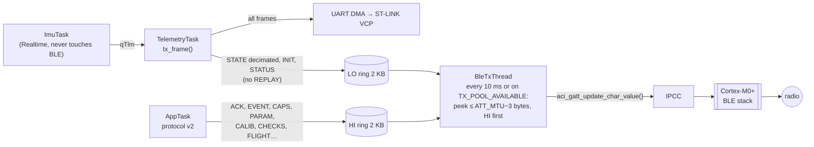

# BLE telemetry


**Goal.** Same behaviour as the USB link, over Bluetooth Low Energy:

- the PC receives the same STATE, INIT and STATUS frames;
- the same viewers, MATLAB and Python, show the attitude;
- the same `.mat` and `.bin` logs are written.

The USB link keeps working unchanged. REPLAY and the embedded-vs-reference
comparison ([Validation against the reference](../tools/validation.md)) stay USB-only. The GATT service is designed so that a mobile
app can use it as it is.

**Status:**

| Item | State |
|---|---|
| Notifications on the board | **working**, checked with nRF Connect (frames starting with `A5 5A`) |
| PC over BLE (Python) | **working on the board**: 57 STATE/s, lag flat within ±0.02 s over 30 s, 0 lost, 0 firmware drops ([Verification](#verification)) |
| PC over BLE (MATLAB) | same frame path; tested with simulated notifications |

## Architecture



Phase 2 had one ring. Protocol v2 added the HI ring and its admission levels
(see [ACwing Pilot protocol v2](protocol-v2.md#ble-rings-and-priorities)), so
that ACKs and events never wait behind the attitude stream.

| File | Role |
|---|---|
| `App/telemetry/tlm_ble.c/.h` | BLE queues (HI and LO lock-free rings), link state, STATE decimation, commands. No HAL, no BLE stack: host-testable |
| `App/bsp/ble_tlm_svc.c/.h` | GATT service on STM32_WPAN, event handler, TX thread |
| `STM32_WPAN/App/app_ble.c` | CubeMX-generated BLE application; three one-line hooks in USER CODE sections ([Firmware hooks](#firmware-hooks)) |
| `Core/Src/app_entry.c`, `hw_timerserver.c`, … | CubeMX-generated infrastructure of the radio core (IPCC, timer server, system commands) |

Design choices:

- **Byte stream, not packets.** A notification carries up to ATT_MTU−3 bytes
  of the frame stream and may cut frames anywhere. The receiver concatenates
  notifications and re-synchronises on `A5 5A` + CRC with the usual parser.
  It works with any MTU (23 by default, 185 on iOS, up to 247 on PCs) without
  a fragmentation protocol. Only the first notification after subscribing is
  guaranteed to start at a frame boundary.
- **ImuTask is never involved.** The BLE work is in TelemetryTask (queueing)
  and BleTxThread (sending).
- **Flow control.** When the link is slower than the data,
  `aci_gatt_update_char_value()` returns `BLE_STATUS_INSUFFICIENT_RESOURCES`.
  The chunk is kept and retried on `ACI_GATT_TX_POOL_AVAILABLE`. If the ring
  fills up, *whole frames* are dropped and counted in `STATUS.ble_drop`.
- **Thread safety.** In the FreeRTOS version of `app_ble.c`, `BLE_StatusNot()`
  takes `MtxHciId` around every HCI command, so ACI calls from BleTxThread are
  serialised with the stack's. The GATT event handler, which runs in the
  stack's thread, only sets flags.

## GATT service

| Item | UUID | Properties | Content |
|---|---|---|---|
| Service "ACwing telemetry" | `7E4A0001-2C6B-4F8E-9A5D-3B1C0E1D2F30` | primary | |
| TLM | `7E4A0002-…` | Notify | frame byte stream, ≤ ATT_MTU−3 bytes per notification |
| CMD | `7E4A0003-…` | Write, Write w/o response | `[0x01]` resend INIT · `[0x02, N]` STATE every N acc updates (1…240) |

When a client enables notifications, the board:

1. clears the queues;
2. sends CAPS, INIT and CHECKS before any periodic frame (protocol v2);
3. requests a 15–30 ms connection interval, a 4 s supervision timeout, an MTU
   exchange and 251-byte link-layer packets.

These values are within the iOS rules and are accepted by Windows, macOS and
Linux. The central has the last word.

## Bandwidth

| Frame | Size on air | Rate over BLE | Bytes/s |
|---|---|---|---|
| STATE | 77 B | 60 Hz (`APP_BLE_STATE_DECIM` = 4) | 4620 |
| STATUS | 68 B | 10 Hz | 680 |
| INIT | 143 B | ~1 Hz, plus once on subscribe | ~143 |
| **Total** | | | **~5.4 kB/s** |

- With MTU 23 (20 B per notification), ~270 notifications/s. If `ble_drop`
  grows, use decimation 8 (30 Hz).
- With MTU ≥ 185, one notification carries 2–3 frames.

## CubeMX configuration

The `.ioc` in the repository already has the BLE middleware enabled. For
reference, and to check after a regeneration:

1. **Clocks.**
   - HSE 32 MHz and LSE 32.768 kHz crystals on.
   - RTC clock and RF wake-up clock from **LSE**.
   - SYSCLK 64 MHz from the PLL fed by **HSE** (M = /2, N = ×8, R = /2). The
     crystal also makes the UART baud rate accurate.
2. **Peripherals.**
   - **HSEM** and **IPCC** activated, with the IPCC C1 RX/TX interrupts.
   - **RTC**: clock source activated, internal wake-up (timer server of the
     stack).
   - **RNG** and **RF** activated.
3. **STM32_WPAN.**
   - *BLE* enabled, server profile, **Heart Rate** template. It is kept
     because, in the CubeMX version used, it is the template that exposes the
     advertised name (`LOCAL_NAME`); with the Custom Template the field is not
     available. The Heart Rate service stays registered alongside ours, unused.
   - The generated `hrs_app.c` has three unused functions (compiler warnings).
     They are outside USER CODE, so silence them for that file only:
     *Properties → C/C++ Build → Settings → MCU GCC Compiler → Miscellaneous*,
     add `-Wno-unused-function -Wno-unused-variable` (Debug and Release).
   - Our service is added in code (`ble_tlm_svc.c`), not in the *BLE GATT* tab.
   - Debug trace **off**: it would use USART1, our telemetry port.
   - Low power **off** (`CFG_LPM_SUPPORTED` = 0): stop mode would halt the
     I²C/DMA of the 960 Hz loop.
4. **FreeRTOS.** Heap ≥ 48 KB (52000 in the repository): the stack's threads
   take ~10 KB. Tickless idle **off**.
5. **NVIC.** Every interrupt that calls RTOS functions needs priority ≥ 5
   (IMU EXTI, IPCC, HSEM, RTC wake-up).

6. **BLE parameters** (*STM32_WPAN → BLE → Configuration*).
   - Advertised **name**: **`ACwFC`** (ACwing FC). CubeMX accepts only 5
     characters here because the name shares the 31-byte advertising packet
     with the template's data. The same name is used as the GAP device name.
     The PC tools recognise any name starting with `ACw`, and also `IEKF…`
     (firmware before the ACwing rename) and `STM32WB` (the CubeMX default).
   - `CFG_BLE_MAX_ATT_MTU`: **247**. It gives fewer and fuller notifications.

The CubeIDE project is named `ACwing_FC_FW` (`ACwing_FC_FW.ioc`,
`ACwing_FC_FW.launch`).

## Firmware hooks

`STM32_WPAN/App/app_ble.c` has three calls, all in USER CODE sections, so they
survive regeneration:

```c
/* USER CODE BEGIN Includes */
#include "ble_tlm_svc.h"

/* APP_BLE_Init(): after SVCCTL_Init(), before advertising starts */
/* USER CODE BEGIN APP_BLE_Init_3 */
  ble_tlm_svc_init();

/* SVCCTL_App_Notification(), case HCI_LE_CONNECTION_COMPLETE_SUBEVT_CODE */
/* USER CODE BEGIN HCI_EVT_LE_CONN_COMPLETE */
  ble_tlm_on_connect(p_connection_complete_event->Connection_Handle);

/* SVCCTL_App_Notification(), case HCI_DISCONNECTION_COMPLETE_EVT_CODE */
/* USER CODE BEGIN EVT_DISCONN_COMPLETE */
  ble_tlm_on_disconnect();
```

`APP_TLM_BLE` in `app_config.h` switches the BLE path:

- **1** (repository default): the BLE path is active;
- **0**: everything compiles without using the stack, and STATUS reports
  `ble_state` = 0.

## Wireless stack on the Cortex-M0+

The radio core runs a binary from ST that is flashed separately with
STM32CubeProgrammer:

1. Take its version from the **same** STM32CubeWB package that CubeMX uses: a
   mismatch is the most common reason why CPU2 never starts.
2. The files are in `Projects/STM32WB_Copro_Wireless_Binaries/STM32WB5x/` of
   that package:
   - the stack, `stm32wb5x_BLE_Stack_full_fw.bin`;
   - the FUS, if it is older than the stack requires.
3. In *Firmware Upgrade Services*:
   1. *Start FUS*, *Read FUS infos*. Update the FUS first if needed.
   2. *Delete FW*.
   3. *Firmware Upgrade* with the stack at the **start address given in
      `Release_Notes.html` for STM32WB5xxG (1 MB)**. It changes from version to
      version.
   4. *Start Wireless Stack*.
4. The application uses at most 512 KB of flash (`STM32WB55RGVX_FLASH.ld`),
   below the stack.

## Bring-up checklist

1. **USB viewer first.** The text panel shows `BLE: advertising`: the service
   is registered and the stack is running.
   - No `BLE` line: the stack did not start. Check the CPU2 firmware ([Wireless stack on the Cortex-M0+](#wireless-stack-on-the-cortex-m0)).
   - `err 0x..`: last stack error. `0x64`/`0x98` at start-up means too little
     GATT attribute space.
2. **Phone, with nRF Connect or LightBlue.**
   1. Scan **without filters**: scanner filters apply to the advertising
      packet, never to the notifications.
   2. Connect and enable notifications on `7E4A0002-…`: the data starts with
      `A5 5A`.
   3. The USB viewer now shows `BLE: streaming`, the MTU and `drop 0`.
3. **960 Hz loop.** `s_irqCount` (~480/s) and `s_procCycMax` in *Live
   Expressions* must behave as without BLE.
4. **Disconnect the phone**, then connect from the PC ([PC tools over BLE](#pc-tools-over-ble)). A peripheral
   accepts one central at a time.

## PC tools over BLE

MATLAB (R2019b+, Windows 10+/macOS, Bluetooth 4.0+ adapter):

```matlab
L = acwingLiveViewer("ble");                 % board found automatically, STATE 60 Hz
L = acwingLiveViewer("ble", "ACwFC", 8); % by name or address, STATE 30 Hz
blelist                                    % what is advertising
```

Python (`pip install bleak`, or `pip install -e ".[ble]"`; Windows, macOS,
Linux/BlueZ):

```bash
acwing-tools scan                            # boards advertising, marked "<-- ACwing board"
acwing-tools viewer --ble                    # board found automatically, STATE 60 Hz
acwing-tools viewer --ble ACwFC --decim 8
acwing-tools capture --ble --duration 30     # no graphics: received rates every 2 s
```

How the tools behave:

- **Discovery.** It picks the strongest device whose name starts with `ACw`
  (`ACwFC`). Boards with older firmware are found too: names starting with
  `IEKF`, or `STM32WB` (the CubeMX default).
- **On connection.** The tools subscribe to TLM and write the decimation to
  CMD.
- **Processing.** Notifications are appended as bytes and go through the same
  parser as the serial port. Log, `.bin` and panel are identical to USB; the
  panel adds a `BLE:` line with state, MTU, drops and notifications received.
- **`lost`.** It counts only real gaps of the decimated stream.

## Verification

**On the board.** The link was measured with `acwing-tools capture --ble --duration 30` and
`acwing-tools info`, on the P-NUCLEO-WB55, HSE clock, Windows PC:

| Quantity | Measured |
|---|---|
| STATE received | 56.8/s; 916 Hz IMU / 16 (the LSM6DSV16X runs at 916 Hz, not 960) |
| Notifications | ~62/s, ~5.2 kB/s, ATT MTU 247 |
| Lag PC − firmware time | flat, −0.00 … +0.02 s over 30 s |
| Lost STATE, firmware BLE drops | 0, 0 |
| Firmware | 916 gyro samples/s, ~560 IMU interrupts/s, 0 FIFO overruns, 0 I²C errors; filter time 30.0 s over 29.9 s of uptime |

Two firmware problems appeared only on the board, with the BLE stack running,
and were fixed in `ImuTask` ([Troubleshooting](../guides/troubleshooting.md)):

- **INT1 stuck high.** It caused 0 IRQ/s, 39 % of the samples and ~50 I²C
  errors/s.
- **Gyro integrated partly with the nominal period.** The filter time fell
  1.3 % behind real time.

**Off the board:**

| Check | Result |
|---|---|
| Notifications on the board, nRF Connect | frames `A5 5A …` received |
| Full firmware build with ARM GCC 13.3, include paths and defines read from `.cproject` (87 C files + startup, linked with `STM32WB55RGVX_FLASH.ld` and CMSIS-DSP) | 0 errors, 0 warnings (with the per-file flags of `hrs_app.c`, [CubeMX configuration](#cubemx-configuration)). HSE clock, MTU 247. Debug flags (`-O0 -g3`): 108 KB flash, 73 KB RAM; `-O2`: 66 KB flash |
| `ble_tlm_svc.c` against the STM32_WPAN headers | all ACI/HCI functions, events and structs used exist with that signature |
| Host test of the BLE queue: 60 s of frames, random MTU 23–247, 30 % refused sends | bytes received = frames queued; overload drops whole frames only |
| MATLAB viewer, BLE path with simulated notifications (Octave) | 660 STATE at step 4, 0 lost, INIT/STATUS decoded, `.bin` identical, CMD `[2 4]` written |
| Python: 7 BLE tests (`tests/test_ble.py`, 26 in the whole suite) | STATUS 54/62 B, board discovery, reassembly from 20-byte notifications, viewer on a decimated stream (0 lost, BLE line), a real gap counted once, BLE worker process, headless `capture --ble` |

## Troubleshooting (BLE)

| Symptom | Cause / action |
|---|---|
| The phone does not list the board | scanner filter on data: remove it ([Bring-up checklist](#bring-up-checklist)); reset the board (after 60 s the advertising interval grows to 1–2.5 s) |
| No `BLE` line in the USB viewer | CPU2 stack missing or not matching the CubeWB package ([Wireless stack on the Cortex-M0+](#wireless-stack-on-the-cortex-m0)) |
| USB telemetry garbled after enabling BLE | stack debug trace on USART1: trace off |
| SWD lost, IMU stops | low power on: `CFG_LPM_SUPPORTED` = 0, tickless idle off |
| HardFault / stack overflow at start-up | FreeRTOS heap too small |
| `multiple definition of HAL_GPIO_EXTI_Callback` after a regeneration | keep a single definition, calling `app_exti(pin)` |
| `ble_drop` grows | link slower than the data: decimation 8, larger MTU |
| PC viewer over BLE: rate below 60 Hz, `lag` growing, `lost 0` and `drop 0` | the PC delivers the notifications late (nothing is lost on the link). The Python tools receive BLE in a separate process for this reason (since the BLE support was added); update them. The `BLE:` line shows the notifications/s actually received, `draw` the redraw time. `acwing-tools capture --ble` measures the link without graphics: if it shows 60 STATE/s and a stable lag, the limit is the viewer's redraw on that PC |
| PC tools: board not found | it is connected to another central (phone): disconnect it. Python on Linux: `bluetoothd` running |

## The mobile app

The service was designed to be what a mobile app needs:

- 128-bit UUIDs;
- notify plus write-without-response;
- connection parameters within Apple's rules;
- an MTU-agnostic byte stream.

The **ACwing Pilot** app (`02 - Tools/02 - App`) uses it as it is. It parses
the same frame stream, reads STATE for the attitude and STATUS for the BLE
diagnostics, and adds the frames and commands of
[ACwing Pilot protocol v2](protocol-v2.md) on the same two characteristics.
