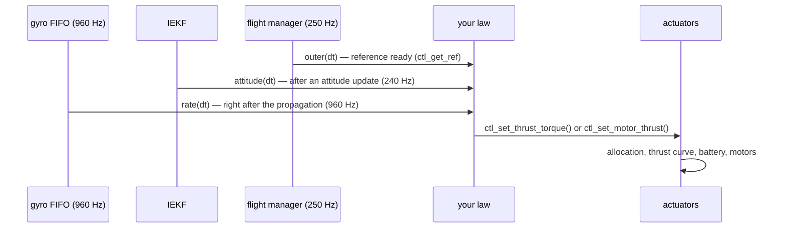

# Writing a control law

Firmware 0.12 separates the control law from the flight manager and from the actuators
([ADR 0013](../decisions/0013-control-law-interface.md)). A law is a table of five functions. It reads the
reference and the vehicle state with getters, and commands the drone with a setter. Everything is in
`App/control/ctl_api.h`; this page is the practical guide.

## The steps of a law



| Function | Called | Typical content |
|---|---|---|
| `init()` | when the law becomes active (boot, or `ctlLaw` changed while disarmed) | set up states, read parameters |
| `reset()` | right after `init()` | integrators to zero |
| `outer(dt)` | ~250 Hz, after the flight manager has written the reference | vertical and horizontal loops; `ctl_set_status()` |
| `attitude(dt)` | 240 Hz, after each attitude update | tilt / attitude loop |
| `rate(dt)` | 960 Hz, after each gyro propagation | body-rate loop; **one** command |

They all run in the ImuTask, one after the other: a law needs no lock. They must not block, allocate or print.

## What a law reads

| Getter | What |
|---|---|
| `ctl_get_ref(&ref)` | the reference: `armed`, `in_air`, `motors_off`, and per group what to do (below) |
| `ctl_get_attitude(q)` | quaternion body → world NWU, [w x y z] |
| `ctl_get_rates(w)` | body rates, rad/s, gyro bias removed (the latest rate step) |
| `ctl_get_yaw()`, `ctl_get_cos_tilt()` | heading (rad, + CCW), cosine of the tilt |
| `ctl_height_valid()`, `ctl_get_height()`, `ctl_get_vz()` | altitude estimate (m, m/s, + up) |
| `ctl_get_accel_up()` | world vertical acceleration, gravity and bias removed, 10 Hz low-pass |
| `ctl_vel_valid()`, `ctl_get_vel_body(v)` | horizontal velocity from the optical flow, body x forward, y left |
| `ctl_get_hover_thrust()` | normalised collective of the hover (ADR 0010 estimate) |
| `ctl_get_cell_voltage()` | V per cell under load (0 = unknown) |
| `ctl_get_level_trim(t)` | LEVEL calibration roll, pitch (rad) to subtract from the angle targets |
| `ctl_get_param(id)` | any parameter by id (HANDOVER_FW §8), NaN if unknown |

### The reference

| Group | Kind | Fields |
|---|---|---|
| attitude | `CTL_ATT_ANGLE` | `roll`, `pitch` (rad), `rate[2]` yaw rate |
| | `CTL_ATT_RATE` | `rate[0..2]` roll, pitch, yaw rate (ACRO) |
| vertical | `CTL_V_COLLECTIVE` | `collective` 0..1; if `vz_ceiling` < `CTL_NO_LIMIT`, limit the collective so the climb rate stays below it |
| | `CTL_V_CLIMB` | `vz_sp` m/s |
| | `CTL_V_HEIGHT` | `h_sp` m, at most `vz_up` up and `vz_dn` down |
| | (closed loop) | `vz_ceiling`: cut a positive climb rate to it (geofence); `thrust_max`: upper limit of the collective (take-off ramp) |
| horizontal | `CTL_H_NONE` | use the attitude group |
| | `CTL_H_VELOCITY` | `vel_sp[2]` m/s in the heading frame, zero = hold the point; `v_max` |
| all | | `tilt_max` rad |

## What a law commands

- `ctl_set_thrust_torque(collective, torque[3])`. Collective 0..1 and torques (roll, pitch, yaw), all in normalised
  thrust per motor. The quad-X mixer allocates them: roll and pitch first, then yaw, then the collective is moved
  (airmode).
- `ctl_set_motor_thrust(t[4])`. The thrust 0..1 of M1 rear right, M2 front right, M3 rear left, M4 front left, for
  a law with its own allocation. No idle floor and no priorities are applied.

In both cases the actuator layer applies the thrust curve (`thrCurve`) and the battery compensation, so thrust 0.5
is half the maximum thrust whatever the battery.

`ctl_set_status()` tells the flight manager the collective you command, the attitude targets in use, the climb rate
you ask and whether the collective is at your limit. The hover-thrust learning stops while it is.

### What you cannot override

The actuators apply these rules whatever your law does:
- nothing is written while disarmed;
- duty 0 with `motors_off`, or when a rate step brought no command;
- motors off when the rate steps stop for 50 ms;
- the motor test owns the outputs while disarmed.

The modes, the failsafes, the geofence and the arming checks are in the flight manager, upstream of you.

## A law, from scratch

```c
/* my_law.c — a minimal law: P on the body rates, collective from the reference */
#include "ctl_api.h"

static void my_init(void)  { }
static void my_reset(void) { }

static float s_coll;

static void my_outer(float dt)
{
    (void)dt;
    ctl_ref_t r; ctl_get_ref(&r);
    s_coll = (r.vert == CTL_V_COLLECTIVE) ? r.collective : ctl_get_hover_thrust();   /* no height loop here */
    ctl_status_t st = { s_coll, r.roll, r.pitch, 0.0f, 0u };
    ctl_set_status(&st);
}

static void my_attitude(float dt) { (void)dt; }

static void my_rate(float dt)
{
    (void)dt;
    ctl_ref_t r; ctl_get_ref(&r);
    float w[3]; ctl_get_rates(w);
    const float k = 0.02f;                                     /* torque per rad/s */
    const float tau[3] = { k * (r.rate[0] - w[0]), k * (r.rate[1] - w[1]), 2.0f * k * (r.rate[2] - w[2]) };
    ctl_set_thrust_torque(s_coll, tau);
}

static const ctl_law_t k_my_law = { "my_law", my_init, my_reset, my_outer, my_attitude, my_rate };

/* the weak hook of ctl_io.c: register your laws here; the first one is ctlLaw = 1 */
void ctl_user_laws(void) { (void)ctl_register(&k_my_law); }
```

Add the file to the project (CubeIDE compiles every file under `App/`; for the host tests add it to `SRC` in
`Tests/host/Makefile`), flash, set `ctlLaw` = 1 with the drone disarmed, and the next arm flies your law. Setting
`ctlLaw` back to 0 returns to `cascade_pid`.

## Testing a law on the host

The host tests feed the getters from a simulated vehicle and read the motor outputs back:

- `Tests/host/test_main.c` `test_ctl_api` is a template: it registers a probe law, selects it, and checks what it
  reads and what reaches the motors;
- `Tests/host/test_ctrl.c` (rotational plant) and `test_launch.c` (6-DOF plant) show how to close the loop around
  the attitude and the vertical dynamics.

A new law should pass the same closed-loop cases as `cascade_pid` (`ctrl_test`, `hover_test`, `pos_test`) before it
flies: step responses, disturbance rejection, saturation at both ends, the battery from 4.2 to 3.6 V.
