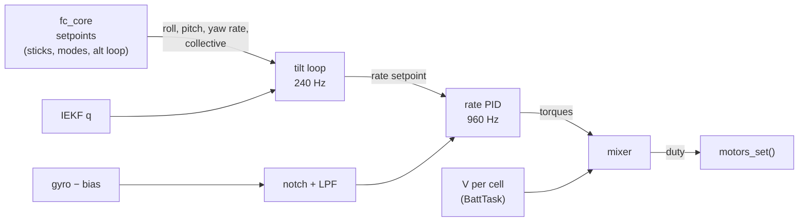

# Attitude control and mixer

Firmware 0.7.0 (phase 3). The flight core ([Flight core](flight-core.md)) decides *what* the drone should do and
publishes setpoints; this layer makes the motors do it. It runs in the ImuTask, the same task as the estimator and
the flight core, so there are no locks between them.

| File | Rate | What |
|---|---|---|
| `App/control/att_ctrl.c` | 240 Hz / 960 Hz | tilt loop (P) and body-rate loops (PID), gyro filters |
| `App/control/mixer.c` | 960 Hz | quad-X mixer: priorities, airmode, thrust curve, battery compensation |
| `App/app/ctrl_loop.c` | 240 / 960 / 250 Hz | glue: setpoints from `fc_setpoint()`, gains from the parameters, `motors_set()`, stall watchdog |

## Conventions

Body FLU, world NWU ([Vehicle model](../theory/vehicle-model.md)). Every setpoint of `fc_setpoint_t` is in FLU:

| Signal | + means |
|---|---|
| roll | right wing down |
| pitch | nose down (forward) |
| yaw rate | counter-clockwise seen from above; **the yaw stick to the right gives a negative rate** |

## Tilt loop (240 Hz)

The desired attitude is built from the roll and pitch setpoints around the **current** heading,
$R_d = R_z(\psi)R_y(\theta_{sp})R_x(\phi_{sp})$. The error is the rotation that brings the body $z$ axis onto the
desired one (reduced attitude): axis $z_b \times z_d$, angle $\operatorname{atan2}(\lvert z_b\times z_d\rvert,
z_b\cdot z_d)$, expressed in the body frame. The heading therefore never enters roll and pitch, and the loop is
well defined at any tilt.

$$\omega_{sp,xy} = k_{att}\,e_{xy},\qquad \lvert\omega_{sp,xy}\rvert \le 6\ \text{rad/s},\qquad \omega_{sp,z} = r_{sp}$$

Yaw is a rate command in every mode (no heading hold). In ACRO the stick rates go to the rate loop directly. The
LEVEL calibration trim is subtracted from the angle setpoints.

## Rate loop (960 Hz)

Per axis: gyro → notch (`gyroNotch`, off by default) → 2nd-order Butterworth low-pass (`gyroLpf`) → PID.

- P and I on the error, **D on the measurement** (no kick on setpoint steps), D low-passed (`dtermLpf`).
- The integrator runs only in the air, is clamped to ±0.15, and stops when the output is saturated in the direction
  of the error.
- Output: torque in **normalised thrust per motor**, clamped to ±0.5.

On the ground at idle (collective ≤ idle + 2 %) the torques are zero and the loops are reset: a drone armed on a
slope does not spin up one side.

## Mixer

Motor numbering as the app (HANDOVER_FW §10.7): M1 rear right CW, M2 front right CCW, M3 rear left CCW, M4 front
left CW.

| | roll | pitch | yaw |
|---|---|---|---|
| M1 RR | −1 | +1 | +1 |
| M2 FR | −1 | −1 | −1 |
| M3 RL | +1 | +1 | −1 |
| M4 FL | +1 | −1 | +1 |

Saturation keeps the attitude first: roll/pitch are scaled only if they alone do not fit in the span
$[t_{idle}, 1]$, then yaw gets the room left, then the collective is moved down at full throttle or up at low
throttle (airmode), so every motor keeps its share of the torque.

Each motor thrust $t_i$ (normalised, 0…1) becomes a duty through the inverse thrust curve and the battery
(ADR 0010 §1):

$$u_i = f^{-1}(t_i)\cdot\frac{4.2\ \text{V}}{V_{cell}},\qquad f(u) = \theta u^2 + (1-\theta)u$$

$V_{cell}$ is the sagged cell voltage of the BattTask (filtered 0.5 s). Without a battery monitor the factor is 1.
$\theta$ is `thrCurve` (1 for the brushed 8520 motors until the thrust stand says otherwise).

## Hover thrust

The collective of the vertical loop and of the manual modes is built around the **hover thrust** $\hat t_h$
(ADR 0010): the stick centre in ACRO/ANGLE, the base of `alt_ctrl` (its integrator only covers ±0.15 of model
error), the airborne test and the open-loop LAND.

- At every arm it starts from the parameter `hoverThr` (80), or from the estimate of an earlier flight of at least
  20 s in the same power cycle.
- In flight `hover_track.c` runs a 1-state Kalman filter (`hover_est.c`) at 50 Hz on the vertical acceleration
  (accelerometer bias removed, 10 Hz low-pass) and the collective of 36 ms earlier (motor lag), only while the model
  holds: airborne past the spool-up, ≥ 0.15 m above the floor, tilt < 30°, $\lvert v_z\rvert$ < 0.5 m/s, collective
  not saturated, below the ceiling. Impacts are rejected by an innovation gate.
- Outside 0.35…0.75 it sends EVENT 44 once; CHECKS item 13 warns when hovering needs more than 80 % of the thrust at
  the present voltage.

`make hover_test`: a ±30 % seed converges within 3 % in 0.6–0.7 s; a +15 g step in 2.0 s; a 4.2 → 3.5 V sag moves it
by at most 2.8 %; a 1 m/s climb by 0.3 %.

## Safety

- The motors are written **only while armed**. Disarmed, `motors_arm(0)` has stopped them, and a MOTOR_TEST owns
  the outputs.
- **Stall watchdog:** if the rate loop has not run for 50 ms while armed (IMU or estimator stopped), the motors are
  set to 0. A command frozen at its last value would fly the drone away. The IWDG (fed by the same task) resets the
  MCU if the whole task stops.
- `MOTORS_ENABLE` = 0 keeps the PWM off on the bench (props off) until the power stage is connected.

## Tuning

The starting gains come from the vehicle model: one unit of roll torque is about 1100 rad/s² on the 75 g frame, and
the rate loop crosses over near 20 rad/s, below the motor pole. They are parameters 90–99 (HANDOVER_FW §8), applied
at once, armed too, and shown in the app under Settings › Controls › Flight tuning.

1. Props off, armed on the bench: the motor outputs (MOTORS frame) react to the tilt with the right signs.
2. Tethered hover: raise `rateP` until a slight oscillation, then back by 30 %; `rateD` against the overshoot.
3. Set `gyroNotch` to the motor-noise peak of the flight log if the gyro is noisy.

## Tests

`make ctrl_test` (Tests/host) runs the loops and the mixer in closed loop with a rotational model of the quad
(inertia, four rotors with a 35 ms lag, thrust quadratic in the voltage, gyro noise):

- 20° roll and pitch steps settle within 1° in 0.54 s, 0.7° overshoot, at 4.2 V and at 3.6 V;
- pitch about the body axis at any heading; yaw rate and sign; ACRO without self-levelling;
- a constant disturbance torque removed by the integrator;
- mixer signs, airmode at both ends, roll/pitch priority over yaw, thrust curve, battery compensation;
- filters: 400 Hz attenuated by the 90 Hz low-pass, a 200 Hz notch.

`host_test` (`test_ctrl_loop`) runs `ctrl_loop.c` with the flight core: no output disarmed, idle armed on the
ground and on a slope, the stall watchdog, the yaw sign from the stick.
