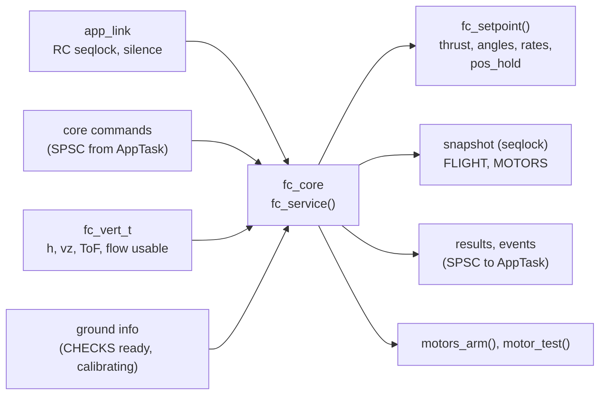
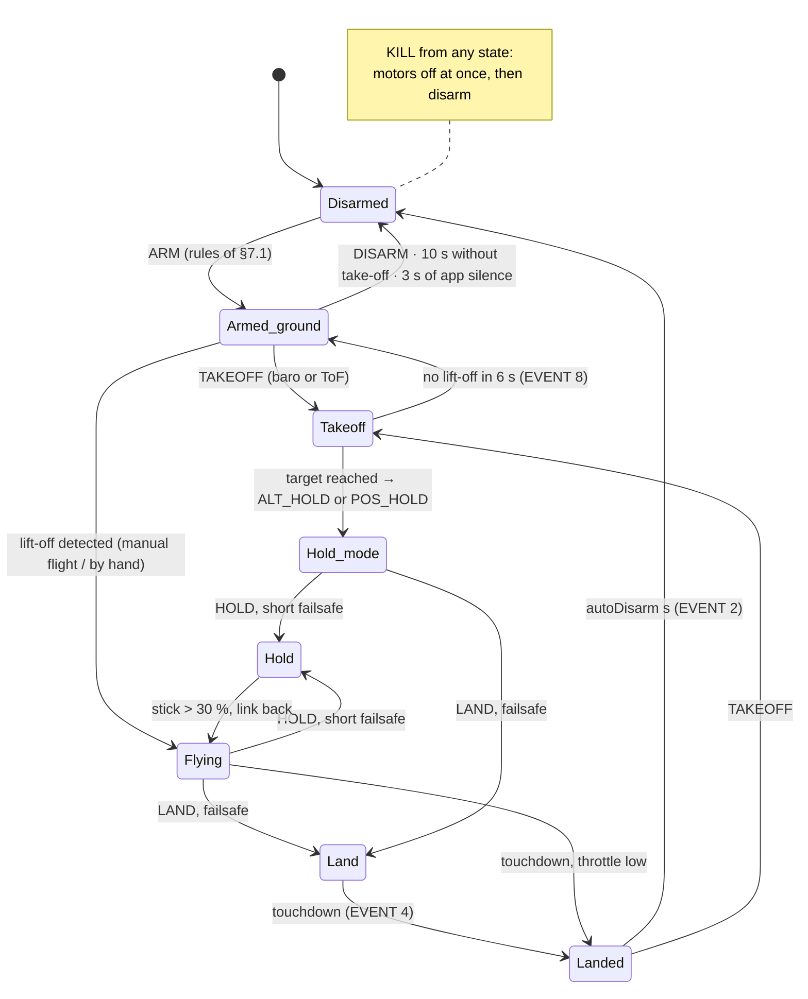
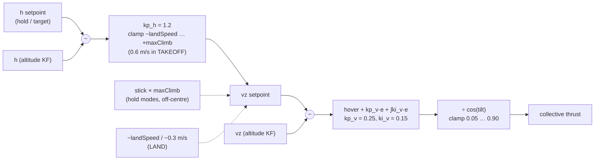

# Flight core

`App/control/fc_core.c` owns the flight state: arming, modes, automatic
actions (TAKEOFF, LAND, HOLD) and failsafes. It runs **only in the ImuTask**,
at about 250 Hz (`fc_service()`), with the attitude and the
[altitude estimate](../theory/altitude-kf.md) as inputs. It produces the
setpoints for the control loops of phase 3 (`fc_setpoint()`) and a state
snapshot for the AppTask. The module has no HAL and no RTOS, and is
host-tested against a vertical plant ([Testing](testing.md)).

## States

`Takeoff`, `Land` and `Hold` are the `auto` field of FLIGHT; `Hold_mode` is
ALT_HOLD or POS_HOLD with `auto` = NONE; `Flying` is ACRO or ANGLE.

## Arming

ARM is accepted only if every rule of §7.1 of the handover holds:

- the magic `A5 5A` is present;
- the drone is not armed, no calibration is running, and it is on the ground;
- the throttle is low on the active input: ≤ −900 in ACRO/ANGLE, ≤ +100 in
  ALT_HOLD/POS_HOLD, checked only if RC arrived in the last 0.5 s;
- the battery is not in FAIL;
- CHECKS are `ready` when `armRequireChecks` = 1.

On top of the handover, the core **never arms without a running attitude
estimate**, whatever `armRequireChecks` says. KILL is always executed, in any
state: motors off first, then the ACK, the disarm and EVENT 70.

## App-link failsafe

The silence is measured from the arrival time of the last CMD frame, which
the BLE thread stores, against `HAL_GetTick()`. A GAP disconnection counts as
at least the short silence, so it can only make the failsafe start earlier.

```mermaid
gantt
  title App silent while in the air (fsAppShort = HOLD, fsAppLong = land without GNSS)
  dateFormat  x
  axisFormat  %S s
  tickInterval 1second
  section RC
  last RC values used        :done, 0, 250
  neutral sticks (RC stale)  :active, 250, 6000
  section Action
  flying normally            :done, 0, 1000
  HOLD (short failsafe)      :crit, 1000, 3000
  LAND + EVENT 20 (long)     :crit, 3000, 6000
```

| Silence | Effect |
|---|---|
| > 0.25 s | RC stale: neutral sticks (level, no yaw rate, hold the height in the hold modes) |
| > 1 s | **short** failsafe (`fsAppShort`): HOLD (0) or LAND (1); FLIGHT.failsafe bit APP_LINK |
| > 3 s | **long** failsafe (`fsAppLong`): RTH (only with GNSS and home, else LAND), LAND or HOLD; EVENT 20, ERROR |
| < 0.5 s again | link back: the failsafe bit clears; a short HOLD gives control back, a long action is kept until the pilot changes mode |
| > 3 s on the ground, armed | disarm |

The motor test stops on any other command, at its timeout, or when the
silence exceeds 1 s.

## TAKEOFF, LAND, HOLD

- **TAKEOFF** needs `BARO` or `TOF` in CAPS (else `UNSUPPORTED/SENSOR_MISSING`),
  an altitude estimate that is ready, and the drone armed and on the ground.
  - The target is `alt` (0 = `takeoffAlt`), clamped to 0.5…3 m and below the
    ceiling.
  - The drone counts as in the air from the ACK on, as in the simulator.
  - Thrust ramps up from idle until lift-off (0.15 m above the ground level).
    The climb is then limited to 0.6 m/s.
  - At the target: `auto` = NONE and mode = POS_HOLD or ALT_HOLD, with
    EVENT 5. The throttle stick is ignored; pitch, roll and yaw are honoured.
  - **No lift-off within 6 s** (props off, motors not built, a stuck drone):
    the takeoff is aborted with EVENT 8 "Takeoff aborted: no lift-off" (WARN, a
    firmware extension). The drone stays armed at idle on the ground, and the
    10 s no-takeoff auto-disarm restarts.
- **LAND** descends at `landSpeed`, slowing to 0.3 m/s below 1 m when the ToF
  is valid. Touchdown is detected when a descent is commanded and the vertical
  speed stays below 0.12 m/s for 0.7 s close to the floor (1 s without ToF).
  Then come EVENT 4, `flags.LANDED`, and the auto-disarm after `autoDisarm`
  seconds.
- **HOLD** holds the current height. Moving a stick by more than 30 % gives
  control back.
- **ALT_HOLD / POS_HOLD**: the stick commands the climb rate (`maxClimb`), and
  the centre holds the height.
- **Setpoints** (`fc_setpoint()`): thrust, roll and pitch angles, rates and
  yaw rate for the attitude and rate loops of phase 3. **Until those loops and
  the motor outputs exist (`MOTORS_ENABLE = 0`) the thrust reaches no motor.**

## Height loop

`App/control/alt_ctrl.c`. The integrator learns the hover thrust, starting
from a guess of 0.45. It integrates only when the output is not saturated in
the direction of the error, so it does not wind up. During the take-off
spool-up the ramp (0.1 + 0.4·t) is the upper limit of the controller itself,
so the integrator does not wind up against the ramp either. Near the ceiling
the climb is stopped and the height setpoint clamped (EVENT 23, arg 0 =
altitude, 1 = ToF ceiling).

## Testing on the bench

Without motors (NUCLEO + IKS4A1: the barometer is on the
shield). Arm from the app (set `armRequireChecks` = 0, or calibrate the
accelerometer first), then send TAKEOFF:

- **lift the board by hand** more than 15 cm: lift-off is detected;
- at the target height `auto` goes back to NONE in ALT_HOLD;
- LAND, then **put the board down**: touchdown is detected and the board
  disarms after 2 s;
- leave it on the table instead: after 6 s you get EVENT 8.

Without any altitude sensor, `g_fc_dbg_in_air` (Live Expressions) still forces
"in the air" for the failsafe tests.
