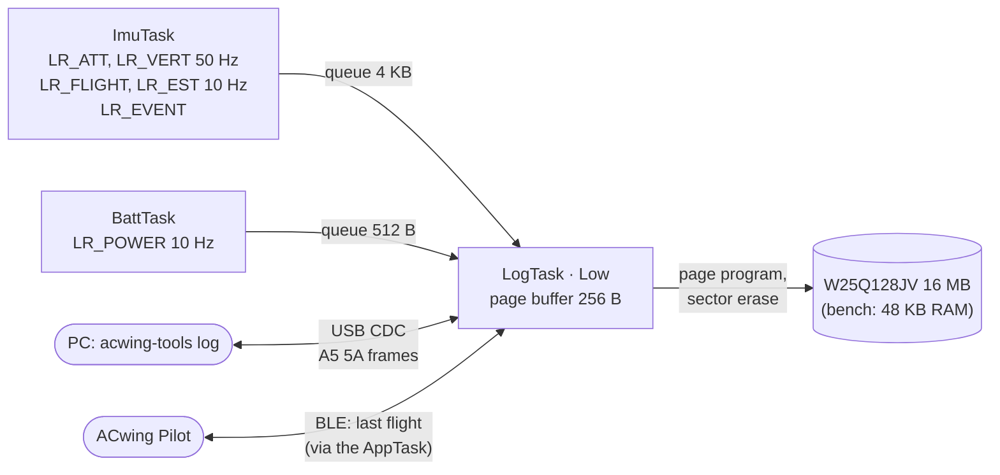

# Flight log and USB download

The firmware records a flight log in the external NOR flash and sends it to
the PC over the FC's USB port. Recording and download are done by the
**LogTask**; the other tasks only put records in a queue.

| What | Where |
|---|---|
| On-flash format (shared with the PC decoders) | `App/log/log_format.h` |
| Sector ring store | `App/log/log_store.c` |
| Record queues, record builders | `App/log/log_queue.c`, `App/log/log_feed.c` |
| LogTask: recording policy, USB commands | `App/app/log_task.c` |
| W25Q128JV driver | `App/drivers/w25q/w25q.c` |
| RAM "flash" for the bench | `App/log/log_flash_ram.c` |
| USB link (framing) and CDC binding | `App/telemetry/usb_link.c`, `App/bsp/usb_cdc.c`, `App/bsp/usb/` |
| PC: download and decode | `acwing-tools log …` (Python, USB or BLE), `acwingLogDownload` (USB) / `acwingLogDecode` (MATLAB) |

## Data path



- **Producers never block.** Each producing task has its own lock-free
  single-producer single-consumer byte ring. A record goes in whole or not
  at all; when a ring is full the record is counted as lost, and the LogTask
  writes an `LR_DROP` record with the count.
- **Rings sized for the erase.** A sector erase takes 45 ms typical, 400 ms
  at most. The ImuTask ring holds about 1.2 s of records (≈ 3.2 kB/s), so an
  erase does not lose data.
- **The LogTask is the only owner** of the flash and of the store: no locks.
  It runs at `osPriorityLow`, every 10 ms (1 ms while a download runs). On the
  ACwing FC the flash shares SPI1 with the IMU: the driver keeps every bus
  transaction short (a sector erase is one command followed by status polls),
  so the IMU waits at most one page transfer.

## Recording policy

| logMode (param 70) | Behaviour |
|---|---|
| 0 | off |
| 1 (default) | one log per flight: from ARM to 1 s after DISARM |
| 2 | one log per power-on, always recording |

- Records produced before the log opens are discarded, except the events: the
  last 8 events (≤ 2 s old) are written right after `LR_INFO`, so the ARMED
  event is in the log although the log opens a few milliseconds after it.
- **USB has priority.** Any command from the PC closes the open log and
  pauses recording for 5 s after the last command, so a download never reads
  a log that is still being written.
- The rate is about **3.4 kB/s**: 16 MB hold about 80 minutes. When the flash
  is full the oldest sectors are erased and reused.

## On-flash format (format 1)

The flash is a **ring of 4 KB sectors**. A log is a run of consecutive
sectors. Every sector starts with a header:

| Offset | Type | Field |
|---|---|---|
| 0 | u32 | magic `0x474C4341` ("ACLG") |
| 4 | u32 | serial: global sector counter, the newest sector has the highest |
| 8 | u16 | log id |
| 10 | u16 | sequence of the sector in the log (0 = first) |
| 12 | u32 | uptime when the log started, ms |
| 16 | u8 | format (1) |
| 17 | u8 | reserved |
| 18 | u16 | CRC-16/CCITT-FALSE of bytes 0–17 |

Then records, until the end of the sector or the first `0xFF` (erased):

```text
[type u8][len u8][payload: len bytes][crc8]      CRC-8/SMBUS over type, len, payload
```

A record never crosses a sector. All values are little-endian.

| Type | Record | Rate | Content |
|---|---|---|---|
| `0x01` | INFO | first record | firmware, board, format, start time, CAPS sensors |
| `0x10` | ATT | 50 Hz | quaternion (×32767), gyro (mrad/s), acc (mg) |
| `0x11` | VERT | 50 Hz | h, vz, height and climb set points, thrust, ToF, flow quality, pressure, flags |
| `0x12` | FLIGHT | 10 Hz | armed, mode, automatic action, failsafe bits, flags, sticks, app-link silence |
| `0x13` | EVENT | on event | level, code, argument (same codes as the EVENT frame) |
| `0x14` | EST | 10 Hz | gyro bias, attitude uncertainty, vibration, loop rate, jitter, CPU, magnetic interference |
| `0x20` | POWER | 10 Hz | vbat, current, mAh, cell (sagged and at rest), %, level, R per cell, cells, present |
| `0x7F` | DROP | when records were lost | count, producer |

The exact layouts are the packed structs of `log_format.h`, checked with
`_Static_assert`; the Python and MATLAB decoders follow them.

## The store

- **Mount** (at boot): the store reads the 20-byte header of every sector
  once (4096 headers on the W25Q128, about 0.1 s), finds the newest sector by
  its serial, and rebuilds the list of logs from the oldest. The next write
  goes to the sector after the newest.
- **Writing**: records are packed into a 256-byte page buffer; a full page is
  programmed at once. A new sector is erased just before use. A log always
  starts on a new sector.
- **Power loss** loses at most the page in RAM. The record cut at the last
  programmed page fails its CRC and the reader skips it; the log stays
  readable.
- **Wrap**: erasing the oldest sector shortens the oldest log, which becomes
  *truncated* (its first sector is gone, the rest still decodes); a log that
  loses all its sectors disappears from the list. A log that would overwrite
  its own first sector is closed.
- **Erase**: LOG_ERASE erases the sectors that hold data (or the whole chip
  when the driver offers it); log ids restart from 1.

## USB link

The FC enumerates as a **USB CDC virtual COM port** (ST's development VID/PID
0x0483/0x5740, so the standard drivers bind on every OS). The baud rate set
by the PC is ignored. Both directions carry protocol v2 frames
(`A5 5A | TYPE | LEN | PAYLOAD | CRC16`):

- PC → drone: type `0x20` **CMD**, payload `op, seq, args` (the same bytes as
  a BLE command write);
- drone → PC: `0x10` LOG_ENTRY, `0x11` LOG_DATA, `0x0E` ACK.

| Command | Op | Arguments | Answer |
|---|---|---|---|
| LOG_LIST | `0x50` | – | one LOG_ENTRY per log, then ACK |
| LOG_READ | `0x51` | id u16, offset u32, length u32 (0 = to the end) | LOG_DATA frames (id u16, offset u32, ≤ 240 bytes), then ACK |
| LOG_ERASE | `0x52` | `"WIPE"` | ACK IN_PROGRESS, then ACK when done |

LOG_ENTRY: id u16, index u8, count u8, flags u8 (bit 0 truncated, bit 1 being
written), sectors u16, start time u32 (ms after power-on), bytes u32.

The ACK always comes **after** the data, so it means "complete". LOG_READ and
LOG_ERASE are refused with `ARMED` while armed; an unknown id is
`INVALID / OUT_OF_RANGE`; a board without log flash answers
`REJECTED / SENSOR_MISSING`. Other opcodes are `UNSUPPORTED`: the USB link
carries only the log commands for now. The parser resynchronises after a bad
CRC, so a corrupted frame does not swallow the next command.

CAPS bit 11 FLASH_LOG is set when a log store is mounted, and SYSTEM.log is
the percentage of sectors in use.

## Over Bluetooth: the last flight

The same LOG_LIST and LOG_READ work over BLE, on every platform the app runs
on (iOS included, where USB is not available), limited to **the last
flight**:

- the commands are written raw to the CMD characteristic (`op, seq, args`);
  the AppTask, which owns the BLE rings, forwards them to the LogTask through
  an SPSC queue, and moves the answers (LOG_ENTRY, LOG_DATA, ACK) to the HI
  ring through a second queue;
- LOG_LIST lists only the newest log; LOG_READ accepts only that log
  (`REJECTED / OUT_OF_RANGE` otherwise); LOG_ERASE is `UNSUPPORTED`;
- both are refused while armed, and arming stops a running download;
- log frames may fill the HI ring up to 60 %, so ACKs and events keep their
  room; while a download runs, the STATE stream (LO ring) is starved.

At a few kB/s up to ~20 kB/s (depending on the phone), a 5-minute flight
(about 1 MB) takes 1–3 minutes. The whole memory and the erase stay on USB,
which is about 50 times faster. From a PC: `acwing-tools log get --ble`.

## On the PC

```bash
acwing-tools log list --port /dev/ttyACM0          # COM7 on Windows
acwing-tools log get --port /dev/ttyACM0           # all logs -> acwing_flight_<id>.bin
acwing-tools log get 12 13 --port COM7 --out-dir logs
acwing-tools log decode logs/acwing_flight_00012.bin --csv out --mat out
acwing-tools log erase --port COM7 --yes
acwing-tools log get --ble                         # the last flight over Bluetooth (needs bleak)
```

`decode` prints a summary (duration, battery from start to end, minimum cell,
mAh, events) and writes one CSV per record type and/or a `.mat` file (variable
`F`). In MATLAB:

```matlab
run('<repo>/02 - Tools/00 - Matlab/initPath.m')
files = acwingLogDownload('COM7', 'all', 'logs');
F = acwingLogDecode(files{end});
plot(F.power.t, F.power.cell), hold on, plot(F.vert.t, F.vert.h)
```

The Python and MATLAB decoders give the same numbers on the same file.

## Status and limits

- **Bench**: the NUCLEO-WB55 has no log flash. The log goes to a 48 KB RAM
  area (about 14 s), lost at power-off: enough to test the whole chain
  (recording, USB download, decoding). The USB port is the **USB_USER**
  connector of the Nucleo board.
- **ACwing FC rev A**: the W25Q128JV driver is written and tested against a
  simulated chip; its SPI1 binding (shared with the IMU, CS on PE4) comes with
  the rev A port, together with the IMU on SPI.
- **Not run on hardware yet**: the USB CDC device (ST USB device library
  2.11.6, HSI48 trimmed by the CRS on the USB SOF) and the ADC binding.
- **The app**: ACwing Pilot has a Flight logs screen (Settings › Drone &
  firmware): the last flight over BLE on every platform, every log and erase
  over USB through Web Serial (Chrome/Edge on PC and Mac, Android Chrome), a
  viewer and `.bin`/CSV export identical to the Python tools. Tested against
  the app's simulator and the firmware test vector, not yet against a board.
  USB inside the native Android app is still open (needs a USB-serial plugin);
  see [`HANDOVER_APP.md`](https://github.com/andrea-cirillo/ACwing_FlightController_FW/blob/main/02%20-%20Tools/02%20-%20App/HANDOVER_APP.md).
