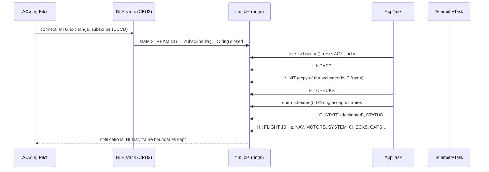
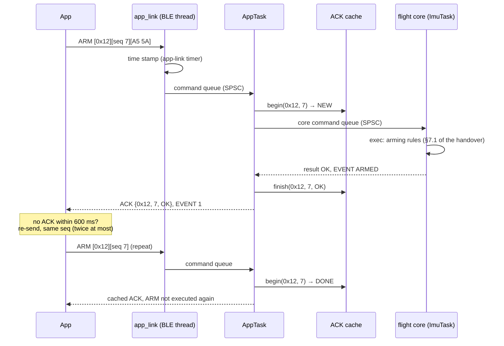

# ACwing Pilot protocol v2

The **ACwing Pilot** app (`02 - Tools/02 - App/`) talks to the drone with
protocol v2. The contract is
[`HANDOVER_FW.md`](https://github.com/ACwing-UAV/ACwing_FW/blob/main/02%20-%20Tools/02%20-%20App/HANDOVER_FW.md),
and the app simulator `src/sim/simDrone.ts` is the reference for behaviour.

Protocol v2 only **adds** frames `0x05…0x0F` and commands `≥ 0x10` on the GATT
service of [BLE telemetry](ble.md). The phase-2 frames, the legacy commands
and the PC tools are unchanged; the PC tools ignore the new frame types.

The code is in `App/app/app_task.c` (dispatcher, frames, flash), in
`App/telemetry/` (`proto_v2`, `app_link`, `ack_cache`, `tlm_ble`) and in the
[flight core](flight-core.md).

## Frames sent by the drone

| Type | Frame | When | Source |
|---|---|---|---|
| `0x05` | CAPS | on subscribe, on REQUEST, every 5 s, when a sensor appears | AppTask |
| `0x06` | FLIGHT | 10 Hz (STREAM_RATES 1–20) | flight-core snapshot |
| `0x07` | POWER | 5 Hz (STREAM_RATES 1–10), on REQUEST; only on boards that measure the battery | BattTask snapshot, see [Battery](battery.md) |
| `0x08` | NAV | 5 Hz, also on indoor models (baro, ToF, flow quality; `fix = 0xFF`) | estimator snapshot |
| `0x09` | MOTORS | 5 Hz | flight-core snapshot |
| `0x0A` | SYSTEM | 2 Hz | estimator snapshot (loop rate, jitter, CPU, vibration, attitude uncertainty, magnetic interference) |
| `0x0B` | EVENT | on event; ERROR and CRITICAL sent 3 times, 100 ms apart | flight core, AppTask |
| `0x0C` | PARAM | answer to PARAM_GET/SET/LIST/SAVE/DEFAULTS, lists paced to the TX ring | AppTask |
| `0x0D` | CALIB | 10 Hz while a calibration is active, and on every state change | calib_mgr |
| `0x0E` | ACK | one per command with a sequence number | AppTask |
| `0x0F` | CHECKS | 2 Hz disarmed, 0.5 Hz armed, on REQUEST | checks |

The payload layouts are packed C structs in `telemetry/proto_v2.h`, checked by
`_Static_assert`. The host test checks them byte for byte against the app's own
encoders and decoders (see [Testing](testing.md)).

## Connection: subscribe order

The app always learns what the drone can do (CAPS) and the filter
configuration (INIT) before the first periodic frame.

## Commands and ACKs

Commands are `[op][seq][payload]`, at most 20 bytes, written without
response on the CMD characteristic. RC (`0x11`) and HEARTBEAT (`0x10`) have no
ACK; every other command gets **exactly one** ACK.

- **ACK cache** (`ack_cache.c`, 32 entries, the handover asks ≥ 16). A repeat
  of a command still running (PENDING) is ignored, since its ACK is on the
  way. A repeat of a finished one gets the cached ACK again. A repeated ARM,
  TAKEOFF or MOTOR_TEST can never run twice.
- **Core commands** (ARM, DISARM, TAKEOFF, LAND, RTH, HOLD, KILL, SET_MODE,
  MOTOR_TEST) go to the flight core and are executed in the ImuTask. While
  one is pending, the AppTask takes no new command (at most one control cycle,
  4 ms).
- **Local commands** (parameters, calibrations, requests, name) run in the
  AppTask. Any of them stops a running motor test first, as the handover asks.
- Unknown opcode → `UNSUPPORTED`; a payload that is too short or has a bad
  magic → `INVALID`.

## BLE rings and priorities

Two rings of 2 KB feed the TX thread (`telemetry/tlm_ble.c`). The thread
drains **HI** first and switches ring only at a frame boundary, so a frame is
never interleaved with another. Each frame type may be queued only up to a fill
level, so that the important frames always find room:

| Frame types | Ring | Admitted up to |
|---|---|---|
| ACK, EVENT, CAPS | HI | 100 % |
| CALIB, PARAM, INIT, STATUS | HI / LO | 85 % |
| FLIGHT, CHECKS | HI | 70 % |
| POWER, NAV | HI | 55 % |
| STATE | LO | 50 % |
| MOTORS, SYSTEM | HI | 45 % |

Parameter lists are paced: the AppTask sends the next PARAM only while more
than 256 bytes are free in the HI ring, so a list never pushes out an ACK.

## What is implemented, and what is reported as missing

| Area | Implemented | Reported honestly as missing (as §15 of the handover asks) |
|---|---|---|
| Frames | CAPS (sensor bits detected at run time, cells), FLIGHT 10 Hz, POWER 5 Hz, NAV 5 Hz (also indoor: baro, ToF, flow quality), MOTORS 5 Hz, SYSTEM 2 Hz (with the flash log %), CHECKS 2 Hz (0.5 Hz armed), CALIB, EVENT (ERROR and CRITICAL sent 3 times, 100 ms apart), PARAM, ACK | POWER only where the battery is measured (ACwing FC; not on the bench by default): elsewhere `REQUEST(POWER)` returns `UNSUPPORTED` |
| Commands | ACK cache of 32 entries: a repeat gets the cached ACK and is not executed again. ARM, DISARM, KILL, SET_MODE, TAKEOFF, LAND, HOLD, PARAM_*, CAL_*, MOTOR_TEST (behind `MOTORS_ENABLE`), STREAM_RATES, REQUEST, SET_NAME | RTH → `NO_GPS`. MOTOR_REVERSE and MOTOR_REMAP → `UNSUPPORTED` |
| Parameters | the full ids.ts table; A/B flash pages with seq + CRC32; save allowed only when disarmed | – |
| Calibrations | ACCEL (6 positions), LEVEL, GYRO, COMPASS (ellipsoid fit, 36-sector coverage), BATTERY (voltage and current scales), each with one backup per type (CAL_RESTORE) | FLOW_TOF → `UNSUPPORTED` while the board is present. STICKS, MOTORS → `SENSOR_MISSING`; BATTERY too without CAPS CURRENT |
| Failsafes | app link (RC stale 0.25 s, short 1 s, long 3 s with EVENT 20, link back 0.5 s, ground disarm 3 s), geofence ceiling (gfMaxAlt, gfCeiling with ToF), flow lost in POS_HOLD, battery (LOW / CRITICAL → LAND / EMERGENCY → locked LAND, events 30/31/32/22) | radio, GNSS: no hardware yet. Battery RTH needs GNSS: LAND instead |

## Parameters and flash

- The table is the same as `ids.ts` (`App/app/params.c`): ids, defaults,
  ranges and the sensor each parameter needs. Parameters whose sensor is
  missing are not listed. PARAM_SET checks the range and the battery
  thresholds' order (warn > crit > emergency), and changes RAM only (flag
  *dirty*).
- PARAM_SAVE, CAL_SAVE, CAL_RESTORE and SET_NAME write one **flash image**
  (`App/app/cfg_store.c`): parameters, name, calibrations, one backup per
  calibration type, and the charge of the last flight (for the BATTERY
  calibration, written at disarm). Since firmware 0.5.0 (image version 2) the
  parameters are stored **by id**, with room for 48: new parameters need no
  migration. A version-1 image (0.4.x) is converted at boot, keeping the
  parameters, the name and every calibration. There are two pages used alternately (A/B), each image
  with a sequence number and a CRC32, so a reset during a write leaves the
  previous image valid. All of these are refused while armed.
- On the WB55 the write is coordinated with CPU2 (`bsp/cfg_flash_wb.c`): the
  flash semaphore is taken, and the erase starts only when CPU2 allows it, as
  ST requires while the radio runs.

## Calibrations

`App/control/calib_mgr.c` runs in the AppTask. The ImuTask sends raw samples
(calibration removed) only while a calibration needs them, and takes the
result when it is DONE.

| Type | Procedure | Result |
|---|---|---|
| ACCEL | six positions in any order, 2 s still window each | per-axis offset and scale (FAILED outside 0.9–1.1 or offset > 0.25 g) |
| LEVEL | 5 s average of roll and pitch, the board still | trim = − measured (CAL_SET_REF ≤ 5°) |
| GYRO | 5 s still window; movement restarts it, more than 3 restarts → FAILED | bias |
| COMPASS | 36-sector coverage in 3 rings, 6-parameter axis-aligned ellipsoid fit | hard iron + per-axis scale, quality and interference |

ACCEL and COMPASS restart the attitude estimator, because the gravity and
field references change; GYRO moves the IEKF bias by the same amount. BATTERY
(multimeter voltage, then the charge put back by the charger) is described in
[Battery](battery.md#battery-calibration-106). FLOW_TOF is `UNSUPPORTED` for
now; STICKS and MOTORS are `SENSOR_MISSING`.

## Firmware extensions

Additions that the handover does not list yet. The app knows the parameters
and the events; the log download over USB and the rest of the app work are
described in
[`HANDOVER_APP.md`](https://github.com/ACwing-UAV/ACwing_FW/blob/main/02%20-%20Tools/02%20-%20App/HANDOVER_APP.md).

| Kind | Id | Meaning |
|---|---|---|
| EVENT | 8 TAKEOFF_ABORTED (WARN) | no lift-off within 6 s: back on the ground, motors at idle |
| EVENT | 33 BATTERY_MONITOR_LOST (ERROR) | the BattTask stopped: battery unknown, ARM refused |
| PARAM | 23 battCapacity (mAh, 0 = unknown) | coulomb counting and POWER.remain |
| PARAM | 24 battCells (0 = detect) | forces the cell count |
| PARAM | 70 logMode (0 off, 1 armed, 2 always) | flight log, listed with CAPS FLASH_LOG |
| Command | 0x50 LOG_LIST, 0x51 LOG_READ, 0x52 LOG_ERASE | USB: every log; BLE: LIST and READ of the last flight only, ERASE unsupported. See [Flight log and USB](logging.md#over-bluetooth-the-last-flight) |
