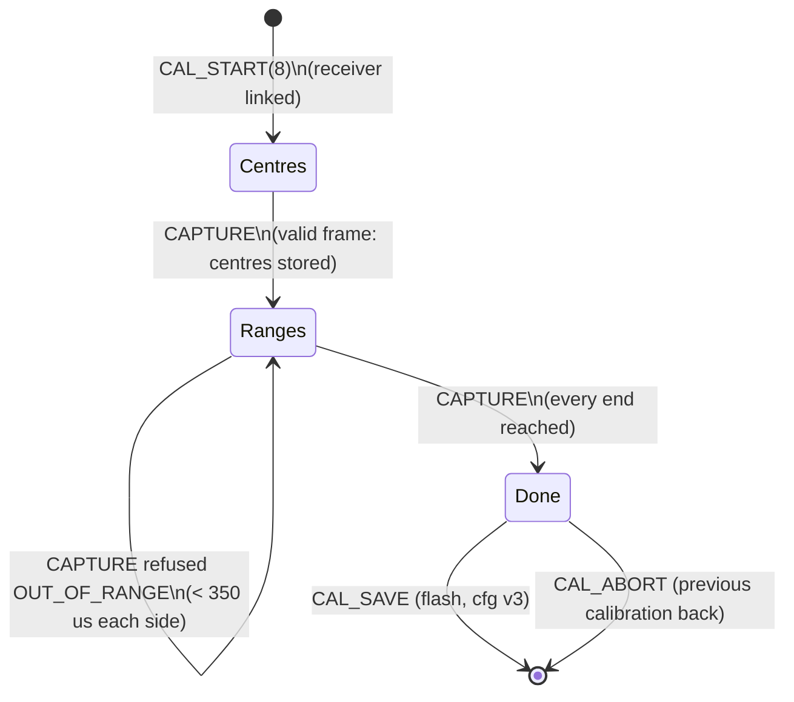
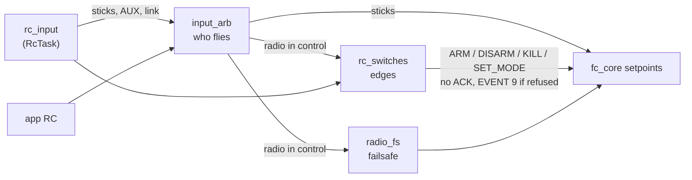

# RC receiver

Firmware 0.8.0. The drone can be flown by a radio transmitter through a receiver on the flight controller, as well
as by the app. This page covers the input (protocols, channels, link state), the STICKS calibration, the switches,
the arbitration between the radio and the app and the radio failsafe (HANDOVER_FW §6).

| Module | What |
|---|---|
| `App/drivers/rc/rc_crsf.c`, `rc_sbus.c`, `rc_ibus.c`, `rc_dsm.c` | one parser per protocol, byte by byte |
| `App/control/rc_input.c` | protocol selection, channel map, normalisation (with the STICKS calibration), failsafe, staleness, link statistics; published with a sequence counter |
| `App/control/cal_sticks.c` | STICKS calibration procedure (centres, ranges, AUX positions), driven by `calib_mgr.c` |
| `App/control/input_arb.c` | who flies: the app or the radio |
| `App/control/radio_fs.c` | radio failsafe |
| `App/control/rc_switches.c` | arm switch (AUX1), mode switch (AUX2) |
| `App/bsp/rc_uart.c` | USART1, receive-to-idle in interrupt, lock-free ring |
| `App/app/rc_task.c` | **RcTask**: the receiver and nothing else (2 ms) |

## Wiring

**ACwing FC rev A:** USART1, PB6 TX / PB7 RX → connector **J5**. With the receiver on USART1 the PC telemetry no
longer goes out on the UART (`APP_TLM_UART` 0): the USB port carries it (`APP_USB_TLM`).

**NUCLEO-WB55 bench:** USART1 is the ST-LINK virtual COM port. A receiver needs the ST-LINK VCP solder bridges
opened and `APP_RC_UART` 1; by default the bench has no receiver.

## Protocols (parameter `rcProtocol`, 100)

| Value | Protocol | Serial | Receivers (examples) |
|---|---|---|---|
| 1 | **CRSF** | 420 kbaud 8N1 | ExpressLRS of any brand (RadioMaster, BetaFPV, Happymodel, Jumper, iFlight), TBS Crossfire / Tracer |
| 2 | **SBUS** | 100 kbaud 8E2, **inverted** (the UART inverts RX) | FrSky ACCST/ACCESS (X8R, R-XSR, Archer), Futaba FASST/FHSS, RadioMaster / Jumper / FlySky SBUS receivers |
| 3 | **i-BUS** | 115200 8N1 | FlySky FS-iA6B, FS-iA10B, FS-X6B |
| 4 | **DSM** | 115200 8N1 | Spektrum DSM2 / DSMX serial satellites |
| 0 | none | – | – |

Changing the parameter reopens the UART with the new settings (RcTask, within 0.2 s).

Not supported yet: FrSky F.Port and SmartPort telemetry, Spektrum SRXL2, ImmersionRC Ghost (GHST), CRSF telemetry
back to the transmitter.

## Channels

- Order (`rcMap`, 101): **AETR** (roll, pitch, throttle, yaw: ExpressLRS, Crossfire, FrSky) or **TAER** (throttle,
  roll, pitch, yaw: most Spektrum, Futaba, FlySky). AUX1–AUX4 are the next four channels.
- Sticks are normalised to the app's RC scale: −1000…1000, throttle −1000 at the bottom, pitch + forward, yaw +
  right; 1500 µs is the centre, 1000/2000 µs the ends until the STICKS calibration is saved.

## STICKS calibration

With a calibration each stick is scaled around its own centre, $s = 1000\,(u-c)/(u_{max}-c)$ above the centre and
$1000\,(u-c)/(c-u_{min})$ below, clamped to ±1000; the throttle linearly over $[u_{min}, u_{max}]$. Offsets of the
transmitter trims and end points shorter than 1000/2000 µs are therefore removed. The threshold of 350 µs each side
refuses a calibration made with the sticks moved only part of the way (a full deflection would be scaled beyond
1000, the stick saturated over most of its travel). The AUX channels are not scaled; the calibration only reports
how many positions each switch has (`auxPos`).

## Switches

| Channel | Use | Parameter |
|---|---|---|
| AUX1 | arm switch: off → on arms (if seen off before), on → off disarms on the ground, kills in the air | `rcArmSwKill` (102) |
| AUX2 | flight mode, 3 positions (2-position: low/high) | `rcModeMap` (103), **off by default** |

Edges only, acting only while the radio has control; refusals are EVENT 9 (HANDOVER_FW §6, §11).

## Link state

| Protocol | Lost link | Link quality |
|---|---|---|
| CRSF | no channel frame for 250 ms, or LQ 0 in the link statistics | uplink LQ, RSSI, SNR, transmitter power from the link statistics |
| SBUS | the failsafe flag, or no frame for 250 ms | 100 − % of frames the receiver lost (over 100 frames) |
| i-BUS, DSM | no frame for 250 ms (set the receiver failsafe to "no pulses") | 100 while frames arrive |

The AppTask reports it: CAPS sensor bit 9 once a receiver has been seen, the SYSTEM frame link fields (LQ, RSSI,
SNR, packet rate, transmitter power), CHECKS item 6 (WARN below 70 % or with the link lost).

## Tests

`make rc_test`: the STICKS procedure and scales, the switches (edges, switch on at power-up, take-over, link loss,
kill, mode maps), each parser on frames built as the receivers send them (CRSF CRC, SBUS flags and resync after noise,
i-BUS checksum, DSMX 2048 and DSM2 1024 with the frame gap), the channel maps, the scales, failsafe, staleness,
SBUS link quality, the restart after a pause. `host_test` feeds a CRSF receiver to the AppTask: CAPS, SYSTEM and
CHECKS item 6, and runs the switches through the flight core (arm, disarm, kill, refusals as EVENT 9, mode maps).
`power_test` runs the STICKS calibration through the CALIB protocol and the v2 → v3 image migration. The UART
binding (`rc_uart.c`) has **not been run on hardware**.
