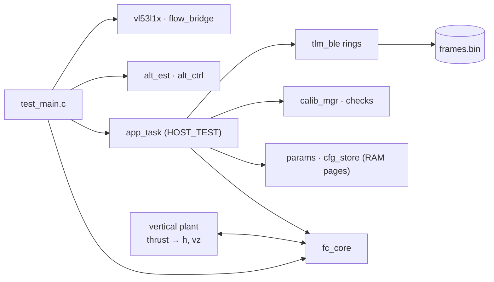

# Testing

The firmware logic is written so that it can run on a PC: the flight core, the
estimators, the drivers and the protocol have no HAL and no RTOS. These are
the tests that run without a board, and what each one proves.

| Suite | Command | Checks | What it covers |
|---|---|---|---|
| FC host tests | `make` in `00 - FC_FW/Tests/host` | 93 | flight core, failsafes, TAKEOFF/LAND, altitude filter, drivers, AppTask protocol, BLE rings |
| ExtTask, end to end | same `make` (`ext_test`) | 12 | Qwiic probing and polling, with the real bridge logic of `01 - FLOW_FW` |
| Flow bridge | `make test` in `01 - FLOW_FW` | 22 | register map against the FC driver, I²C target protocol, PMW3901 sequences |
| Frames vs app decoders | `frames.bin` from the FC host test, decoded by the app (`src/protocol`) | every v2 frame | byte-for-byte layout of CAPS, FLIGHT, NAV, MOTORS, SYSTEM, EVENT, PARAM, CALIB, ACK, CHECKS |
| Python tools | `pytest` in `02 - Tools/01 - Python` | 26 | parity of the Python filters and parsers with MATLAB |
| Firmware builds | CubeIDE / `arm-none-eabi-gcc` | – | the FC firmware (include paths and defines from `.cproject`) and the Flow firmware (`make`) |

The C suites build with **AddressSanitizer and UBSan**, so an out-of-bounds
access or an undefined shift fails the test, not only a wrong value.

## FC host tests

They cover:

- the ACK cache;
- TAKEOFF rules: no altitude sensor, not armed, no lift-off within 6 s, a
  second TAKEOFF;
- TAKEOFF → hold 1 m → LAND → auto-disarm, against a simple vertical plant.
  This checks the climb rate, the overshoot and the `autoDisarm` timing;
- the indoor model:
  - POS_HOLD at the target, and the slow landing below 1 m;
  - flow lost, and the ceiling;
  - no FLOW_LOST and no position hold below 80 mm, at take-off and landing;
- the app-link failsafe timings (short at 1 s, long at 3 s, then landing and
  disarm), with BLE silent, and the GAP disconnect;
- the altitude filter:
  - baro only;
  - baro + ToF with a baro drift;
  - re-anchoring on a step;
  - the "on the ground" reading;
  - the vertical acceleration at rest and tilted;
- the VL53L1X driver against a register model, and the flow-bridge decoder;
- the AppTask protocol:
  - the subscribe order CAPS → INIT → CHECKS, and the rates;
  - PARAM_SET repeated with the same seq, executed once;
  - PARAM_SAVE and a reload from flash;
  - ARM blocked by CHECKS;
  - TAKEOFF with the saved `takeoffAlt`;
  - KILL with EVENT 70 sent 3 times;
  - REQUEST, SET_NAME, a Flow board plugged in late, a flash error reported;
- the CHECKS flow item on the ground and in the air;
- HI/LO ring priority: an ACK right after a half-sent STATE frame, and HI
  frames accepted while LO is full.

## ExtTask end to end

`ext_test` runs `app/ext_sens.c` with a VL53L1X register model and, for the
flow, the **real bridge firmware logic** (`01 - FLOW_FW/Core/Src/bridge.c`).
The bridge sits behind a simulated I²C bus, reached through the FC
`flow_bridge` driver. The test covers:

- the probe at 0 s and 5 s, with nothing plugged;
- a board plugged in at 7 s and found at 10 s;
- ToF samples on data ready;
- flow frames every cycle, with motion only when new;
- status-only frames when the sensor is below its minimum height;
- a ToF lost after 50 errors and found again.

If the FC driver and the bridge firmware ever disagree on the register map or
the latch semantics, this test fails.

## Cross-check with the app

The FC host test writes every frame the AppTask sends to `frames.bin`. To
check the layouts against the app:

1. parse the stream with the app's `StreamParser`
   (`02 - Tools/02 - App/src/protocol/frame.ts`);
2. decode each frame with `decodeFrame()`;
3. re-encode it with the matching `encode*()`.

The bytes must be identical, and there must be no CRC error. Last result:
142 frames, 0 CRC errors, 0 mismatches.

## On the board

The tests above do not replace the board. The acceptance tests of
`HANDOVER_FW.md` §16 (with the app), the hand test of TAKEOFF/LAND
([Flight core](flight-core.md#testing-on-the-bench)) and the first checks of
the Flow board ([ACwing Flow bridge](flow-bridge.md#on-the-first-board)) are
still to be run.
