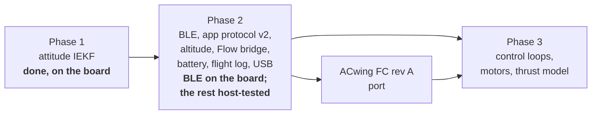

# Roadmap

## On the board, next

- Run the acceptance tests of `HANDOVER_FW.md` §16 with the ACwing Pilot app
  (see [ACwing Pilot protocol v2](../firmware/protocol-v2.md)).
- A mode-0 capture with firmware 0.6 to re-baseline the IEKF comparison with
  the tangential innovation ([Validation](../tools/validation.md#results)).
- Hand test of TAKEOFF / LAND on the bench
  ([Flight core](../firmware/flight-core.md#testing-on-the-bench)).
- ACwing Flow: program the bridge, then check the LED, CAPS and the flow axis
  signs `APP_FLOW_SIGN_*`
  ([ACwing Flow bridge](../firmware/flow-bridge.md#on-the-first-board)).
- Tune the altitude filter ($\sigma_a$, $\sigma_b$) and the height loop on the
  first flights ([Altitude Kalman filter](../theory/altitude-kf.md#limits-and-next-steps)).
- USB CDC on the Nucleo USB_USER port: enumeration, DTR, `acwing-tools log list/get`
  with the RAM log, the PC telemetry over USB, ARM refused with the cable in ([Flight log and USB](../firmware/logging.md#status-and-limits)).
- Battery chain with a bench supply on A0 (`APP_BATT_ADC 1`): levels,
  events, LAND, calibration ([Battery](../firmware/battery.md#testing)).

## Firmware features

- FLOW_TOF calibration: ToF offset, flow scale, axis-sign check. Then POS_HOLD
  on the flow velocity.
- ACwing Pilot app: flight logs (BLE last flight, USB all logs, viewer,
  export) and the battery items of
  [`HANDOVER_APP.md`](https://github.com/ACwing-UAV/ACwing_FW/blob/main/02%20-%20Tools/02%20-%20App/HANDOVER_APP.md)
  are written and tested on the simulator: run them against the board. Still
  open: USB in the native Android app.
- The app on the USB link (Web Serial): telemetry, Settings and Calibration
  without the flight controls (the firmware side is done, ADR 0009 and
  [ACwing Pilot protocol v2](../firmware/protocol-v2.md#usb-a-ground-link)).
- GNSS (ACwing GPS board): NAV, home, RTH, distance geofence, GPS compass.
- ELRS receiver: input arbitration, radio failsafe, STICKS calibration.

## Estimation

- Gyro scale and misalignment calibration (turntable or known rotations), then
  a lower `IEKF_SIGMA_GYRO`.
- Verify the magnetometer latency $\bar\tau$ on the bench, with a constant-rate
  rotation about the vertical. The internal filter delay of the LIS2MDL is not
  modelled.
- Read the LSM6DSV16X `INTERNAL_FREQ_FINE` register at start-up, so the true
  ODR is used from the first sample instead of the nominal one during the
  first 2 s.
- I²C Fast-mode Plus and 1920 Hz sampling (check the bus edges on a scope
  first).

## Port to the ACwing FC rev A

When the first boards are built:

- pin map and CubeMX configuration from the FC pin map in the hardware
  repository;
- IMU on SPI, with a new `bsp/` binding;
- IIS2MDC compass and LPS22HB barometer on the sensor hub;
- IMU axes remapped to the board axes, as noted in the FC README;
- `APP_HW_REV` = 'A' (enables the battery ADC on PA5/PA4 and the W25Q log);
- SPI1 binding of the W25Q128JV log flash (CS PE4), sharing the bus lock with
  the IMU; `erase_chip` for a fast LOG_ERASE;
- move the configuration pages below the CPU2 stack on the 512 KB part
  (STM32WB55CEU6), if that part is chosen.

## Phase 3: control

- **Done in firmware 0.7.0** ([Attitude control and mixer](../firmware/control.md)):
  rate PID at 960 Hz with a filtered (and optionally notched) gyro, tilt loop
  at 240 Hz, quad-X mixer with airmode, thrust curve and battery compensation
  (ADR 0010 §1), stall watchdog, tuning parameters in the app. Host-tested in
  closed loop (`ctrl_test`); to be tuned on the bench and the first flights.
- Next: the hover-thrust estimate of ADR 0010 §2–5 (once accepted, #40); the
  motor power stage on the bench (`MOTORS_ENABLE`); DShot is not needed for the
  brushed 8520 motors of the indoor frames.
- A **thrust model** in the estimators: rejecting sustained accelerations in
  the IEKF acc update, and as an input of the altitude filter.
- On the first flight logs (c4dynamics review, 2026-11), compare for the IEKF
  accelerometer noise: the current $\sigma_{acc}$ (sensor scatter only), a
  model-error term $\sigma_{acc}^2 = \text{scatter}^2 + \sigma_{sf}^2$ with
  $\sigma_{sf}$ ≈ 0.05–0.1, and the thrust model. In the notebook the extra
  error of unmodelled acceleration was mostly heading.
- Check the gyro bias estimate in the flight logs (`LR_EST`, 0.1 mrad/s): it
  must stay within its calibration value during manoeuvres (bias leakage).
- Option: a right-invariant error, if hand launch makes large-error
  convergence a requirement (MATLAB first, against the cold-start test).
