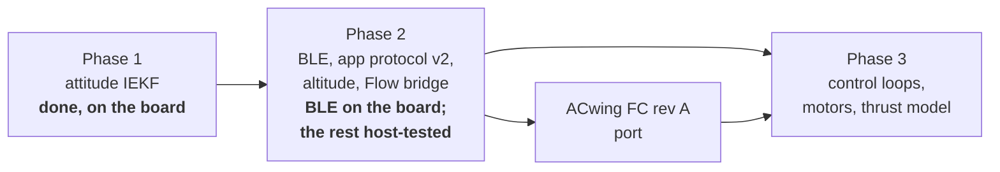

# Roadmap

## On the board, next

- Run the acceptance tests of `HANDOVER_FW.md` §16 with the ACwing Pilot app
  (see [ACwing Pilot protocol v2](../firmware/protocol-v2.md)).
- Hand test of TAKEOFF / LAND on the bench
  ([Flight core](../firmware/flight-core.md#testing-on-the-bench)).
- ACwing Flow: program the bridge, then check the LED, CAPS and the flow axis
  signs `APP_FLOW_SIGN_*`
  ([ACwing Flow bridge](../firmware/flow-bridge.md#on-the-first-board)).
- Tune the altitude filter ($\sigma_a$, $\sigma_b$) and the height loop on the
  first flights ([Altitude Kalman filter](../theory/altitude-kf.md#limits-and-next-steps)).

## Firmware features

- FLOW_TOF calibration: ToF offset, flow scale, axis-sign check. Then POS_HOLD
  on the flow velocity.
- POWER frame and battery failsafes once the ADC (VBAT, current) is read;
  BATTERY calibration.
- GNSS (ACwing GPS board): NAV, home, RTH, distance geofence, GPS compass.
- ELRS receiver: input arbitration, radio failsafe, STICKS calibration.

## Estimation

- Gyro scale and misalignment calibration (turntable or known rotations), then
  a lower `IEKF_SIGMA_GYRO`.
- Verify the magnetometer latency $\bar\tau$ on the bench, with a constant-rate
  rotation about the vertical. The internal filter delay of the LIS2MDL is not
  modelled.
- Read the LSM6DSV16X `INTERNAL_FREQ_FINE` register at start-up, so the true
  ODR is used from the first sample instead of the nominal one during the
  first 2 s.
- I²C Fast-mode Plus and 1920 Hz sampling (check the bus edges on a scope
  first).

## Port to the ACwing FC rev A

When the first boards are built:

- pin map and CubeMX configuration from the FC pin map in the hardware
  repository;
- IMU on SPI, with a new `bsp/` binding;
- IIS2MDC compass and LPS22HB barometer on the sensor hub;
- IMU axes remapped to the board axes, as noted in the FC README;
- `APP_HW_REV` = 'A'.

## Phase 3: control

- Rate PID at 960 Hz with a notch-filtered gyro, attitude loop at 240 Hz, both
  in the existing hooks (`ctrl_rate_step`, `ctrl_attitude_step`), fed by
  `fc_setpoint()`.
- Motor power stage and mixer; DShot on the ACwing FC.
- A **thrust model** in the estimators: rejecting sustained accelerations in
  the IEKF acc update, and as an input of the altitude filter.
