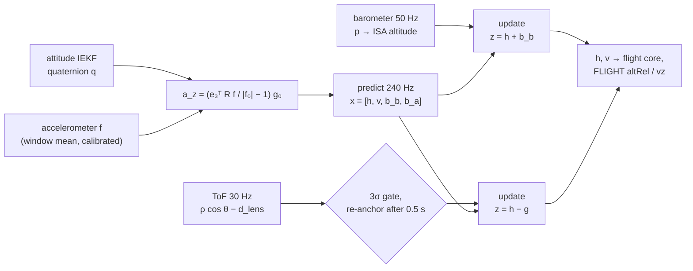

# Altitude Kalman filter

The attitude IEKF ([Attitude IEKF](iekf.md), [IEKF on the microcontroller](iekf-embedded.md)) estimates only the attitude. Takeoff, landing, the hold
modes and the ceiling also need the **height** and the **vertical speed**. A
second, independent filter estimates them: `App/filters/altitude_kf/alt_est.c`.

## Why a separate, linear filter

- **Cascade on the attitude.** The altitude filter takes the attitude from
  the IEKF as an input; it does not feed back into it. The IEKF stays exactly
  the filter validated against the MATLAB reference ([Validation against the reference](../tools/validation.md)). Height errors cannot
  disturb the attitude, which is the quantity the drone needs most.
- **A linear Kalman filter, not an EKF.** The non-linear parts sit outside the
  filter, where they cost nothing in accuracy:
  - the pressure is converted into an altitude before the update;
  - the ToF range is multiplied by $\cos$ of the tilt before the update;
  - the specific force is rotated into the world frame with the IEKF
    attitude before the prediction.

  What enters the filter is linear in the state, so there are no Jacobians
  and no linearisation error. It would become an EKF only if the raw pressure,
  or the attitude itself, were part of the state or of the measurement model.

- **Small.** It has 4 states and scalar updates, about 150 multiply-adds per
  prediction, with nothing to invert.

## State and process model

World frame NWU ($z$ up), heights in metres:

$$
x = \begin{bmatrix} h & v & b_b & b_a \end{bmatrix}^\top
$$

| State | Meaning |
|---|---|
| $h$ | height above the reference (the first baro samples, or the floor below the drone at the first ToF reading) |
| $v$ | vertical speed, + up |
| $b_b$ | barometer bias: what the baro reads in excess of $h$ (weather, temperature drift, prop wash) |
| $b_a$ | bias of the vertical acceleration (accelerometer offset along $z$ and residual tilt error) |

**Input: vertical acceleration.** The accelerometer measures the specific
force $f = R^\top (a - g)$ in body axes, with $g = (0, 0, -g_0)$. In the
world frame,

$$
a_z = \left( \frac{e_3^\top R\, f}{\|f_0\|} - 1 \right) g_0,
\qquad e_3^\top R = \begin{bmatrix} 2(xz - wy) & 2(yz + wx) & 1 - 2(x^2 + y^2) \end{bmatrix}
$$

where $q = [w, x, y, z]$ is the IEKF quaternion. $f$ is the calibrated,
rotation-compensated window mean `acc_mean` ([Rotation-compensated accelerometer mean (`accwin`)](iekf-embedded.md#rotation-compensated-accelerometer-mean-accwin)), in g. $\|f_0\|$ is the
magnitude measured at rest during the static calibration (`nom_acc`), so the
input is zero at rest even with a small residual scale error. The function is
`alt_est_accel_up()`.

**Continuous model:**

$$
\dot h = v, \qquad \dot v = a_z - b_a + w_a, \qquad \dot b_b = w_b, \qquad \dot b_a = w_{ba}
$$

Here $w_a$ is the acceleration noise (sensor noise plus vibration), and
$b_b$ and $b_a$ are random walks.

**Discrete model** with step $\Delta t$ (one acc window, 1/240 s):

$$
x_{k+1} = F x_k + B\,a_{z,k}, \qquad
F = \begin{bmatrix} 1 & \Delta t & 0 & -\tfrac{\Delta t^2}{2} \\ 0 & 1 & 0 & -\Delta t \\ 0 & 0 & 1 & 0 \\ 0 & 0 & 0 & 1 \end{bmatrix}, \qquad
B = \begin{bmatrix} \tfrac{\Delta t^2}{2} \\ \Delta t \\ 0 \\ 0 \end{bmatrix}
$$

$$
P_{k+1} = F P_k F^\top + Q, \qquad
Q = \sigma_a^2\, G G^\top + \mathrm{diag}\!\left(0,\ 0,\ \sigma_{bb}^2 \Delta t,\ \sigma_{ba}^2 \Delta t\right), \qquad
G = \begin{bmatrix} \tfrac{\Delta t^2}{2} & \Delta t & 0 & 0 \end{bmatrix}^\top
$$

$P$ is symmetrised after every step, in single precision as in the IEKF.

## Measurements

All updates are scalar, $z = H x + n$, with
$K = P H^\top / S$, $S = H P H^\top + r$, $x \leftarrow x + K (z - Hx)$ and
$P \leftarrow P - K H P$.

**Barometer**, 50 Hz. It is read through the IMU sensor hub and arrives in
the same FIFO, so it shares the IMU time base.

$$
z_b = 44330 \left[ 1 - \left( \frac{p}{p_0} \right)^{0.190295} \right] = h + b_b + n_b, \qquad H_b = \begin{bmatrix} 1 & 0 & 1 & 0 \end{bmatrix}, \quad r_b = \sigma_b^2
$$

This is the ISA altitude relative to $p_0$, the mean of the first 25 samples
(0.5 s). At that moment $b_b$ is set so that the baro agrees with the current
$h$. Absolute altitude does not matter: FLIGHT `altRel` is measured from the
take-off point, captured at ARM.

**ToF height**, 30 Hz (VL53L1X, ACwing Flow). The range $\rho$ is measured
along the board normal, so the height of the lens above the floor is
$\rho \cos\theta$, with $\cos\theta = R_{33}$ from the IEKF:

$$
z_t = \rho \cos\theta - d_{lens} = h - g + n_t, \qquad H_t = \begin{bmatrix} 1 & 0 & 0 & 0 \end{bmatrix}, \quad r_t = (\sigma_t + 0.01\,\rho)^2
$$

- $d_{lens}$ = 11.3 mm is the lens height when landed (frame C2).
- $g$ is the floor level in the $h$ frame. It is a parameter, not a state: it
  is set at the first ToF reading and moved only by the re-anchoring below.
- Rejected outright: a reading out of range ($\rho$ > 4 m), a range status
  that is not valid, or a tilt above 30°.

**On the floor.** The VL53L1X reads short or nothing below about 40 mm, and
the lens is 11 mm above the floor when landed. A reading below
$\rho_{min}$ + 20 mm, or no return right after a height below 0.15 m, means
"on the floor":

- the filter applies $z_t = 0$ with $\sigma$ = 3 cm;
- `tof_ground` is reported, which the take-off and touchdown logic use ([TAKEOFF, LAND, HOLD](../firmware/flight-core.md#takeoff-land-hold)).

## Gating and re-anchoring

A ToF reading is **gated** when its normalised innovation exceeds 3σ:

$$
\frac{(z_t - (h - g))^2}{S} > 3^2
$$

This happens when an object passes under the drone, or when the drone flies
over the edge of a table. After **15 consecutive rejections** (0.5 s) the
step is taken as real and the floor is re-anchored, $g \leftarrow h - z_t$.
The height above the new floor is then right at once, while $h$ (and with it
`altRel`) stays continuous.

## Observability

| Sensors | What is observable | What the filter does |
|---|---|---|
| baro only | $h + b_b$ only: the two cannot be separated. $b_a$ is observable from the second derivative of the baro | $\sigma_{bb}$ is set to 0, so $b_b$ is frozen (no process noise) and its variance does not grow without limit. $h$ follows the baro, drift included: barometric weather drift, ~0.1 m/min, is not corrected |
| baro + ToF | everything: the ToF fixes $h - g$, the baro difference gives $b_b$ | $\sigma_{bb}$ is enabled while a ToF sample was used in the last 1 s. The baro bridges ToF gaps (out of range, tilt, gating) with the bias it has just learned |
| ToF only | $h$, $v$, $b_a$ | works the same way, but without a fallback during ToF gaps |

This is why both models use the same filter. With GNSS outdoors the baro is
the reference. Indoors the ToF dominates near the floor, and the baro takes
over above 4 m or over gaps.

## Tuning (`alt_est_default_cfg()`)

| Parameter | Value | Note |
|---|---|---|
| $\sigma_a$ | 0.5 m/s² | vibration in flight dominates; to be tuned on the first flights from the vibration level in SYSTEM |
| $\sigma_{ba}$ | 0.01 m/s²/√s | slow accelerometer drift |
| $\sigma_{bb}$ | 0.05 m/√s | only with ToF |
| $\sigma_b$ | 0.30 m | LPS22 noise is a few cm at 50 Hz with averaging; the margin covers prop wash |
| $\sigma_t$ | 0.02 m + 1 % of the range | VL53L1X long mode |
| ToF range | 0.04–4 m, tilt ≤ 30° | |
| Gate, re-anchor | 3σ, 15 rejects | |
| $P_0$ | diag(0.01, 0.01, 1, 0.04) | |

Rates: prediction 240 Hz in the ImuTask, right after the IEKF accelerometer
update (`on_state`); baro 50 Hz (`correct_events`); ToF 30 Hz (`take_ext`, from
the ExtTask queue). Everything runs in the ImuTask, the only owner of the
state, so there are no locks.

**Host tests** (`00 - FC_FW/Tests/host`):

- a 60 s profile with 0.5 m/s² steps, accelerometer noise and bias, and a
  baro with 0.25 m noise and drift. The height RMS stays below 0.15 m with
  the baro alone and below 0.03 m with ToF, while the baro drifts at
  0.1 m/s; the vertical speed RMS stays below 0.08 m/s;
- re-anchoring on a 0.7 m step;
- `tof_ground` with a short reading;
- $a_z$ = 0 at rest and at 30° of tilt.

## Limits and next steps

- **Not tuned on hardware yet.** $\sigma_a$, $\sigma_b$ and the gate come
  from the datasheets and from simulation.
- **Prop wash and ground effect** bias the baro near the floor and during fast
  climbs. With ToF this ends up in $b_b$; without ToF it is height error. A
  thrust-dependent baro correction is a phase-3 item.
- **Vibration.** The input is the 4-sample window mean at 240 Hz, so motor
  vibration above ~100 Hz aliases into $a_z$. The FC damping mounts
  (isolation band ~90–120 Hz, mechanical handoff in the hardware repository)
  and the SYSTEM vibration figure on the first flights decide whether a
  dedicated low-pass is needed.
- **Floor model.** The ToF assumes a flat floor under the drone. Slopes and
  stairs show up as re-anchoring steps.
- The filter is linear on purpose. Should the thrust model of phase 3 enter
  the prediction (thrust divided by mass instead of the accelerometer, or both
  fused), the state stays the same and only $B$ and $Q$ change.
