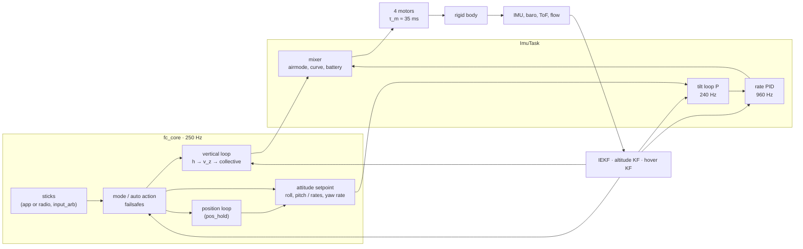
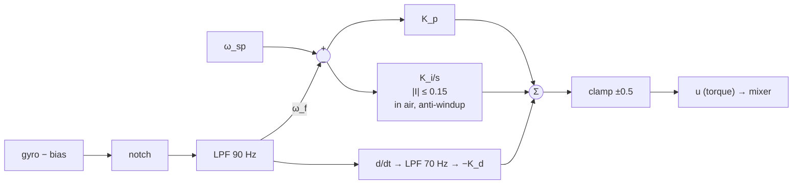
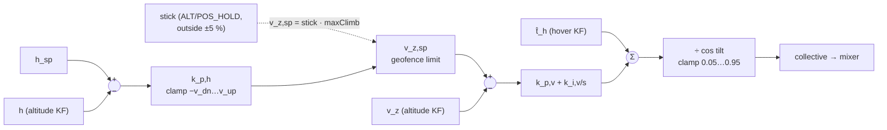
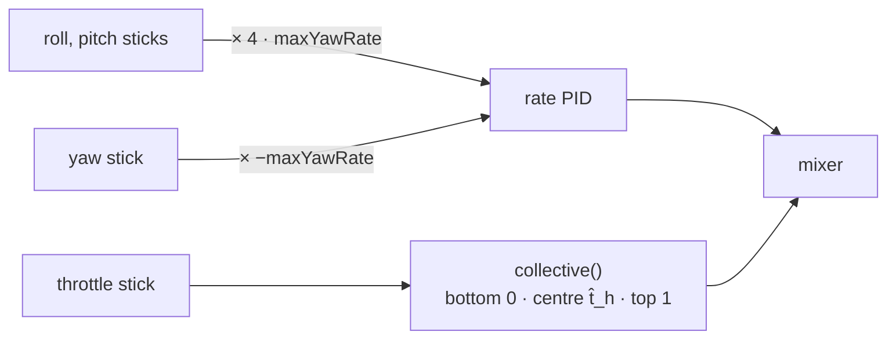
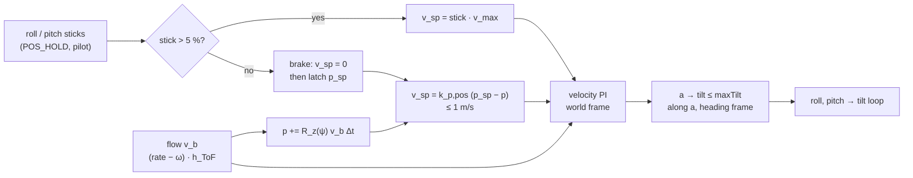
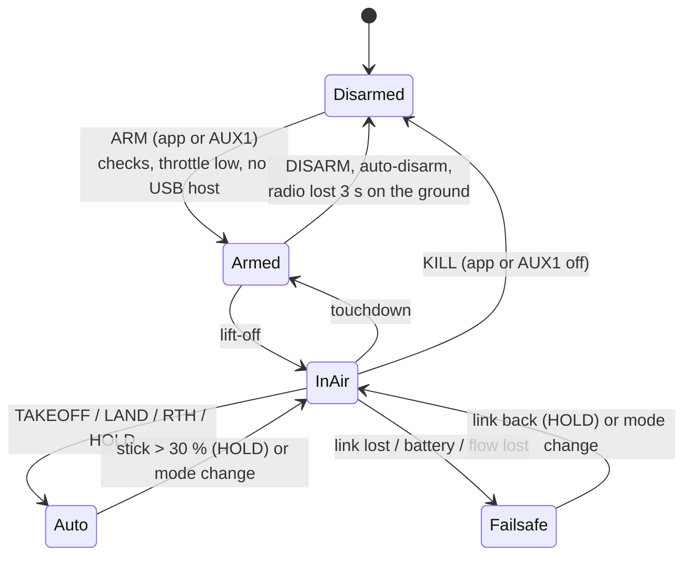

# Control loops

This page gives the control structure of firmware 0.8, flight condition by flight condition: the theory behind each
loop, the numbers it was designed with, and what the code does. The code is in [Attitude control and mixer](../firmware/control.md)
(attitude, rate, mixer) and [Flight core](../firmware/flight-core.md) (modes, vertical loop, failsafes). The plant
and its assumed numbers are in [Vehicle model](vehicle-model.md#design-numbers-assumed).

## Overall structure

A cascade, fastest loop innermost. Each outer loop runs well below the bandwidth of the loop it drives, so that it
sees that loop as a unit gain (time-scale separation, ratio about 4).

| Loop | Rate | Crossover (design) | Plant seen | Gains (parameter) |
|---|---|---|---|---|
| rate, roll/pitch | 960 Hz | ≈ 22 rad/s | $\frac{b}{s(\tau_m s + 1)}$, $b$ ≈ 1100 rad/s² per unit torque | P 0.020 (90), I 0.20 (91), D 0.0004 (92) |
| rate, yaw | 960 Hz | ≈ 11 rad/s | $b$ ≈ 270 rad/s² | P 0.040 (93), I 0.20 (94) |
| tilt | 240 Hz | 6 rad/s | the closed rate loop ≈ 1/s | P 6.0 1/s (95) |
| vertical speed | 250 Hz | ≈ 4.8 rad/s | $g/t_h$ ≈ 19 m/s² per unit collective | $k_{p,v}$ 0.25, $k_{i,v}$ 0.15 |
| height | 250 Hz | 1.2 rad/s | the closed speed loop ≈ 1/s | $k_{p,h}$ 1.2 1/s |
| horizontal velocity | 250 Hz | 1.8 rad/s | $g$ per rad of tilt, via the tilt loop | $k_{p,vel}$ 1.8, $k_{i,vel}$ 0.9 |
| horizontal position | 250 Hz | 0.8 rad/s | the closed velocity loop | $k_{p,pos}$ 0.8 1/s |

## Rate loop (inner, every mode)

**Plant.** Per axis, with the torque command $u$ in normalised thrust per motor and the motor lag:

$$
\dot\omega = b\,\frac{u}{\tau_m s + 1},\qquad b_{x,y} = \frac{4\ell T_{max}}{J_{xx}} \approx 1100\ \text{rad/s}^2,\quad
b_z = \frac{4\kappa T_{max}}{J_{zz}} \approx 270\ \text{rad/s}^2
$$

**Controller.** PID with D on the measurement (no kick on a setpoint step):

$$
u = K_p e + K_i \int e\,dt - K_d\,\frac{d\omega_f}{dt},\qquad e = \omega_{sp} - \omega_f
$$

$\omega_f$ is the bias-corrected gyro after the notch (`gyroNotch`, off by default) and the second-order Butterworth
low-pass (`gyroLpf` 90 Hz); the D term has its own low-pass (`dtermLpf` 70 Hz). With $K_p$ = 0.02 the open loop is
$K_p b/s$ ≈ 22/s at low frequency: crossover below the motor pole $1/\tau_m$ ≈ 28 rad/s, the D term adds the phase
lost to that pole. The integrator removes a constant disturbance torque (an off-centre battery): in `ctrl_test` a
3 mN·m disturbance leaves 0.01° with I and 37° without.

Integrator rules: it runs only in the air; it stops when the output is saturated in the direction of the error; on
the ground at idle the torques are zero and the loop is reset (a drone armed on a slope does not spin up one side).

## Tilt loop (ANGLE-type modes)

The desired attitude is $R_d = R_z(\psi)R_y(\theta_{sp})R_x(\phi_{sp})$ around the **current** heading $\psi$. The
error is the rotation that takes the body $z$ axis onto the desired one (**reduced attitude**):

$$
e = \frac{z_b \times z_d}{\lVert z_b \times z_d\rVert}\,\operatorname{atan2}(\lVert z_b\times z_d\rVert,\ z_b\cdot z_d)
\quad\text{(in body axes)},\qquad
\omega_{sp,xy} = k_{att}\,e_{xy},\ \lvert\omega_{sp,xy}\rvert \le 6\ \text{rad/s}
$$

Why the reduced attitude: the heading never enters roll and pitch, the error is well defined at any tilt (no Euler
singularity), and the tilt converges along the shortest rotation. Yaw is a rate command in every mode,
$\omega_{sp,z} = -\,\text{stick}_{yaw}\cdot$`maxYawRate` (stick right = clockwise = −z in FLU). There is **no heading
hold**: with the stick centred the yaw rate is held at zero, so the heading drifts slowly with the gyro bias error.

With the rate loop closed at ≈ 22 rad/s, the tilt loop sees nearly an integrator and $k_{att}$ = 6 gives a
first-order response with τ ≈ 0.17 s: a 20° step settles within 1° in 0.54 s, 0.7° overshoot (`ctrl_test`, at 4.2
and 3.6 V).

## Vertical loop

**Plant.** Near hover, with $t$ the collective and $t_h$ the hover thrust ([Hover-thrust Kalman filter](hover-kf.md)):

$$
\ddot z = g\left(\frac{t\cos(\text{tilt})}{t_h} - 1\right) \approx \frac{g}{t_h}\,(t\cos(\text{tilt}) - t_h)
$$

**Controller** (`alt_ctrl.c`): a P height loop that gives a climb-rate setpoint, and a PI speed loop around the
hover feed-forward, divided by $\cos(\text{tilt})$ so the vertical thrust does not drop in a tilt:

$$
v_{z,sp} = \operatorname{clamp}\big(k_{p,h}(h_{sp} - h),\ -v_{dn},\ v_{up}\big),\qquad
t = \frac{\hat t_h + k_{p,v}(v_{z,sp} - v_z) + I}{\cos(\text{tilt})},\quad \dot I = k_{i,v}(v_{z,sp} - v_z),\ \lvert I\rvert \le 0.15
$$

The speed loop crosses over at $k_{p,v}\,g/t_h$ ≈ 4.8 rad/s, the height loop at 1.2 rad/s (ratio 4). The integrator
has its zero at $k_{i,v}/k_{p,v}$ ≈ 0.6 rad/s and covers only the error of the hover model: the bulk is the live
estimate $\hat t_h$, so switching into the loop never needs a thrust jump. The output is limited to 0.05…0.95.

## Flight conditions

### ACRO

Sticks → body rates; no self-levelling; the collective is the throttle stick.

Forbidden in beginner mode (`beginner` = 1). The stick centre is the hover thrust (piecewise linear), so a centred
throttle holds height roughly, whatever the tray.

### ANGLE

Sticks → tilt angles (`maxTilt`, 30°; halved in beginner mode) through the tilt loop; yaw rate; collective from the
throttle stick as in ACRO. Below the geofence ceiling, with an altitude estimate, the collective is limited by the
vertical loop driven with the largest climb rate that can still stop in time,
$v_{ok} = \sqrt{2 a_b (h_{ceil} - h)}$ with $a_b$ = 2.5 m/s².

### ALT_HOLD

Attitude as ANGLE. Throttle stick → climb rate (`maxClimb`, 2 m/s); within ±5 % of the centre the height is held
at the value where the stick was released. Needs an altitude source (baro or ToF); the mode is refused without one.

### POS_HOLD

Vertical as ALT_HOLD; horizontal from the position loop (`control/pos_ctrl.c`) whenever the flag `pos_hold` is set.

**Two flags, one invariant.** The flight core publishes, with every setpoint,

| Flag | Set when | Effect |
|---|---|---|
| `alt_ctrl` | in the air with an altitude estimate, in a hold mode or an automatic action | the collective comes from the vertical loop |
| `pos_hold` | `alt_ctrl` **and** (POS_HOLD, or TAKEOFF / LAND / RTH / HOLD / failsafe hover) **and** the flow usable (ToF ≥ 80 mm, quality) **and** no flow failsafe | roll and pitch come from the position loop instead of the sticks |

`pos_hold` implies `alt_ctrl` by construction (checked at every step in `host_test`): a position is never held without
the height. With `pos_hold` = 0 (near the floor, flow lost, ALT_HOLD, ANGLE) the angles come from the sticks, level
when centred. Both flags are in the flight log (VERT record, flags bits 4 and 5).

**Horizontal plant.** With the tilt loop closed (τ ≈ 0.17 s) and small angles, in the heading frame ($x$ forward,
$y$ left):

$$
\dot v_x = g\tan\vartheta - \mu v_x + d_x,\qquad \dot v_y = -g\tan\varphi - \mu v_y + d_y
$$

($\vartheta$ + nose down, $\varphi$ + right wing down, $\mu$ the rotor drag, $d$ the wind).

**Measurement.** The optical flow gives the ground speed in body axes: flow rate minus the body rate, times the ToF
height, low-pass filtered (`app_main.c`). For the tilts of a hold it is taken as the velocity in the heading frame.
The position is its dead reckoning in the world plane, $p \mathrel{+}= R_z(\psi)\,v_b\,\Delta t$: relative, drifting
slowly with the flow scale error, used only to come back to a point held recently.

**Controller.**

$$
v_{sp} = \begin{cases} \text{stick}\cdot v_{max} & \text{stick outside ±5 \%}\\
0 & \text{braking after the release, until } \lvert v\rvert < 0.2\ \text{m/s (at most 1.5 s)}\\
\operatorname{sat}_{1\,\text{m/s}}\big(k_{p,pos}(p_{sp} - p)\big) & \text{holding the point where it stopped}\end{cases}
$$

$$
a = k_{p,vel}(v_{sp} - v) + I,\quad \dot I = k_{i,vel}(v_{sp} - v)\ \text{(world frame)},\qquad
\text{tilt} = \operatorname{atan}\frac{\min(\lvert a\rvert, g\tan\text{maxTilt})}{g}\ \text{along } a
$$

- The point is latched after braking, not at the instant of the release: the drone stops where it can and stays
  there, instead of flying back the braking distance (0.33 m from 1 m/s).
- The integrator is in the **world** frame: the wind is fixed in the world, so it does not have to follow the
  heading while the drone yaws.
- The tilt is limited as a cone, $\lVert(\varphi, \vartheta)\rVert \le$ `maxTilt`, not per axis.
- $v_{max}$ = `maxHSpeed` (halved in beginner mode), capped at 2 m/s on the indoor models.
- In the automatic actions the sticks are ignored: the drone holds the point while it takes off, lands or hovers.

| Loop | Gain | Crossover |
|---|---|---|
| velocity | $k_{p,vel}$ = 1.8 1/s, $k_{i,vel}$ = 0.9 1/s², $\lvert I\rvert \le$ 2 m/s² | 1.8 rad/s (tilt loop 6 rad/s), PI zero 0.5 rad/s |
| position | $k_{p,pos}$ = 0.8 1/s | 0.8 rad/s |

`make pos_test` closes the loop on the horizontal plant above, with flow noise and its filter:

| Case | Result |
|---|---|
| released at 1 m/s | stops in 0.33 m, then holds within 10 cm |
| side wind 0.8 m/s² (≈ 5° of tilt), step | worst drift 0.28 m, back within 1 cm |
| half stick | 1 m/s along the heading, at any heading |
| full stick | tilt within `maxTilt` |
| yawing at 1 rad/s with wind | held within 15 cm |
| tilt loop twice as slow, flow scale +25 % | stable, moves 3 cm in 6 s |

`host_test` (`test_pos_hold_flags`) checks the flags through the flight core: TAKEOFF and LAND hold the position,
POS_HOLD follows the stick and brakes a drift, ANGLE and ALT_HOLD leave it off, a lost flow falls back to level.

**Outdoor (GNSS)** is not a position source yet. The M10 is read from firmware 0.15 (ADR 0014), but its solution is
not fused: with a GPS board and no flow POS_HOLD is refused (`SENSOR_MISSING`) and the takeoff ends in ALT_HOLD,
rather than a POS_HOLD that would not hold the position. It comes with the horizontal estimator (GNSS step 2).

### TAKEOFF (automatic)

Needs an altitude source. The spool-up ramps the collective limit from 0.10 at 0.40/s until the drone leaves the
ground (0.15 m above the ground level), so the integrator cannot wind up on the ground; then the height loop climbs
at 0.6 m/s to the target (`takeoffAlt`, below the ceiling). No lift-off within 6 s → TAKEOFF aborted (EVENT 8),
back on the ground.

### Hand launch (LAUNCH)

Armed with the motors stopped (`motors_off`: `ctrl_loop.c` writes duty 0, the loops stay reset) while the drone
is in the hand; neither the airborne test nor the no-take-off disarm runs. At the motor start (10 cm from the
release point, or the apex of a toss) the setpoint is level attitude, yaw rate 0, and the collective of
`launch.c`: 1.0 while falling, $\hat t_h/\cos(\text{tilt})$ otherwise, $\hat t_h$ beyond 60° of tilt (the
attitude first, the airmode keeps the torque). Once level, slow and no longer falling, the vertical loop holds
the height reached. Details, numbers and limits: [ADR 0011](../decisions/0011-hand-launch.md).

### Flip (FLIP)

Climb at full thrust for 0.18 s with the attitude level. Then the body-rate reference `flipRate` on one axis, the
other rates zero, collective 0.25: the mixer's airmode raises it as far as the torque needs. The rotation ends at
360° minus the braking lead $\omega^2/2\alpha$ ($\alpha$ = 500 rad/s²) minus 10°. The recovery is level, with
full thrust while falling and the hover thrust once climbing, until tilt < 5° and $\lvert\omega\rvert$ < 1 rad/s.
Then the mode and the height of before return. The IEKF runs on the gyro only for the length of the manoeuvre.
Gate, numbers and validation: [ADR 0012](../decisions/0012-autonomous-flip.md).

### LAND and RTH

With an altitude estimate: descent at `landSpeed` (0.7 m/s), 0.3 m/s below 1 m when a ToF sees the floor;
touchdown when $\lvert v_z\rvert$ < 0.12 m/s for 0.7 s (1 s without ToF), then disarm. Without GNSS and home, RTH
lands in place. **Without** an altitude estimate: open-loop descent, the collective ramps in 1 s to 0.85 $\hat t_h$
and stays there for at most 20 s.

### HOLD (pause)

Holds the height where it began (vertical loop) and the attitude level. It ends when a stick moves by more than
30 % (the throttle relative to its position when HOLD began). Without an altitude estimate: the collective is held at
$\hat t_h$, the height drifts.

### No altitude source

Only ACRO and ANGLE; the hold modes, TAKEOFF and the vertical limits are not available; the airborne test is the
collective above 0.8 $\hat t_h$ for 0.3 s; LAND and failsafes descend open-loop.

## Failsafes and mode logic

| Trigger | Condition | Action |
|---|---|---|
| app link short | no app frame for 1 s (app in control) | `fsAppShort`: hover (default) or land |
| app link long | 3 s | `fsAppLong`: hover, land, RTH (default; land without GNSS); EVENT 20 |
| radio link | no valid radio frame for 1 s (radio in control) | `fsRadio` (same choices), EVENT 21; on the ground disarm after 3 s |
| battery | low / critical / emergency (BattTask) | warn / RTH or land / forced land, no override except KILL ([Battery and failsafes](../firmware/battery.md)) |
| flow lost | quality < 30 for 0.5 s above 0.15 m | `fsFlowLost`: ALT_HOLD with a warning, or land |
| geofence | ceiling or maximum height | climb limited, EVENT 23 |
| stall | rate loop silent 50 ms | motors 0 |

Stale sticks (older than 0.25 s) are replaced by the neutral of the mode: level attitude, no yaw rate, height held in
the hold modes, the last collective in the air in ACRO/ANGLE, idle on the ground.

## Limits of the present design

- Horizontal position only from the optical flow (indoor); the GNSS is read but not fused yet (ADR 0014). No heading hold.
- The flow position is dead reckoning: it drifts with the flow scale error (FLOW_TOF calibration) over long holds.
- Gains from assumed numbers: to be tuned on a tether and from the logs; a calibration / auto-calibration procedure
  is planned (issue #42).
- No feed-forward of the setpoint rate, no TPA (gain reduction at high throttle), no dynamic notch on the motor
  speed: candidates once the logs show the need.
- The airmode keeps the attitude authority at idle in the air; at full throttle the collective gives way to the
  torques, so a climb at full throttle may slow down during a hard manoeuvre.
