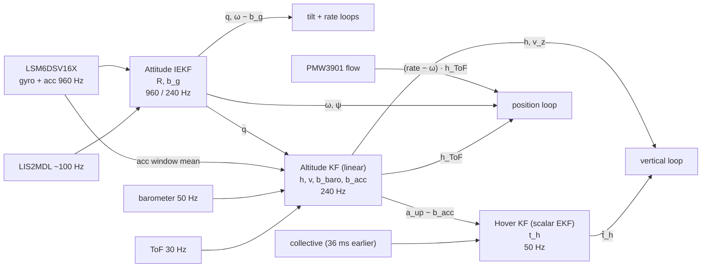
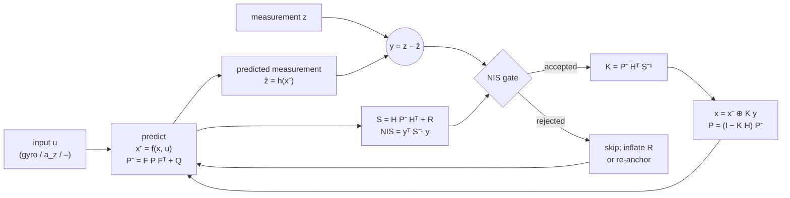

# State estimation: overview

Three filters run on the flight controller, each one small and specialised, chained so that each uses the output
of the one before as a known input. The pages that follow give their theory and implementation:
[Attitude IEKF](iekf.md) and [IEKF on the microcontroller](iekf-embedded.md),
[Altitude Kalman filter](altitude-kf.md), [Hover-thrust Kalman filter](hover-kf.md). The horizontal velocity of the
optical flow is a direct measurement, not a filter state ([Control loops](control-loops.md#pos_hold)).

| Filter | Type | State | Why this form |
|---|---|---|---|
| Attitude | invariant EKF on SO(3) (left-invariant error) | rotation $R$, gyro bias $b_g$ | the attitude kinematics are group-affine: the error dynamics do not depend on the estimate, so the filter keeps its convergence from any initial attitude |
| Altitude | linear Kalman filter | $h, v, b_b, b_a$ | with the attitude known, the vertical model is linear: no linearisation error, exact covariance, cheap |
| Hover thrust | scalar EKF (random walk) | $t_h$ | one slowly varying unknown, observed through a measurement non-linear in it |

The chain is a **cascade**, not a joint filter: each filter treats the output of the previous one as exact. That is
valid because their time scales are separated (attitude ≈ 0.1 s, height ≈ 1 s, hover thrust ≈ 1–2 s) and because
each one gates the samples taken when its inputs are not trustworthy (high tilt, saturation, impacts).

## The common structure

Every filter has the same predict–correct structure; what changes is the model and the gate.

| | Attitude IEKF | Altitude KF | Hover KF |
|---|---|---|---|
| predict $f$ | $R \leftarrow R\,\mathrm{Exp}((\omega - b_g)h)$ | $h \mathrel{+}= v\Delta t + \tfrac12 (a_z - b_a)\Delta t^2$, $v \mathrel{+}= (a_z - b_a)\Delta t$ | $t_h$ constant |
| measurements | gravity direction (acc), field direction (mag) | $h + b_b$ (baro), $h$ − ground (ToF) | $a_{up} = g(t_c/t_h - 1)$ |
| $H$ | $[\hat z]_\times$ of the predicted direction, in the invariant error | constant rows | $-g t_c/\hat t_h^2$ |
| $\oplus$ | retraction $R \leftarrow R\,\mathrm{Exp}(\delta)$, $b \leftarrow b + \delta b$ | sum | sum, clamped 0.25…0.85 |
| gate | NIS with adaptive inflation, stillness detector, dip check | 3σ on the ToF, re-anchor after 0.5 s | NIS > 9: reject, R × 4 for 0.5 s |
| rate | 960 Hz predict, 240 Hz acc, ~100 Hz mag | 240 Hz predict, 50 Hz baro, 30 Hz ToF | 50 Hz |

## Assumptions shared by the chain

- The vehicle is a rigid body; the IMU is at the centre of mass (the lever-arm acceleration is neglected).
- The accelerometer measures the specific force; it is the gravity direction only when the vehicle does not
  accelerate. The IEKF de-weights it otherwise, the hover KF and the altitude KF use it as an input with the
  attitude known.
- World frame NWU with $z$ up, body FLU ([Vehicle model](vehicle-model.md#frames-and-conventions)).
- Noises are white and Gaussian, the biases random walks. The vibration of the rotors is not white; it is reduced
  by the window mean (acc) and the low-pass filters, and its residual is covered by $R$.

The design numbers of the vehicle (mass, inertia, motor lag) do not enter the attitude and altitude filters; the
hover KF only uses $g$ and the ratio $t_c/t_h$.
