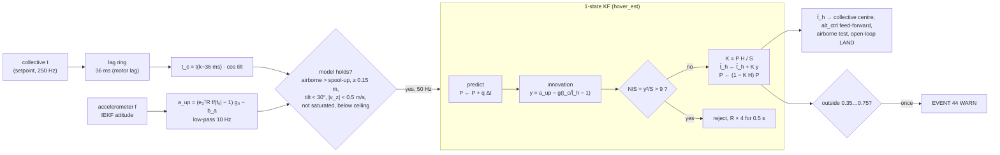

# Hover-thrust Kalman filter

The collective of every mode is built around the **hover thrust** $t_h$: the normalised thrust (fraction of the
maximum thrust of the four motors at 4.2 V per cell) that holds the drone in a hover. It is the centre of the
throttle stick in ACRO/ANGLE, the feed-forward of the vertical loop, the reference of the airborne test and of the
open-loop landing ([Control loops](control-loops.md)). It changes with the tray (T400 / T800 / T1200), a GPS board, a
payload, damage, and slowly with the motors' temperature. The battery does not change it: the mixer compensates
$V_{cell}$ (ADR 0010 §1).

The firmware estimates it online with a scalar Kalman filter, `App/filters/hover_est/hover_est.c`, fed by
`App/control/hover_track.c`, which decides when the model holds.

## Model

Vertical dynamics of the rigid body ([Vehicle model](vehicle-model.md#rigid-body-dynamics)), with the total thrust
$T = t\,T_{max,4}$ along $z_b$ and $t_h = mg/T_{max,4}$:

$$
m\,\ddot z = T\cos\varphi\cos\vartheta - mg + f_{drag,z}
\quad\Longrightarrow\quad
a_{up} = g\left(\frac{t_c}{t_h} - 1\right) + w,
\qquad t_c = t\,\cos(\text{tilt})
$$

$w$ collects the vibration, the rotor drag and the ground effect. The assumptions, and how the firmware keeps them
true, are:

| Assumption | Violated by | Kept by |
|---|---|---|
| thrust = commanded thrust | motor lag (35 ms) | $t_c$ taken from the command 36 ms earlier (ring of 16 samples at 4 ms, 9 samples back) |
| the mixer delivers $t$ exactly | saturation | no update when the collective is at its limits |
| no drag | fast climbs and descents | $\lvert v_z\rvert$ < 0.5 m/s (a 1 m/s climb moves the estimate by 0.3 %, `hover_test`) |
| no ground effect | the first 15 cm | no update below 0.15 m (ToF), nor during the spool-up |
| small horizontal acceleration | hard manoeuvres | tilt < 30°, NIS gate |
| $a_{up}$ unbiased | accelerometer offset | the bias $b_a$ of the altitude KF is removed |

## Filter

State $x = t_h$, random walk (it only changes slowly):

$$
t_{h,k+1} = t_{h,k} + n_k, \qquad \mathrm{E}[n^2] = q\,\Delta t
$$

Measurement $z = a_{up}$, non-linear in $t_h$, linearised at the estimate (an EKF in one dimension):

$$
h(t_h) = g\left(\frac{t_c}{t_h} - 1\right), \qquad
H = \frac{\partial h}{\partial t_h} = -\frac{g\,t_c}{\hat t_h^{\,2}}
$$

$$
S = H^2 P + R,\qquad K = \frac{P H}{S},\qquad \hat t_h \leftarrow \hat t_h + K\,(z - h(\hat t_h)),\qquad
P \leftarrow (1 - K H)\,P
$$

The estimate is clamped to 0.25…0.85 and $P \ge 10^{-8}$.

**Gate.** An innovation with $\mathrm{NIS} = y^2/S > 9$ (3σ) is rejected, and $R$ is inflated ×4 for 0.5 s: an
impact, a hand catch or a gust gives a burst of large innovations, and the inflation keeps the samples just after
it from pulling the estimate.

## Tuning and dynamics

| Symbol | Value | Meaning |
|---|---|---|
| $\sqrt q$ | 0.012 s$^{-1/2}$ | how fast $t_h$ may change |
| $\sqrt R$ | 2 m/s² | vibration with the props on, after the 10 Hz low-pass (to be taken from the flight logs) |
| $\sigma_0$ | 0.1 | initial 1σ around the seed |
| update | 50 Hz | |

Near hover $t_c \approx t_h$, so $\lvert H\rvert \approx g/t_h \approx 19$ m/s². For a random walk observed at
$f_s$ = 50 Hz, the steady-state variance and time constant are approximately (continuous-time limit,
$R_c = R/f_s$):

$$
P_\infty \approx \frac{\sqrt{q R_c}}{\lvert H\rvert} \approx 1.7\cdot 10^{-4}\ (\sigma \approx 0.013),
\qquad
\tau \approx \frac{R_c}{P_\infty H^2} \approx 1.2\ \text{s}
$$

so the filter follows a step of the mass within about 2 s and settles to ±1.3 % of $t_h$. The first value of $q$
(0.003²) gave a time constant above 8 s, too slow for a tray change; see the amendments of ADR 0010.

## Seeding and memory

- At every arm the filter starts from the parameter `hoverThr` (80), or from the value of an earlier flight of at
  least 20 s in the same power cycle (`HT_KEEP_MS`).
- The estimate is used at once. Only after 50 updates may it raise EVENT 44 or seed the next flight.
- EVENT 44 WARN is sent once when it leaves 0.35…0.75 (wrong tray parameter, a lost propeller, a payload too heavy).
- CHECKS item 13 warns when hovering needs more than 80 % of the available thrust at the present voltage.

## Validation (`make hover_test`)

The test closes the vertical loop (`alt_ctrl.c`) on a point-mass plant with the motor lag, drag, vibration noise and
the battery sag:

| Case | Result |
|---|---|
| seed off by ±30 % | within 3 % in 0.6–0.7 s |
| mass step +15 g in flight | within 3 % in 2.0 s |
| battery 4.2 → 3.5 V in 300 s | worst error 2.8 % |
| climb at 1 m/s for 5 s | worst error 0.3 % (no update above 0.5 m/s) |
| impacts | rejected by the gate |
| abnormal value | one EVENT 44 |

**Not yet validated in flight.** $R$ and $q$ have to be re-tuned from the logs of the first hovers (ADR 0010 §5:
logging of $\hat t_h$, $P$, NIS; issue #42).
