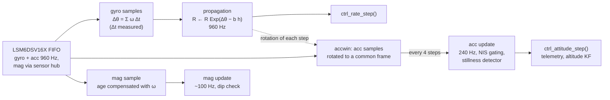

# IEKF on the microcontroller

The filter of [Attitude IEKF](iekf.md) was developed in MATLAB. This page lists
what had to change, and what was added, to run it on the STM32WB55 at 960 Hz in
float32, with the real sensors. The code is in `App/filters/iekf/` and
`App/app/est_pipeline.c`.

Each item lists *why* it was needed. Unless stated otherwise all numbers come
from the PC simulation of the full firmware pipeline (same C code, synthetic
LSM6DSV16X FIFO encoded byte by byte).

## Multi-rate structure with angle increments

| Function | Rate |
|---|---|
| Gyro + acc sampling (FIFO) | 960 Hz (1920 Hz with I²C Fast-mode Plus) |
| FIFO-threshold interrupt → propagation, `ctrl_rate_step()` | 960 Hz |
| Accelerometer update, `ctrl_attitude_step()`, telemetry | 240 Hz |
| Magnetometer update (LIS2MDL 100 Hz, sensor hub 120 Hz) | on new data |

When a propagation step spans several gyro samples, the increments are summed
without loss of information:

$$
\Delta\theta = \sum_i \omega_{m,i}\,\Delta t_i, \qquad \phi = \Delta\theta - \hat b\,h, \qquad \hat R \leftarrow \hat R\,\mathrm{Exp}(\phi).
$$

$\Delta t$ is **measured** by the MCU (DWT cycle counter between interrupts),
which absorbs the tolerance of the sensor's internal oscillator.

## Rotation-compensated accelerometer mean (`accwin`)

Averaging the acc over a 4 ms window while rotating at 360 °/s smears the
direction and lags by half a window (**0.66°** error). Each sample is moved to
the body frame at the start of the window with the already-propagated
increments $E_j$, averaged, and moved back:

$$
\bar a = D_N^\top\,\frac1N\sum_i D_i\,a_i, \qquad D_i = E_1 E_2 \cdots E_i .
$$

Error after compensation: **0.000°**.

## Static calibration and levelled world frame

At start-up the board must stay still for ~2 s (`calib.c`, restarts if it moves):

- **bias:** $\hat b_0$ = mean gyro;
- **noise:** $\sigma_{acc}, \sigma_{mag}$ from the direction scatter
  (port of `directionNoiseStd.m`), with a floor `IEKF_SIGMA_VEC_MIN = 0.01`;
- **world frame:** levelled **NWU** (x = horizontal magnetic north, y = west, z = up)
  built by **TRIAD**, instead of "body at $t=0$" used by `runRealData.m`:

$$
z = \frac{\bar a}{\|\bar a\|},\quad
x = \frac{\bar m - (\bar m\cdot z)z}{\|\cdot\|},\quad
y = z\times x,\quad
R_0 = \begin{bmatrix}x & y & z\end{bmatrix}^\top .
$$

The tilt-compensated magnetometer update assumes a vertical world $z$; with
"body at $t=0$" and a board that is not perfectly level that assumption fails.

## Magnetometer through the sensor hub, with latency compensation

In IKS4A1 Mode 3 the LIS2MDL is behind the LSM6DSV16X and its samples land in
the same FIFO, time-aligned with gyro and acc. The hub re-reads the LIS2MDL
faster than its ODR (duplicates discarded), so a new sample has a random age
$\tau \sim U(0, 1/f_{sh})$. The mean age is compensated by rotating the
measurement forward with the gyro, the random part enters the noise:

$$
y \leftarrow y - \bar\tau\,(\hat\omega \times y), \qquad
R_m \leftarrow R_m + \big(\|\hat\omega \times u\|\,\sigma_\tau\big)^2 I,
\qquad \bar\tau = \tfrac{1}{2f_{sh}},\ \sigma_\tau = \tfrac{1}{\sqrt{12}f_{sh}} .
$$

| Magnetometer | Attitude RMSE (fast rotations) |
|---|---|
| 50/60 Hz, no compensation | 1.150° |
| 50/60 Hz, compensated | 0.165° |
| **100/120 Hz, compensated** | **0.095°** |

## Single-precision numerics

- `so3_exp` switches to a 4th-order Taylor series below 0.05 rad: in float32,
  $(1-\cos\theta)/\theta^2$ loses all digits for $\theta \sim 10^{-3}$, the typical
  $\omega h$.
- $\hat R$ is re-orthonormalised (Gram–Schmidt) after every product.
- **Covariance conditioning** after every propagation and update: exact
  symmetrisation and a floor on the diagonal ($10^{-12}$ rad², $10^{-16}$ (rad/s)²).
  The Joseph form guarantees $P \succeq 0$ only in exact arithmetic.
- The 6×6 covariance algebra uses CMSIS-DSP (`arm_mat_*`); static workspaces keep
  large matrices off the RTOS task stack.

## Error reset after the retraction

After $\hat R \leftarrow \hat R\,\mathrm{Exp}(\delta\theta)$ the error is defined
w.r.t. the *new* estimate, $\delta' \approx \delta - \delta\theta - \tfrac12[\delta\theta]_\times\delta$, hence

$$
J = I - \tfrac12[\delta\theta]_\times, \qquad P_{aa} \leftarrow J P_{aa} J^\top, \qquad P_{ab} \leftarrow J P_{ab}.
$$

Negligible at steady state, relevant for large corrections (`IEKF_RESET_JACOBIAN`).

## Robustness to external accelerations

The magnitude test of [Vector measurements](iekf.md#vector-measurements) misses accelerations **perpendicular** to gravity:
0.4 g sideways changes $\|a\|$ by a few percent but rotates the measured
direction by >20°. The tilt error then leaks into yaw through the
tilt-compensated compass (× tan of the magnetic dip, ~1.6 in Italy).

**NIS-driven inflation with memory** (accelerometer):

$$
\nu = e^\top S_0^{-1} e,\qquad
g_k = \min\!\Big(g_{max},\ \max\big(1,\ \lambda\,g_{k-1},\ \nu/\gamma\big)\Big),\qquad
R_{eff} = g_k R_m ,
$$

with $S_0$ computed with the nominal $R_m$, $\gamma$ = `IEKF_ACC_NIS_GATE` (4),
$\lambda = e^{-h_{acc}/\tau}$ with $\tau$ = `IEKF_INFL_TAU_S` (0.5 s),
$g_{max}$ = `IEKF_INFL_MAX` (100).

**Magnetic dip check** (magnetometer): the angle between the *measured* field and
the *measured* gravity is compared with its calibration value; it does not depend
on the estimate, so it cannot mistake a true yaw error for a disturbance:

$$
R_m \leftarrow R_m\left(1 + \left(\frac{|\angle(y_m, y_a) - \mathrm{dip}_{ref}|}{\mathrm{tol}_{dip}}\right)^2\right).
$$

**Stillness detector:** $\big|\|a\|/a_{nom} - 1\big| < 0.02$ and
$\|\omega_{raw}\| < 3$ °/s for 0.3 s ⇒ an external acceleration is impossible ⇒ the
next acc update is not inflated.

**Lockout protection.** If the estimate is truly wrong, the innovation is large
because of the estimate, NIS inflates $R$ forever and the filter stops
correcting (recovery > 16 s in simulation). With a correct gyro, a true attitude
error is *fixed in the world frame*, while a hand shaking the board produces a
zero-mean innovation. The world-frame innovation is tracked:

$$
m_k = \lambda_p m_{k-1} + (1-\lambda_p)\,\hat R e_k,\qquad
p_k = \lambda_p p_{k-1} + (1-\lambda_p)\,\|e_k\|^2 ,
$$

and if the acc has been inflated for `IEKF_LOCKOUT_S` (0.5 s) **and**
$\|m\|^2 > \rho\,p$ and $\|m\| > m_{min}$ (persistent), then
$P_{aa} \leftarrow P_{aa} + \sigma_{bump}^2 I$ (10°) and the acc is trusted for
`IEKF_GRACE_S` (0.25 s).

| Simulation (0.4 g lateral for 10 s) | yaw max | tilt max | recovery from 37° error in motion |
|---|---|---|---|
| magnitude test only (original) | 14.9° | 20.3° | 0.26 s |
| NIS without lockout protection | 2.56° | 1.72° | 16.6 s |
| **final configuration** | **2.40°** | **2.32°** | **0.95 s** |

Nominal accuracy is unchanged (RMSE 0.095° at 360 °/s peak).
**Known limit:** a *sustained, constant* external acceleration (steady turn) is as
persistent as a true error and is accepted after 0.5 s. Only a thrust model
(phase 3) can separate the two.

Tried and left disabled: gain projection so that acc corrects only tilt and mag
only yaw (`IEKF_DECOUPLE`: tilt max 3.3° vs 2.3°); NIS inflation on the
magnetometer (`IEKF_MAG_NIS_GATE`: a high mag NIS is often a true yaw error).

## Tuning notes

- **6 states, not 3.** With a realistic bias: RMSE 0.095° (6 states) vs 0.184°
  (3 states). `IEKF_ESTIMATE_BIAS = 0` reduces the filter exactly to 3 states.
- **`IEKF_SIGMA_GYRO = 0.5 °/s/√Hz`.** It must cover what the model ignores
  (scale factor, misalignment, g-sensitivity), not just the sensor noise
  (~0.003 °/s/√Hz). With 1 % scale error and 1° misalignment: σ = 0.1 → RMSE 1.17°,
  σ = 0.5 → 0.42°. Lower it only after calibrating the gyro.

## MATLAB mirror of the C code

`IEKF_embeddedVersion/iekfAttitudeEmb.m` is the **extended MATLAB filter**: same
signature and options as `iekfAttitude.m` plus the extensions above
(`accNisGate`, `inflTau`, `dipTol`, `decouple`, `resetJacobian`, `inflMax`,
`lockoutTime`, …). Its maths goes through `iekfCore*.m`, written line by line
after `iekf.c`. As in the firmware, the inflation memory and the lockout counters
run **per accelerometer update**; their exact per-update values (`inflDecay`,
`lockoutUpdates`, `graceUpdates`, `persistDecay`) and the per-sample inputs
produced by the firmware pipeline (`accTrusted` from the stillness detector,
`magExtraVar` from the mag-age model) can be passed directly. A 4th output
reports `lockouts` and `accInflMax`. With every extension off it matches the
original within 10⁻¹² deg.
