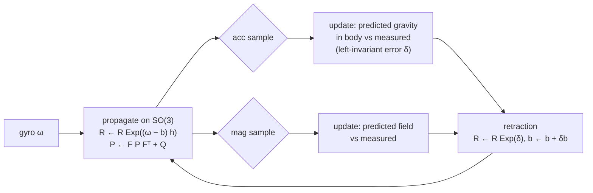

# Attitude IEKF

This section documents the filter as implemented in
`FiltersComparison/IEKF_originalVersion/iekfAttitude.m` (MATLAB tools). The embedded filter implements the
same equations ([IEKF on the microcontroller](iekf-embedded.md) lists what was added on top).

## State and error definition

The attitude $R \in SO(3)$ rotates body-frame vectors into the world frame.
$SO(3)$ is not a vector space, so the estimation error is defined through the
group operation as a **left-invariant (body-frame) error**:

$$
R = \hat R\,\mathrm{Exp}(\delta), \qquad \delta = \mathrm{Log}(\hat R^\top R) \in \mathbb{R}^3 \cong \mathfrak{so}(3)
$$

where $\mathrm{Exp}$ is Rodrigues' formula
$\mathrm{Exp}(\phi) = I + \sin\theta\,[u]_\times + (1-\cos\theta)\,[u]_\times^2$,
$\theta = \|\phi\|$, $u = \phi/\theta$, and $[\cdot]_\times$ is the skew-symmetric
matrix. All Gaussian machinery (mean, covariance, linear update) is applied to
$\delta$, which lives in a vector space.

With gyro-bias estimation the error state is

$$
x = \begin{bmatrix}\delta \\ \beta\end{bmatrix}, \qquad \beta = b - \hat b .
$$

## Process model

The gyroscope measures $\omega_m = \omega + b + n_g$; the bias is a random walk,
$\dot b = n_b$. The error dynamics are

$$
\dot\delta = -[\hat\omega]_\times\,\delta - \beta - n_g, \qquad \dot\beta = n_b,
\qquad \hat\omega = \omega_m - \hat b .
$$

Because the kinematics are *group-affine*, these dynamics are **autonomous**: the
Jacobian depends only on the measured rate, never on the estimate $\hat R$.
This is what distinguishes the IEKF from a classical multiplicative EKF and
gives it consistent covariance even when the estimate is far off (fast
convergence from a bad initialisation).

## Propagation (discrete, step $h$)

$$
\hat R \leftarrow \hat R\,\mathrm{Exp}(\hat\omega h)
$$

$$
F = \begin{bmatrix}\mathrm{Exp}(-\hat\omega h) & -h I \\ 0 & I\end{bmatrix},
\qquad
Q = \begin{bmatrix}\sigma_g^2 h\, I & 0 \\ 0 & \sigma_b^2 h\, I\end{bmatrix},
\qquad
P \leftarrow F P F^\top + Q .
$$

## Vector measurements

Accelerometer and magnetometer are both treated as observations of a known
world-frame direction $v$ (gravity $g_{ref}$, magnetic field $m_{ref}$):

$$
y = R^\top v + n, \qquad \hat y = \hat R^\top v .
$$

Measurements are normalised ($y \leftarrow y/\|y\|$). Linearising with the
left-invariant error, $R^\top v = \mathrm{Exp}(-\delta)\hat R^\top v \approx \hat y + [\hat y]_\times \delta$, so

$$
y - \hat y \approx [\hat y]_\times\,\delta
\quad\Longrightarrow\quad
H = \begin{bmatrix}[\hat y]_\times & 0\end{bmatrix}.
$$

**Adaptive measurement noise.** When the measured magnitude departs from its
nominal value (external acceleration, magnetic disturbance) the measurement is
de-weighted rather than rejected:

$$
R_m = \sigma^2 I \left(1 + \left(\frac{\Delta}{\tau}\right)^2\right),
\qquad \Delta = \frac{\big|\,\|y_{raw}\| - n_{nom}\big|}{n_{nom}} .
$$

**Tilt-compensated magnetometer.** With `tiltCompensatedMag = true` the
predicted field is built from the measurement itself, keeping only its
horizontal component, so the magnetic dip never enters the innovation and the
magnetometer can only correct yaw:

$$
h_w = \hat R y,\qquad b_w = \begin{bmatrix}\sqrt{h_{w,x}^2 + h_{w,y}^2} & 0 & h_{w,z}\end{bmatrix}^\top,\qquad \hat y = \hat R^\top b_w .
$$

## Update and retraction

$$
S = H P H^\top + R_m, \qquad K = P H^\top S^{-1}, \qquad \delta x = K\,(y - \hat y)
$$

$$
\hat R \leftarrow \hat R\,\mathrm{Exp}(\delta x_{1:3}), \qquad \hat b \leftarrow \hat b + \delta x_{4:6}
$$

$$
P \leftarrow (I - KH)\,P\,(I - KH)^\top + K R_m K^\top \quad\text{(Joseph form)}, \qquad P \leftarrow \tfrac12 (P + P^\top).
$$

The retraction through $\mathrm{Exp}$ keeps $\hat R$ on $SO(3)$ at all times.
Per sample the order is: propagate with `gyro(:,k-1)`, accelerometer update,
magnetometer update.

## Filter dynamics: what is observable, how fast it corrects

**Error dynamics as a linear system.** Between updates the error evolves as
$x_{k+1} = F_k x_k + w_k$, with $F_k$ from [Propagation (discrete, step $h$)](#propagation-discrete-step-h). At an update,
$x^+ = (I - K_k H_k)\,x^-$. Both $F_k$ and $H_k$ depend only on the measured
rate and on the *predicted* measurement direction $\hat y = \hat R^\top v$,
never on how wrong $\hat R$ is. The closed-loop error dynamics are therefore
the same for small and large errors. This is the practical benefit of the
invariant formulation: the covariance stays consistent and the filter
converges from any initial attitude without tuning for it.

**Observability.** $[\hat y]_\times$ has rank 2, and its null space is
$\hat y$ itself: a vector measurement corrects the two error components
orthogonal to the measured direction and says nothing about rotations
*about* it.

| Measurement | Corrects | Cannot see |
|---|---|---|
| gravity (accelerometer) | roll and pitch | yaw, i.e. rotations about the vertical |
| magnetic field (magnetometer) | rotations about axes orthogonal to the field: mainly yaw, plus part of the tilt unless tilt-compensated | rotations about the field direction |
| both, non-parallel | the full attitude | (singular only where the field is vertical, i.e. at the magnetic poles) |

The gyro bias enters through the coupling $-hI$ in $F$: a bias produces an
attitude drift that the measurements see, so it becomes observable.

- With gravity alone, the bias component about the vertical is unobservable,
  because the yaw drift it causes is invisible.
- The magnetometer makes the full bias observable.

The *tilt-compensated* magnetometer ([Vector measurements](#vector-measurements)) makes the separation explicit: the
magnetometer only acts on yaw, and a disturbed field cannot tilt the
estimate.

**Correction bandwidth.** The filter can be read as a complementary filter
whose crossover is set by the noise ratio. Take one axis, small angles, gyro
noise density $\sigma_g$ (rad/s/√Hz, $Q = \sigma_g^2 h$) and accelerometer
updates at $f_u$ with direction noise $\sigma_a$ (rad). The steady-state
Kalman gain gives a first-order correction of the gyro-integrated attitude
with bandwidth and steady-state uncertainty

$$
\omega_c \simeq \frac{\sigma_g\sqrt{f_u}}{\sigma_a},
\qquad
\sigma_{\delta,ss} \simeq \sqrt{\frac{\sigma_g\,\sigma_a}{\sqrt{f_u}}} .
$$

With the firmware values ($\sigma_g$ = 0.5 °/s/√Hz, $f_u$ = 240 Hz):

| $\sigma_a$ | $\omega_c$ | crossover | steady-state σ |
|---|---|---|---|
| 0.01 (floor of the static calibration, [Static calibration and levelled world frame](iekf-embedded.md#static-calibration-and-levelled-world-frame)) | 13.5 rad/s | 2.2 Hz | 0.13° |
| 0.02 | 6.8 rad/s | 1.1 Hz | 0.19° |
| 0.2, i.e. $R$ inflated ×100 by the NIS logic ([Robustness to external accelerations](iekf-embedded.md#robustness-to-external-accelerations)) | 0.68 rad/s | 0.11 Hz | 0.61° |

The values were checked against the iterated scalar Riccati equation.

Below the crossover the attitude follows the accelerometer and magnetometer,
above it the gyroscope. The adaptive noise and the NIS inflation of [Robustness to external accelerations](iekf-embedded.md#robustness-to-external-accelerations) work
by *moving the crossover down* while the measurement is not trustworthy, down
to ~0.1 Hz at the cap. In that window the estimate is essentially
gyro-integrated, and the gyro bias error sets how fast it drifts.
